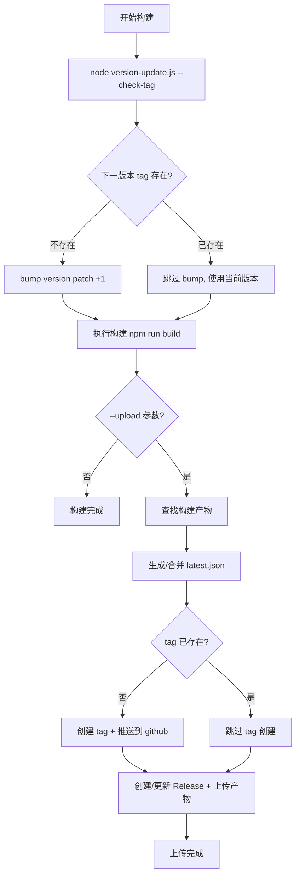
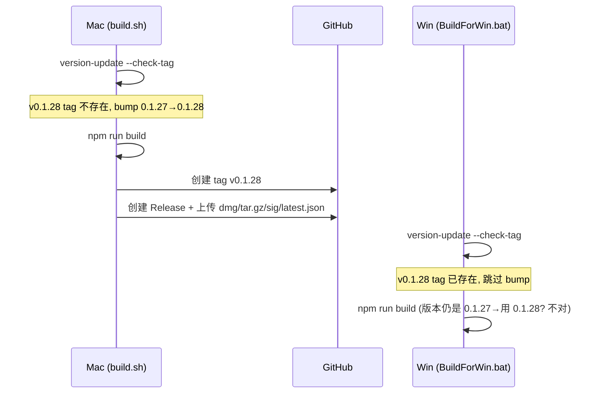

## 产品概述

完善 KVMini 的跨平台构建发布流程，使 Mac 和 Win 两端构建时版本号自动管理且保持一致，Win 端也具备完整的 GitHub Release 上传能力。

## 核心功能

### 1. 智能版本号自动递增

- Mac（build.sh）和 Win（BuildForWin.bat）构建时都自动执行 patch +1
- 但在 bump 之前先检查 GitHub 上对应 tag 是否已存在：若存在则说明另一个平台已先构建过，跳过 bump 直接复用当前版本号
- 确保两端构建出的产物版本号完全一致

### 2. Win 端完整的上传发布能力

- BuildForWin.bat 增加 --upload 参数支持
- 上传流程与 Mac 一致：创建 tag、推送 tag 到 github remote、生成/合并 latest.json、创建或更新 Release、上传构建产物
- Win 端的 gh 命令和 git 命令适配 Windows batch 语法

### 3. version-update.js 增强

- 新增 --check-tag 模式：检查当前版本 +1 后的 tag 是否已存在于 GitHub，存在则跳过 bump 并返回特定退出码（如 exit code 2）
- 原有无参数调用行为不变（向后兼容）

## 技术栈

- 构建脚本：Bash (macOS) + Windows Batch (.bat)
- 版本管理：Node.js (scripts/version-update.js)
- 发布工具：gh CLI (GitHub CLI)
- Git 管理：双 remote（origin → woa 内部仓库, github → github.com/mackhan/KVMini）

## 实现方案

### 核心策略：tag 存在性检测 + 条件 bump

整体思路是在构建前通过 `gh release view` 或 `git ls-remote --tags` 检查下一个版本的 tag 是否已存在于 GitHub：

- 不存在 → 正常 bump version（patch +1）→ 构建 → 创建 tag + Release → 上传
- 已存在 → 跳过 bump → 直接用当前版本号构建 → 上传产物到已有 Release

这个方案的关键决策理由：

1. **用 gh CLI 检测** 而不是 git ls-remote：因为 gh 已登录且已在使用，且可以同时检测 Release 是否存在，一举两得
2. **检测逻辑放在 version-update.js 中** 而不是 shell/bat 脚本中：Node.js 跨平台一致，避免在 bash 和 bat 中写两套相同逻辑
3. **用 exit code 区分结果**：exit 0 = 已 bump，exit 2 = 已跳过（tag 已存在），exit 1 = 错误。构建脚本根据 exit code 决定后续行为

### version-update.js 改造

新增 `--check-tag` 参数：

```
node scripts/version-update.js --check-tag
```

执行逻辑：

1. 读取当前版本号（如 0.1.27）
2. 计算下一版本号（0.1.28）
3. 执行 `gh release view v0.1.28 --repo mackhan/KVMini`
4. 如果 Release 已存在 → 打印提示 → exit(2)（跳过 bump）
5. 如果不存在 → 正常执行 bump → exit(0)

无参数调用保持原行为（无条件 bump），向后兼容。

### build.sh 改造

在构建步骤之前插入版本管理步骤：

```
# 智能版本管理：检测 tag，决定是否 bump
node scripts/version-update.js --check-tag
BUMP_RESULT=$?
if [ $BUMP_RESULT -eq 2 ]; then
    log_info "tag 已存在，跳过版本号递增（另一个平台已构建）"
elif [ $BUMP_RESULT -ne 0 ]; then
    log_error "版本号更新失败"
    exit 1
fi
```

### BuildForWin.bat 改造

1. 将当前无条件 `call node scripts/version-update.js` 改为 `call node scripts/version-update.js --check-tag`，根据 errorlevel 判断
2. 新增 --upload 参数解析
3. 新增上传逻辑段（Step 5），包含：检测 gh CLI、读取版本号、查找 Win 产物（.exe, .nsis.zip, .nsis.zip.sig）、生成/合并 latest.json（用 python 或 node）、创建/推送 tag、创建/更新 Release、上传产物

Win 端 latest.json 合并用 Node.js（而非 python3），因为 Windows 不一定有 python3 但一定有 Node.js（Tauri 开发依赖）。

## 实施要点

### 性能与可靠性

- `gh release view` 是轻量 HTTP 请求，耗时 < 1s，不影响构建性能
- 网络不可达时 `gh` 命令会超时失败，此时 exit code 非 0 非 2，脚本应 fallback 为不 bump（安全侧）或报错提示用户检查网络

### 向后兼容

- `node scripts/version-update.js`（无参数）行为完全不变
- `./build.sh`（无 --upload）仍然正常本地构建，但会加入 bump 步骤
- `BuildForWin.bat`（无 --upload）仍然正常本地构建 + 启动

### 关键约束

- GH_REPO 固定为 `mackhan/KVMini`
- GitHub remote 名为 `github`（不是 origin）
- Win 端 latest.json 合并用 Node.js 实现（替代 Mac 端用的 python3）
- build.sh 的 python3 合并逻辑保持不变（Mac 一定有 python3）

## 架构设计

### 发布流程



### 多平台发布时序



注意：上面的时序揭示了一个关键问题 —— 如果 Mac 先 bump 并提交了代码，Win 需要先 `git pull` 才能拿到 bump 后的版本号。所以正确流程是：

1. Mac bump + 构建 + 上传 + **git commit + git push origin master**
2. Win **git pull** + 检测 tag 存在 → 跳过 bump + 构建 + 上传

version-update.js 的 `--check-tag` 模式实际上还需要处理"当前版本号已经是最新的"这个情况：如果当前版本就是 0.1.28 且 tag v0.1.28 已存在，说明已经 bump 过了，直接跳过。

## 目录结构

```
KVMini/
├── build.sh                     # [MODIFY] 在构建前加入 version-update --check-tag 调用
├── BuildForWin.bat              # [MODIFY] 改为 --check-tag 模式 + 新增 --upload 上传逻辑
├── scripts/
│   ├── version-update.js        # [MODIFY] 新增 --check-tag 参数支持，检测 GitHub tag 决定是否 bump
│   └── generate-latest-json.js  # [NEW] 跨平台 latest.json 生成/合并脚本（Node.js），Win/Mac 共用
└── __tests__/
    └── version-manager.test.ts  # [MODIFY] 新增 --check-tag 逻辑的单元测试
```

### 关于 generate-latest-json.js

提取 latest.json 的生成/合并逻辑为独立 Node.js 脚本，Mac 和 Win 共用：

- 输入：版本号、tag、平台 key、产物 URL、签名内容、已有 latest.json 路径（可选）
- 输出：合并后的 latest.json 文件
- 好处：Mac 端不再依赖 python3 内嵌脚本，两端逻辑完全一致，代码可测试

## 关键代码结构

```typescript
// scripts/version-update.js 新增的核心逻辑（伪代码）
function checkTagAndBump(): number {
  const currentVersion = getCurrentVersion();  // e.g. "0.1.27"
  const nextVersion = incrementVersion(currentVersion);  // "0.1.28"
  const tag = `v${nextVersion}`;
  
  // 用 gh CLI 检查 tag 对应的 Release 是否存在
  const result = execSync(`gh release view ${tag} --repo mackhan/KVMini`, { stdio: 'pipe' });
  
  if (releaseExists) {
    // 另一个平台已构建，检查当前版本是否已经是 nextVersion
    if (currentVersion === nextVersion) {
      console.log(`版本已是 ${nextVersion}，跳过 bump`);
    } else {
      // 当前还是旧版本但 tag 已存在 → 说明需要 pull 代码
      // 直接 bump 到 nextVersion（与已有 tag 一致）
      bumpToVersion(nextVersion);
    }
    return 2;  // 信号：tag 已存在
  }
  
  // tag 不存在，正常 bump
  bumpToVersion(nextVersion);
  return 0;
}
```

## Agent Extensions

### Skill

- **test-driven-development**
- Purpose: 在修改 version-update.js 和新建 generate-latest-json.js 前，先编写测试用例覆盖 --check-tag 逻辑和 latest.json 合并逻辑
- Expected outcome: 测试先行，确保版本管理的各种边界情况（tag 存在/不存在/网络失败）和 JSON 合并逻辑都有测试覆盖

- **verification-before-completion**
- Purpose: 每步改动完成后验证构建脚本语法正确、测试通过
- Expected outcome: bash -n 验证 build.sh 语法，node --check 验证 JS 语法，npm test 验证测试通过

- **requesting-code-review**
- Purpose: 完成所有改动后请求代码审查
- Expected outcome: 确保构建脚本逻辑、版本管理逻辑、跨平台兼容性都经过 review