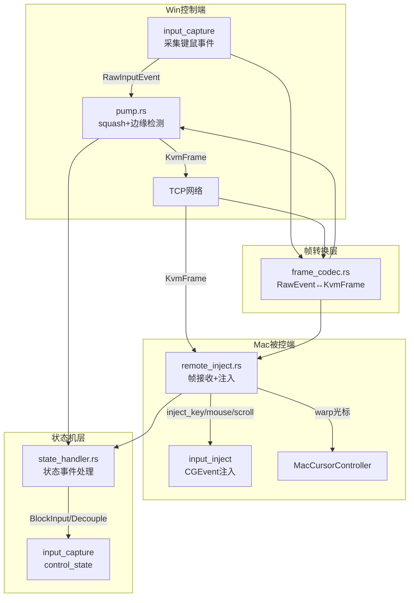

## 用户需求

### 核心问题（5 个 Bug + 1 个架构重构）

**Bug 修复：**

1. **鼠标拖拽丢帧**：Mac 作为控制端拖动窗口时，对端只收到 Down/Up，没有中间移动轨迹；根因是 `cg_event_to_raw` 缺少 `LeftMouseDragged`/`RightMouseDragged`/`OtherMouseDragged` 处理分支
2. **滚轮不工作**：`SCROLL_UNIT_PIXEL` 模式 ±120px 在 macOS 实际无效；需改回 `SCROLL_UNIT_LINE` + `dy = raw_dy / 120`（±1行）
3. **鼠标点击前几次不响应**：`MacInputBlocker.create_block_tap` 注册了 RunLoop source 但从未运行该 RunLoop，屏蔽 Tap 永远不生效；合成注入事件有时被误判为物理抢占，导致 RemoteControlling 提前退出
4. **Mac 激活后屏蔽本机触摸板（抢占交互逻辑不完整）**：Win 抢占回 Armed 后，极小的鼠标抖动就立即重新触发 LocalControlling，远端用户被立刻重新屏蔽，无法持续操作；需要 Armed 重进后有"静默保护期"（500ms 内不触发边缘切换）
5. **MacInputBlocker 无效死代码**：`create_block_tap` 无效，需清理并明确屏蔽机制文档

**产品交互模式（用户明确指出）：**

- 鼠标移到屏幕边缘 → 控制远端（本机键鼠屏蔽）
- 远端用户动了键盘或鼠标 → 夺回控制权（远端恢复本地响应，本机恢复）
- 主控端再动键鼠 → 重新切换到控制远端
- 这与 Barrier/Synergy 的"边缘切换 + 抢占回切 + 再次边缘切换"模式一致

**架构重构：**

- `sharing.rs` 1050 行混合了所有逻辑，需要按职责拆分为 `sharing/` 子模块
- Win/Mac/远端/本机职责明确，避免牵一发动全身

### 产品功能描述

KVMini 是跨平台 KVM 软件，Win 和 Mac 通过局域网共享一套键鼠。本次修复使键鼠共享的核心交互流程（边缘切换、被控端抢占回切、再次切换）完整可用，包括拖拽、滚轮、点击的完整响应。代码按职责拆分为独立模块，修改某一端不影响另一端逻辑。

### 核心功能

- 修复 Mac 作为控制端时拖拽移动帧丢失（拖窗口有过程）
- 修复 Mac 被控端滚轮响应（LINE 模式 ±1 行）
- 修复 Mac 被控端首次鼠标点击不响应（清理无效 BlockInput Tap）
- 修复抢占回切后 Armed 静默期（远端用户有时间操作再切回）
- 重构 `sharing.rs` 为 `sharing/` 子模块（pump/remote_inject/state_handler/frame_codec 四个职责分离文件）

## 技术栈

- **语言**：Rust（src-tauri）+ TypeScript（测试）
- **平台 API**：macOS `CGEventTap`、`CGEvent`（拖拽分支、滚轮 LINE 模式）；Windows Win32 Hook
- **框架**：Tauri + tokio async runtime
- **测试**：Jest + TypeScript（`__tests__/`）

---

## 实现方案

### 方案概述

以"最小精准改动 + 职责分离"为原则。Bug 修复各自独立，互不影响；架构拆分只做文件拆分（`mod.rs` 重新导出），不改公共接口，保证零行为变更。

### Bug 1 修复：Mac 拖拽丢帧

**根因**：`macos/input_capture.rs` 的 `cg_event_to_raw` 中 `LeftMouseDragged`/`RightMouseDragged`/`OtherMouseDragged` 返回 `None`。

**修复**：在 `cg_event_to_raw` 中添加三个拖拽类型分支，复用 `MouseMoved` 的 delta 读取逻辑（`EventField::MOUSE_EVENT_DELTA_X/Y`），转为 `RawInputEvent::MouseMove`。

```rust
CGEventType::LeftMouseDragged
| CGEventType::RightMouseDragged
| CGEventType::OtherMouseDragged => {
    let loc = event.location();
    use core_graphics::event::EventField;
    let dx = event.get_integer_value_field(EventField::MOUSE_EVENT_DELTA_X) as i16;
    let dy = event.get_integer_value_field(EventField::MOUSE_EVENT_DELTA_Y) as i16;
    Some(RawInputEvent::MouseMove { x: loc.x as i32, y: loc.y as i32, dx, dy })
}
```

**注意**：Armed 态边缘检测可以正常响应拖拽了（因为变成了 MouseMove）；LocalControlling 态拖拽帧会正常进入 pump squash 逻辑发送给对端。

### Bug 2 修复：滚轮 LINE 模式

**根因**：`SCROLL_UNIT_PIXEL(=2)` + ±120 在 macOS 实际效果与预期不符。

**修复**：`macos/input_inject.rs` 的 `inject_scroll` 改回 `SCROLL_UNIT_LINE(=1)`，传入 `dy / 120`（Win WHEEL_DELTA ÷ 120 = 格数，通常 ±1）：

```rust
const SCROLL_UNIT_LINE: u32 = 1;
// 协议层 dy = ±120（Win WHEEL_DELTA 标准）；LINE 模式需除以 120 转为格数
let lines_dy = if dy != 0 { dy / 120 } else { 0 };
let lines_dx = if dx != 0 { dx / 120 } else { 0 };
CGEvent::new_scroll_event(source, SCROLL_UNIT_LINE, 2, lines_dy, lines_dx, 0)
```

**注意**：Mac 采集外接鼠标时 `×120` 的逻辑不动（Mac→Win 方向，Win 被控端需要 ±120）。

### Bug 3 修复：MacInputBlocker 清理 + 点击误判

**根因 1**：`create_block_tap` 在 `get_current()` RunLoop 注册 source 但不运行，永远不生效，是死代码。

**根因 2**：`block_input()` 调用失败后 Mac 仍然处于 `CONTROL_STATE_REMOTE_CONTROLLING`，CGEventTap 已经在吞事件（这是第一层屏蔽），`BlockInput` 只是辅助。问题实际出在合成事件的 magic tag 检验：当 `inject_mouse_button` 调用 `CombinedSessionState` 后，事件 `set_integer_value_field` 写入 magic 之前，CGEventTap 可能先读到事件（时序问题）。

**修复**：

1. 彻底删除 `MacInputBlocker` 中的 `create_block_tap` 函数及相关导入，`block_input` 只设标志位 + 日志
2. 在 `inject_mouse_button` 中确保 `tag_synthetic` 在 `event.post()` 之前（顺序已正确，但加明确注释）
3. 在 `inject_remote_frame` 入口处，增加一次 `control_state` 检查：若不是 `RemoteControlling`，丢弃该帧不注入（防止状态竞争导致在错误状态注入）

### Bug 4 修复：Armed 重进静默期

**根因**：Win 端 `PreemptDetector` 触发 `SwitchBackControl` 后，Win 回到 Armed 态；此时 EdgeDetector 仍然 active，Win 用户任何微小移动（甚至系统级抖动）就重新触发 `LocalControlling`，远端用户完全没有操作窗口。

**修复方案**：在 `SharingManager` 中维护一个 `reentry_guard_until: Instant`，在 `local_to_armed` 转换发生（收到 `SwitchBackControl`）后，设置 500ms 静默期，期间 pump loop 收到 EdgeDetect Triggered 时跳过（不调用 `armed_to_local_controlling`）：

```rust
// sharing.rs pump loop，edge triggered 分支
if current_state == ControlState::Armed {
    // v0.1.52: 静默保护期内不触发边缘切换
    if Instant::now() < reentry_guard_until.load() {
        log::debug!("[Sharing] Armed 静默期内，跳过边缘触发");
        continue;
    }
    let events = { ... sm.armed_to_local_controlling(...) };
}
```

`reentry_guard_until` 用 `Arc<Mutex<Instant>>` 保存，在 `on_remote_switch_back` 调用时设置为 `now + 500ms`。

### Bug 5 修复：squash 逻辑中 TOCTOU 合并

顺带修复 pump loop 中 `let current_state = state_arc.lock().await.state()` + `let mut sm = state_arc.lock().await` 的双重 lock，合并为一次：

```rust
let events = {
    let mut sm = state_arc.lock().await;
    if sm.state() == ControlState::Armed && Instant::now() >= reentry_guard_until {
        sm.armed_to_local_controlling(direction, pos_ratio)
    } else { vec![] }
};
```

### 架构重构：sharing.rs 拆分

`sharing.rs`（1050行）拆分为 `sharing/` 子模块，**只做文件拆分，不改公共接口**：

```
src-tauri/src/sharing/
  mod.rs            — SharingManager 结构定义、new()、Tauri 命令、公开接口（原 sharing.rs 骨架）
  pump.rs           — start_capture_and_pump、pump loop、squash、边缘检测（控制端职责）
  remote_inject.rs  — inject_remote_frame、handle_remote_mouse_delta（被控端职责）
  state_handler.rs  — handle_one、handle_events_on_edge_trigger（状态事件处理职责）
  frame_codec.rs    — raw_to_frame、inject_frame、mouse_button_to_u8/u8_to_mouse_button 等（帧转换职责）
```

各模块职责：

- `pump.rs`：仅关注"控制端如何把输入采集帧发给对端"，不了解注入
- `remote_inject.rs`：仅关注"被控端如何把收到的帧注入本机"，不了解采集
- `state_handler.rs`：仅关注"状态事件如何映射到平台操作"，不了解帧格式
- `frame_codec.rs`：仅关注"RawInputEvent ↔ KvmFrame 转换"，无副作用纯函数

---

## 实现细节

1. **拖拽分支与 squash 兼容**：拖拽事件转为 `RawInputEvent::MouseMove` 后，pump squash 逻辑无需修改（已按 `MouseMove` 处理）
2. **滚轮 `dy/120` 精度**：Win 通常发 ±120，除以 120 = ±1；高分辨率鼠标可能发 ±40，除以 120 = 0（丢帧）。加保护：`if dy.abs() > 0 && lines == 0 { lines = dy.signum() }` 保证至少 ±1 行
3. **静默期 Arc 传递**：`reentry_guard_until: Arc<Mutex<Instant>>` 在 `SharingManager` 构建时初始化为 `Instant::now()`，`on_remote_switch_back` 更新，pump loop 读取
4. **MacInputBlocker 精简**：移除 `create_block_tap`、相关 `use` 导入；Mac 屏蔽完全依赖 `input_capture.rs` 的 `CONTROL_STATE_REMOTE_CONTROLLING` 分支（已双重保障）
5. **拆分后 mod.rs**：使用 `mod pump; mod remote_inject; mod state_handler; mod frame_codec;` 并 `pub use` 必要符号，`main.rs` 中 `use crate::sharing::SharingManager` 等路径不变

---

## 架构图



---

## 目录结构

```
src-tauri/src/
  sharing/                          # [NEW] 原 sharing.rs 拆分为子模块
    mod.rs                          # [NEW] SharingManager 结构体、Tauri 命令、公共接口
                                    #   - 维护 reentry_guard_until: Arc<Mutex<Instant>>
                                    #   - on_remote_switch_back 更新静默期
                                    #   - pub use pump/remote_inject/state_handler/frame_codec 内部符号
    pump.rs                         # [NEW] 控制端采集泵
                                    #   - start_capture_and_pump()
                                    #   - pump loop（squash + EdgeDetect + 静默期检查）
                                    #   - 消费 RawInputEvent，调用 frame_codec.raw_to_frame
    remote_inject.rs                # [NEW] 被控端帧注入
                                    #   - inject_remote_frame()
                                    #   - handle_remote_mouse_delta()
                                    #   - 进入前检查 control_state == RemoteControlling
    state_handler.rs                # [NEW] 状态事件处理
                                    #   - handle_one(StateEvent)
                                    #   - handle_events_on_edge_trigger()
                                    #   - control_state_to_u8()、state_name()
    frame_codec.rs                  # [NEW] 帧编解码（纯函数，无副作用）
                                    #   - raw_to_frame()、inject_frame()
                                    #   - mouse_button_to_u8()、u8_to_mouse_button()
                                    #   - now_ms()

  platform/macos/
    input_capture.rs                # [MODIFY] cg_event_to_raw 添加拖拽分支
                                    #   - 为 LeftMouseDragged/RightMouseDragged/OtherMouseDragged
                                    #     添加与 MouseMoved 相同的 delta 读取逻辑
    input_inject.rs                 # [MODIFY] inject_scroll 改回 LINE 模式
                                    #   - SCROLL_UNIT_LINE(=1) + dy/120（含精度保护）
    input_block.rs                  # [MODIFY] 删除无效的 create_block_tap
                                    #   - block_input 只设标志位 + 日志，明确注释说明屏蔽机制

__tests__/
  bug-drag-move-frames.test.ts      # [NEW] 拖拽帧：验证 cg_event_to_raw 有拖拽分支
  bug-scroll-line-mode.test.ts      # [NEW] 滚轮 LINE 模式：验证 dy/120 转换逻辑
  bug-armed-reentry-guard.test.ts   # [NEW] Armed 静默期：验证 reentry_guard_until 更新
  sharing-module-split.test.ts      # [NEW] 模块拆分验证：pump/remote_inject/state_handler/frame_codec 文件存在且各有职责函数

docs/
  CHANGELOG_v0.1.52.md             # [NEW] 本次修复归档
```