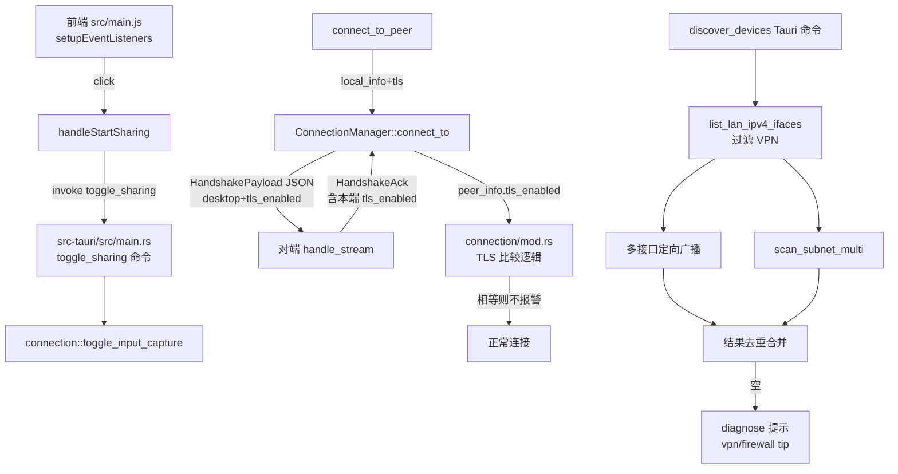

## 用户需求

两台 Mac 都运行 KVMini 时遇到三个问题，需一次性全部修复：

1. 同一局域网互相扫描不到设备（VPN utun6 + macOS 防火墙开启）
2. 手动连接时弹出"本机已开启 TLS 加密，但对端未开启"的误报警告
3. 连接成功后点击"开始共享"按钮没有任何反应

## 核心修复

- TLS 双端状态正确互传，消除误报；双方都开 TLS 时不再弹警告
- 开始共享按钮点击后真实切换键鼠捕获状态，按钮文字与状态栏同步切换
- VPN/防火墙环境下扫描使用所有物理网卡进行多接口子网扫描和多接口定向 UDP 广播；扫描失败时给出可操作的诊断建议（防火墙放行命令、断开 VPN 提示、改走手动连接）
- 全平台支持（Win / MacM / MacIntel），全部新增文本中英双语

## 技术栈

- 既有项目：Rust（kvm-core / src-tauri，Tauri 2）+ 原生 JS 前端 + Jest 测试
- 复用既有日志（log crate）、既有 i18n 体系（src/i18n.js 的 t() + zh/en 字典）、既有事件总线（broadcast::Sender<NetworkEvent>、Tauri Event）

## 实现策略

### Bug 1：握手 TLS 状态正确互传

- 不破坏现有帧二进制兼容性：`KvmFrame::Handshake / HandshakeAck` 的 `screen_info` 字段已是 `Vec<u8>` 承载 JSON。
- 在 kvm-core/src/network.rs 的 `HandshakeInfo` 中新增/复用一个 wire payload：将 `VirtualDesktop` 与 `tls_enabled` 共同序列化进 `screen_info` 字节（采用一个新的内部 struct `HandshakePayload { desktop, tls_enabled }`，serde 加 `#[serde(default)]` 兼容旧版本仅含 desktop 的 JSON）。
- `HandshakeInfo::screen_info_bytes()` 改为序列化整体 payload；`parse_screen_info()` 增补 `parse_handshake_payload()`，支持新旧格式回退（先尝试 HandshakePayload，失败则退回旧 VirtualDesktop，tls_enabled=false）。
- 主动方 `connect_to`（第 516 行）与被动方 `handle_stream`（第 694 行）都从 wire payload 读取真正的 `tls_enabled` 写入 `HandshakeInfo`。
- 被动方需在 `handle_stream` 接受到本端 TLS 状态。最简方案：在 `ConnectionManager::accept_loop` 把 local_handshake_info 注入 handle_stream（增加参数），HandshakeAck 的 screen_info 用本机 payload 字节。
- 复杂度 O(1)；无新增网络往返；向后兼容。

### Bug 2：开始共享按钮逻辑

- 后端：先在 src-tauri/src/main.rs（或 connection 模块）确认/添加 `toggle_control` 命令——实际项目中已有 `start_input_capture / stop_input_capture` 等等价能力（依据 accessibility.js 现有用法），优先复用现有命令；若无 toggle 语义，则在 main.rs 新增 `toggle_sharing` 命令包装现有启停逻辑并返回当前 sharing 状态。
- 前端 src/main.js：
- `setupEventListeners()` 中新增 `elements.startSharingBtn?.addEventListener('click', handleStartSharing)`
- 新增模块级状态 `let isSharing = false;`
- `handleStartSharing()` 调用 invoke('toggle_sharing')，根据返回值刷新按钮文字与 `controlState` 状态栏；失败时调用 `showError(t('share_toggle_failed'))`
- 在 `handleDisconnect`、连接断开事件回调中重置 `isSharing=false` 和按钮文字
- 按钮 `data-i18n` 切换 key（start_sharing / stop_sharing），通过 applyI18n 自动应用
- 前端 src/i18n.js：zh+en 同步新增 keys：`stop_sharing` / `sharing_started` / `sharing_stopped` / `share_toggle_failed`
- 测试：__tests__ 中新增前端单测，模拟 DOM 验证 click 事件触发 invoke('toggle_sharing')

### Bug 3：扫描鲁棒性增强

- kvm-core/src/network.rs：
- 新增 `pub fn list_lan_ipv4_ifaces() -> Vec<(String iface_name, IpAddr ipv4, IpAddr broadcast)>`，使用 `if-addrs` crate（如未引入则添加；该 crate 已被 Tauri 生态广泛使用）遍历所有 IPv4 接口，过滤 loopback 与 VPN（mac: utun*/ppp*/tun*/tap*；win: 名称含 "PPP"/"TAP"/"WireGuard"/"OpenVPN"），返回 (name, ipv4, broadcast)
- `discover_devices_v2(udp_port)`：对每个物理接口分别 `bind(<iface_ip>:0)` 后 `send_to(<iface_broadcast>:udp_port, DISCOVERY_MAGIC)`；同时仍发一次 `255.255.255.255:udp_port` 兜底；统一收包去重
- `scan_subnet_multi(ifaces, tcp_port)`：对每个 (local_ip) 调用现有 scan_subnet，结果按 ip 字符串 HashSet 去重合并
- src-tauri/src/main.rs：
- `get_local_lan_ip()` 改为优先返回 `list_lan_ipv4_ifaces()` 里第一个非 VPN 的 IPv4；保留旧 8.8.8.8 connect 路径作为 fallback
- 新增/扩展 `discover_devices` Tauri 命令调用 v2 实现
- `diagnose_network` 命令在结果中追加诊断结论字符串：检测到 utun*/VPN 时附带 `vpn_interference_tip`；扫描结果为空时附带 `firewall_block_tip` 与 macOS 放行命令字符串（按 locale 返回中英文）
- 前端：i18n 新增 `firewall_block_tip` / `vpn_interference_tip`，扫描结果为空 toast 中展示提示+操作建议
- 性能：多接口扫描总耗时 = max(各子网扫描耗时)（并发执行），不会线性放大；新增 `if-addrs` 调用一次/扫描，开销 < 1ms

## 实现注意事项

- **兼容性铁律**：握手 payload 用 `#[serde(default)]` 字段保证旧客户端 JSON 反序列化不报错；解析失败时回退到旧 VirtualDesktop 解析路径
- **接口隔离**：VPN 前缀白名单按 `cfg(target_os = "macos")` / `cfg(target_os = "windows")` 分平台定义，避免互相污染（遵循用户的 win/mac 隔离规则）
- **日志**：握手处 `log::info!("[Handshake] local_tls={} remote_tls={}", ...)`；扫描处 `log::info!("[Discovery] using ifaces: {:?}", ifaces)`；按钮点击 `console.log('[KVMini] toggle sharing -> {state}')`；不打印任何敏感数据
- **i18n 铁律**：所有新文本必须 zh+en 双语，HTML 用 `data-i18n` 标记（开始共享按钮已在 HTML 中，只切换 key 即可），禁止硬编码中文
- **版本规则**：构建前 patch +1（Cargo.toml workspace version → package.json → src/index.html meta[app-version] → main.rs get_changelog 顶部新增条目）；构建产物名带版本号；删除旧产物
- **TDD**：每个 bug 都要先写失败测试再写实现
- **Bug 清单**：3 条记录到 docs/bug-list.md（现象/根因/修改方式/修改次数=1/出现次数=1）

## 架构示意



## 目录结构

```
KVMini/
├── kvm-core/src/network.rs                # [MODIFY] HandshakeInfo wire payload 含 tls_enabled；新增 list_lan_ipv4_ifaces / discover_devices_v2 / scan_subnet_multi；handle_stream 接收 local_info；新增对应单元测试
├── kvm-core/Cargo.toml                    # [MODIFY] 若未引入 if-addrs 则新增依赖
├── src-tauri/src/main.rs                  # [MODIFY] toggle_sharing 命令；get_local_lan_ip 优先用非 VPN 接口；discover_devices 命令切到 v2；diagnose_network 增强提示；get_changelog 新增版本条目
├── src-tauri/src/connection/mod.rs        # [MODIFY] 把 local_handshake_info 传给 ConnectionManager 接受路径；TLS 比较保持不变（peer_info.tls_enabled 已正确）
├── src-tauri/src/platform/mod.rs          # [VERIFY] local_handshake_info 已含 tls_enabled，无需改动
├── src-tauri/tauri.conf.json              # [MODIFY] version +1
├── src-tauri/Cargo.toml                   # [VERIFY] workspace version 自动继承
├── Cargo.toml                             # [MODIFY] workspace.package.version 升级
├── package.json                           # [MODIFY] version 同步
├── src/index.html                         # [MODIFY] meta[app-version] 同步；start-sharing-btn 保持 data-i18n="start_sharing"
├── src/main.js                            # [MODIFY] setupEventListeners 新增 startSharingBtn 绑定；新增 handleStartSharing；断开时重置；扫描空结果展示诊断提示
├── src/i18n.js                            # [MODIFY] zh+en 同步新增 keys: stop_sharing/sharing_started/sharing_stopped/share_toggle_failed/firewall_block_tip/vpn_interference_tip
├── __tests__/handshake_tls.test.ts        # [NEW] HandshakePayload 新旧格式 roundtrip 与向后兼容
├── __tests__/start_sharing_button.test.ts # [NEW] 模拟 DOM 验证 click 触发 invoke('toggle_sharing')
├── __tests__/lan_ifaces.test.ts           # [NEW] VPN 接口过滤逻辑（mock if-addrs 输出）
├── __tests__/i18n_keys.test.ts            # [MODIFY/NEW] 校验新增 keys 在 zh+en 都存在
├── docs/bug-list.md                       # [MODIFY] 新增 3 条 bug 记录
└── build.sh                               # [VERIFY] 复用现有版本同步流程；如已存在自动 bump，本次走自动 bump 即可
```

## 关键代码结构（仅必要接口）

```rust
// kvm-core/src/network.rs
#[derive(Debug, Clone, Serialize, Deserialize)]
struct HandshakePayload {
    #[serde(default)]
    desktop: VirtualDesktop,
    #[serde(default)]
    tls_enabled: bool,
}

impl HandshakeInfo {
    pub fn screen_info_bytes(&self) -> Vec<u8>; // 序列化 HandshakePayload
    pub fn parse_payload(bytes: &[u8]) -> (VirtualDesktop, bool); // 兼容新旧格式
}

pub fn list_lan_ipv4_ifaces() -> Vec<LanIface>; // 过滤 VPN/loopback
pub async fn discover_devices_v2(udp_port: u16) -> KvmResult<Vec<DiscoveredDevice>>;
pub async fn scan_subnet_multi(ifaces: &[LanIface], tcp_port: u16) -> KvmResult<Vec<DiscoveredDevice>>;
```

## Agent Extensions

### Skill

- **test-driven-development**
- Purpose: 在写每个 bug 修复实现之前，先编写失败的测试用例（HandshakePayload roundtrip / 按钮点击触发 invoke / VPN 接口过滤）
- Expected outcome: 每个 bug 都有先失败、后通过的回归测试，落入 **tests** 目录
- **systematic-debugging**
- Purpose: 修复过程中如出现新症状（如握手回退路径异常、TLS 检测仍误报），用结构化方法定位根因而非经验主义
- Expected outcome: 任何中途出现的问题都能给出根因 → 验证 → 修复的明确链条
- **verification-before-completion**
- Purpose: 修复完成后运行全量测试 + 实际启动两端验证 TLS 不再误报、按钮可用、VPN 下扫描有提示，再宣告完成
- Expected outcome: 提供测试通过截图/输出与实机验证记录
- **requesting-code-review**
- Purpose: 提交前请 code-explorer 子代理协同进行代码 review 与性能分析（符合用户的提交规则）
- Expected outcome: 收到 review 反馈并按需调整后再提交

### SubAgent

- **code-explorer**
- Purpose: 在动手前快速确认 toggle_control / start_input_capture 等后端命令的实际命名与签名，避免前端调用错命令
- Expected outcome: 给出准确的 Tauri command 名称与参数、相关文件行号，供 handleStartSharing 直接对接