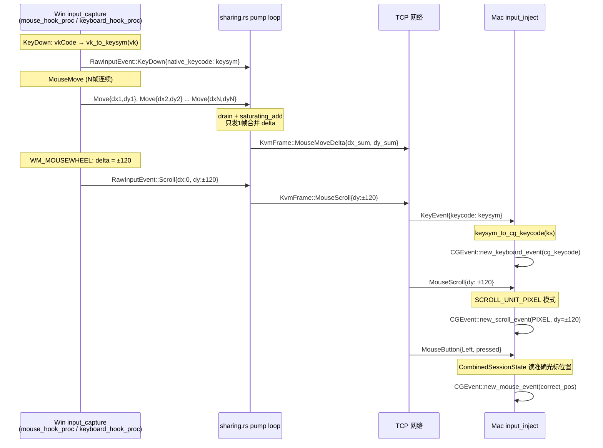

## 用户需求

**场景**：Win 端作为控制端，Mac 端作为被控端（Win 控 Mac）

### 核心问题（4 个 Bug + 1 个同步任务）

1. **键盘完全不工作**：Win 采集 VK 码发送，Mac 被控端直接当 CGKeyCode 注入，两套编码体系不兼容
2. **滚轮完全不工作**：Win 采集 ±120（WHEEL_DELTA 单位），Mac 注入时当行数（SCROLL_UNIT_LINE），导致一次滚 120 行
3. **鼠标左键首次点击不响应**：Mac DecoupleCursor 状态下，`inject_mouse_button` 用 HIDSystemState 读光标位置不准，注入坐标偏移
4. **鼠标拖拽卡顿**：pump 每个 MouseMove 都单独发帧，网络 + async 调度积压，对比竞品 Barrier 的 "Squash mouse moves" 合并策略
5. **Mac 端代码未同步**：v0.1.49 修复仅推送到 master，Mac 未 pull/构建最新代码

### 产品概述

KVMini：基于 Tauri + Rust 的跨平台 KVM 切换软件，支持 Win↔Mac 双向键鼠共享。

### 核心功能（本次修复）

- 建立通用键码中间层（X11 KeySym），Win VK→KeySym 发送，Mac KeySym→CGKeyCode 注入
- 统一滚轮单位制（±120 单位在协议层保持不变，Mac 注入时转换为正确格式）
- 修正 Mac 被控端鼠标点击坐标获取（DecoupleCursor 状态下使用正确的 cursor position API）
- 在 pump 层实现 MouseMoveDelta 帧合并（Squash），减少 async 发送次数
- 推送代码到 master，Mac 端拉取最新版本自行构建

## 技术栈

- **语言**：Rust（src-tauri）+ TypeScript（测试）
- **平台 API**：Win32 `KBDLLHOOKSTRUCT.vkCode`、`WM_MOUSEWHEEL`；macOS `CGEventTap`、`CGEvent::new_keyboard_event`、`CGEvent::new_scroll_event`
- **构建**：Tauri + Cargo（Windows 端构建，Mac 端用户自行构建）
- **测试**：Jest + TypeScript（`__tests__/`）

---

## 实现方案

### Bug 1：键盘 — X11 KeySym 中间层

**策略**：参照 Barrier/Synergy 行业标准，引入 X11 KeySym 作为跨平台通用键码。协议层 `KeyEvent.keycode` 语义从"平台原生码"改为"KeySym"（类型 u16 不变，无需改协议帧格式）。

- **Win 发送端**（`input_capture.rs`）：`keyboard_hook_proc` 采集到 `vkCode`，调用 `vk_to_keysym(vk)` 转换后放入 `native_keycode` 字段
- **Mac 接收端**（`input_inject.rs`）：`inject_key` 收到 KeySym 后调 `keysym_to_cg_keycode(ks)` 转换后调用 `CGEvent::new_keyboard_event`
- **Mac 发送端**（`input_capture.rs` `cg_event_to_raw`）：`KeyDown/KeyUp` 采集 `CGKeyCode`，调 `cg_keycode_to_keysym(cg)` 转换为 KeySym 存入 `native_keycode`
- **Win 接收端**（`input_inject.rs`）：已有 `cg_keycode_to_vk`，改为 `keysym_to_vk(ks)`

转换表放在各平台文件内（Win 侧 `input_capture.rs` + `input_inject.rs`，Mac 侧 `input_capture.rs` + `input_inject.rs`），不修改 kvm-core，最小改动范围。

**KeySym 覆盖范围**：字母(a-z)、数字(0-9)、符号键、空格/Tab/Enter/Esc/Backspace、F1-F20、方向键、修饰键(Shift/Ctrl/Alt/Cmd)、数字键盘，与现有 `cg_keycode_to_vk` 转换表覆盖范围一一对应。

### Bug 2：滚轮 — 单位统一

**策略**：协议层保持 ±120 单位制（与 Barrier 一致，Win WHEEL_DELTA 即 ±120）。Mac 被控端 `inject_scroll` 改为 **PIXEL 模式**（`SCROLL_UNIT_PIXEL = 2`）直接传递像素值，避免 LINE 模式 ÷120 后精度丢失。

- Win 发送端：不变，`delta = (mouseData as i32) >> 16`，通常 ±120
- Mac `inject_scroll`：`CGEvent::new_scroll_event(source, SCROLL_UNIT_PIXEL, 2, dy, dx, 0)`，PIXEL 模式 dy=±120 在 Mac 上滚动幅度合理（约 3-4 行等效）

**注意**：Mac 采集外接鼠标 ×120 是为补偿 Win 被控端的 `MOUSEEVENTF_WHEEL` 需要 ±120，这条路径不动（Mac→Win 方向正确）。

### Bug 3：鼠标左键首次不响应 — 修正 current_pos 获取

**根因**：`DecoupleCursor` 状态下（`CGAssociateMouseAndMouseCursorPosition(0)` 断开物理鼠标绑定），`CGEvent::new(source)?.location()` 从 HIDSystemState 读出的坐标是物理鼠标位置，而非屏幕光标位置（光标已被 `CGWarpMouseCursorPosition` 挪到 RemoteCursor 位置）。

**修复**：`inject_mouse_button` 改用 `CGEventSource::new(CGEventSourceStateID::CombinedSessionState)` 创建临时 event 读 `location()`，这套 State 返回的是合成/warp 后的屏幕光标位置（与 CGWarpMouseCursorPosition 一致）。

### Bug 4：鼠标卡顿 — pump MouseMoveDelta 合并

**策略**：参照 Barrier "Squash mouse moves"。在 pump 的 `rx.recv()` 分支中，收到 `RawInputEvent::MouseMove` 后，**立即 drain** channel 中所有待处理的 Move 帧（`try_recv` 循环），将所有 `dx/dy` 累加，只发一帧合并后的 `MouseMoveDelta`。非 Move 帧（Button/Key/Scroll）立即发送不合并。

效果：将 N 帧 Move 压缩为 1 帧，在网络 RTT（局域网约 1ms）下消除 tokio channel 积压引起的视觉卡顿。

---

## 实现细节

1. **转换表一致性**：`vk_to_keysym` + `keysym_to_vk` 与 `cg_keycode_to_keysym` + `keysym_to_cg_keycode` 必须互为逆运算，防止按键错乱
2. **Win input_inject 兼容**：现有 `cg_keycode_to_vk` 函数仅用于 Win 接收 Mac 发来的帧，改为接受 KeySym 后用 `keysym_to_vk`，函数签名保持 `fn keysym_to_vk(ks: u16) -> u16`
3. **Mac inject_scroll PIXEL 单位**：`CGScrollEventUnit` 为 u32，`SCROLL_UNIT_LINE=1`，`SCROLL_UNIT_PIXEL=2`，文档确认 PIXEL 模式精确传递像素增量
4. **pump drain 边界**：合并后的累加 dx/dy 用 `saturating_add` 防溢出（i16 范围 ±32767，单次帧最大 ±200px，极端情况合并 100 帧也不会溢出）
5. **startup_cleanup 无改动**：Win `BlockInput(0)` 清理逻辑已在 v0.1.49 中实现，保持不变
6. **版本号**：本次修复版本 v0.1.50，更新 `package.json`、`src-tauri/tauri.conf.json`、`Cargo.toml`

---

## 架构设计



---

## 目录结构

```
src-tauri/src/platform/windows/
├── input_capture.rs   # [MODIFY] keyboard_hook_proc 中 vkCode → vk_to_keysym()；新增 vk_to_keysym() 函数
├── input_inject.rs    # [MODIFY] cg_keycode_to_vk 改为 keysym_to_vk()；更新测试用例

src-tauri/src/platform/macos/
├── input_capture.rs   # [MODIFY] cg_event_to_raw 键盘分支改为 CGKeyCode → keysym；新增 cg_keycode_to_keysym()
├── input_inject.rs    # [MODIFY] inject_key 加 keysym_to_cg_keycode()；inject_scroll 改 PIXEL；inject_mouse_button 修正 CombinedSessionState

src-tauri/src/sharing.rs  # [MODIFY] pump loop 中 MouseMove drain+合并逻辑

__tests__/
├── bug-keyboard-keysym-roundtrip.test.ts  # [NEW] VK→KeySym→CGKeyCode 转换正确性；CGKeyCode→KeySym→VK 逆向
├── bug-scroll-unit-fix.test.ts            # [NEW] ±120 单位注入 PIXEL 模式验证；合并已有 scroll 测试
├── bug-pump-squash-move.test.ts           # [NEW] pump 层合并 N 帧 MouseMove → 1 帧 delta 累加验证

docs/
└── CHANGELOG_v0.1.50.md  # [NEW] 本次修复归档
```

---

## 关键代码结构

```rust
// src-tauri/src/platform/windows/input_capture.rs
// VK → X11 KeySym 转换（Win 采集端，发送前调用）
pub(crate) fn vk_to_keysym(vk: u16) -> u16 {
    match vk {
        0x41 => 0x0061, // VK_A → XK_a
        0x42 => 0x0062, // VK_B → XK_b
        // ... 完整转换表 ...
        _ => vk,        // 未知：透传（保守降级）
    }
}

// src-tauri/src/platform/windows/input_inject.rs
// X11 KeySym → Windows VK（Win 被控端，注入前调用）
pub(crate) fn keysym_to_vk(ks: u16) -> u16 { ... }

// src-tauri/src/platform/macos/input_capture.rs
// CGKeyCode → X11 KeySym（Mac 采集端，发送前调用）
pub(crate) fn cg_keycode_to_keysym(cg: u16) -> u16 { ... }

// src-tauri/src/platform/macos/input_inject.rs
// X11 KeySym → CGKeyCode（Mac 被控端，注入前调用）
pub(crate) fn keysym_to_cg_keycode(ks: u16) -> u16 { ... }

// src-tauri/src/sharing.rs — pump loop MouseMove 合并核心逻辑
// 收到 MouseMove 后立即 drain channel，累加 dx/dy，只发一帧
if let RawInputEvent::MouseMove { dx, dy, .. } = raw {
    let mut acc_dx = dx as i32;
    let mut acc_dy = dy as i32;
    while let Ok(extra) = rx.try_recv() {
        if let RawInputEvent::MouseMove { dx: ex, dy: ey, .. } = extra {
            acc_dx = acc_dx.saturating_add(ex as i32);
            acc_dy = acc_dy.saturating_add(ey as i32);
        } else {
            // 非 Move 帧放回 pending 队列，先处理再发 Move
            pending_non_move.push(extra);
            break;
        }
    }
    // 发合并后的单帧
}
```