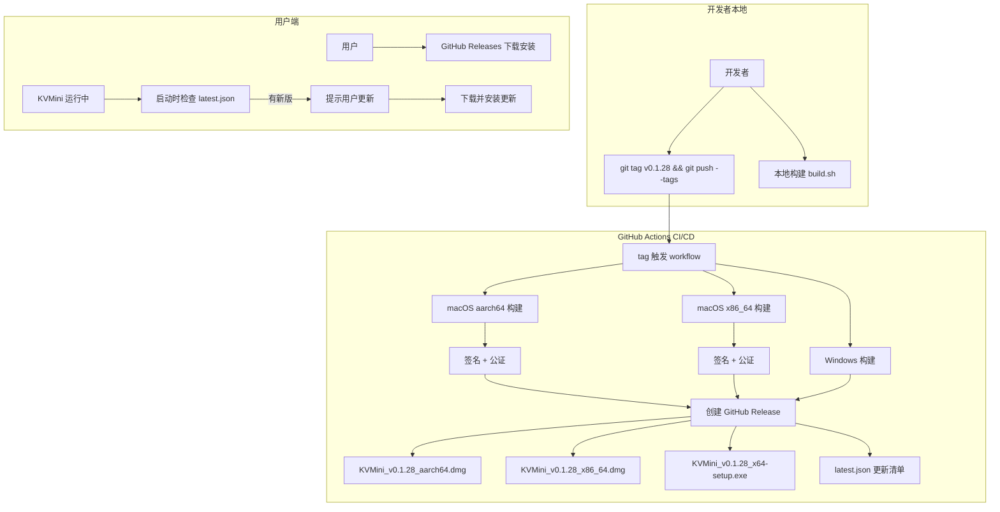

## 用户需求

将 KVMini 项目从本地构建分发模式改造为 GitHub Releases 分发模式，实现自动化 CI/CD 构建发布流水线，并集成应用内自动更新功能。

## 产品概述

KVMini 是一款跨平台键鼠共享工具（Tauri 2.x + Rust + JS），当前版本 v0.1.27。由于使用了辅助功能等底层 API，无法上架 App Store，需要通过 GitHub Releases 进行分发。本次改造将建立完整的 CI/CD 流水线，实现三平台（macOS M芯片、macOS Intel、Windows）自动构建、签名、公证、发布，并在应用内提供自动检查更新功能。

## 核心功能

1. **GitHub Actions CI/CD**：push tag（如 v0.1.28）时自动触发三平台构建，生成 DMG（macOS）和 MSI/NSIS（Windows）安装包，自动上传到 GitHub Releases
2. **macOS 代码签名与公证**：CI 中使用 Developer ID Application 证书签名，并通过 Apple 公证（Notarization），用户下载后无需手动放行
3. **应用内自动更新**：集成 tauri-plugin-updater，启动时自动检查 GitHub Releases 是否有新版本，提示用户下载安装
4. **隐私政策页面**：在 GitHub 仓库中建立隐私政策文档，通过 GitHub Pages 托管，应用内可访问
5. **保留本地构建能力**：现有 build.sh / BuildForWin.bat 保留，可选手动上传到 GitHub Releases

## 技术栈

- 构建框架：Tauri 2.x (patched v2.10.3) + Rust + HTML/CSS/JS
- CI/CD：GitHub Actions（macOS-latest / macOS-13 / windows-latest runners）
- 自动更新：tauri-plugin-updater v2（Rust crate + npm @tauri-apps/plugin-updater）
- 签名：Developer ID Application 证书 + Apple Notarization（xcrun notarytool）
- 分发：GitHub Releases
- 隐私政策：GitHub Pages 静态托管

## 实现方案

### 整体策略

采用 tag-triggered GitHub Actions workflow：当 push 一个 `v*` tag 时，自动触发三平台并行构建。macOS 构建分为 aarch64（M芯片）和 x86_64（Intel）两个 target，分别生成 DMG。Windows 生成 NSIS 安装包。构建完成后自动创建 GitHub Release 并上传所有产物。

自动更新使用 Tauri 官方的 `tauri-plugin-updater`，配置 endpoint 指向 GitHub Releases 的 `latest.json`。每次 CI 构建后会自动生成带签名的 `latest.json`，updater 通过比较版本号决定是否有更新可用。

### 关键技术决策

1. **不构建 Universal Binary，而是分别构建 aarch64 和 x86_64**

- 原因：项目有大量本地 patches（objc2, tao, tauri-runtime-wry, tauri），Universal Binary 构建复杂度高且容易出问题
- 方案：两个独立的 macOS job，分别使用 `--target aarch64-apple-darwin` 和 `--target x86_64-apple-darwin`
- macOS-latest runner 默认是 M 芯片，macOS-13 是 Intel

2. **macOS 公证使用 `xcrun notarytool`**

- 需要用户提供 Apple ID、App-Specific Password、Team ID 作为 GitHub Secrets
- 流程：codesign -> 创建 zip -> notarytool submit -> notarytool wait -> stapler staple

3. **tauri-plugin-updater 而非 tauri-commerce SDK**

- tauri-commerce SDK 当前 rev (b8da74f) 没有 update feature
- tauri-plugin-updater 是 Tauri 官方方案，与 GitHub Releases 天然集成
- endpoint 格式：`https://github.com/mackhan/KVMini/releases/latest/download/latest.json`

4. **更新签名密钥对**

- tauri-plugin-updater 需要 Ed25519 密钥对验证更新包完整性
- 私钥存储在 GitHub Secrets（`TAURI_SIGNING_PRIVATE_KEY`），公钥配置在 `tauri.conf.json`

5. **patches 目录处理**

- patches/ 已在 Git 中，CI checkout 后自然可用
- Cargo.toml 的 `[patch.crates-io]` 使用相对路径，CI 中无需额外配置

### 架构设计



## 实现注意事项

1. **GitHub Secrets 配置**（需要用户手动在 GitHub 仓库设置中添加）：

- `APPLE_CERTIFICATE`：Developer ID Application 证书的 base64 编码（.p12）
- `APPLE_CERTIFICATE_PASSWORD`：证书密码
- `APPLE_ID`：Apple 开发者账号邮箱
- `APPLE_PASSWORD`：App-Specific Password（非账号密码）
- `APPLE_TEAM_ID`：8F772XVA9L
- `TAURI_SIGNING_PRIVATE_KEY`：Ed25519 私钥（用于 updater 签名）
- `TAURI_SIGNING_PRIVATE_KEY_PASSWORD`：私钥密码（可选）

2. **版本号一致性**：CI 中版本号从 Cargo.toml workspace 读取，不自动 bump。Release tag 名与 Cargo.toml version 必须一致，workflow 中增加校验。

3. **i18n**：自动更新相关的所有 UI 文本（检查更新中、发现新版本、更新失败等）必须在 i18n.js 中同时添加 zh/en 两个语言的 key。

4. **性能**：updater 检查不阻塞 UI，使用异步 + 后台线程。设置合理的检查间隔（启动时检查一次，之后每 4 小时检查一次），避免频繁请求。

5. **隐私政策 URL**：从现有的 `https://kvmini.app/privacy` 改为 `https://mackhan.github.io/KVMini/privacy`（GitHub Pages），同时更新 commerce SDK 配置中的 privacy_url。

## 目录结构

```
project-root/
├── .github/
│   └── workflows/
│       └── release.yml              # [NEW] GitHub Actions CI/CD workflow。定义三平台并行构建（macOS aarch64/x86_64 + Windows），包含签名、公证、发布到 GitHub Releases、生成 latest.json 全流程。使用 matrix strategy 管理多平台构建。
├── docs/
│   └── privacy-policy.md            # [NEW] 隐私政策文档（中英双语）。用于 GitHub Pages 托管，替代现有 kvmini.app/privacy。包含数据收集说明（网络通信、设备发现等）、数据存储方式、第三方服务说明。
├── src-tauri/
│   ├── Cargo.toml                   # [MODIFY] 添加 tauri-plugin-updater 依赖。在 [dependencies] 中新增 tauri-plugin-updater = "2"。
│   ├── tauri.conf.json              # [MODIFY] 添加 updater 插件配置：endpoints 指向 GitHub Releases 的 latest.json，pubkey 填入 Ed25519 公钥，配置 bundle targets 为 dmg + nsis。
│   └── src/
│       └── main.rs                  # [MODIFY] 注册 tauri-plugin-updater 插件，添加 check_for_update / install_update Tauri 命令，在 setup 阶段启动后台更新检查任务。
├── src/
│   ├── main.js                      # [MODIFY] 在 initAboutTab() 中添加"检查更新"按钮事件处理，调用后端 check_for_update 命令，显示更新结果。启动时后台静默检查更新。
│   ├── i18n.js                      # [MODIFY] 添加自动更新相关的 i18n key（zh/en 双语）：checkUpdate、updateAvailable、updateDownloading、updateReady、updateFailed、noUpdateAvailable 等。
│   └── index.html                   # [MODIFY] 在关于 Tab 中添加"检查更新"按钮 HTML 元素。
├── scripts/
│   └── generate-updater-key.sh      # [NEW] 生成 tauri-plugin-updater 所需的 Ed25519 密钥对脚本。输出公钥（配置到 tauri.conf.json）和私钥（配置到 GitHub Secrets）。
├── build.sh                         # [MODIFY] 添加可选的 --upload 参数，构建完成后通过 gh CLI 手动上传到 GitHub Releases（降级方案）。
└── package.json                     # [MODIFY] 添加 @tauri-apps/plugin-updater npm 依赖。
```

## 关键代码结构

```rust
// src-tauri/src/main.rs - 更新检查命令
#[tauri::command]
async fn check_for_update(app: tauri::AppHandle) -> Result<Option<UpdateInfo>, String> {
    // 调用 tauri-plugin-updater API 检查 GitHub Releases
    // 返回 Option<UpdateInfo> { version, body, date }
}

#[tauri::command]
async fn install_update(app: tauri::AppHandle) -> Result<(), String> {
    // 下载并安装更新
}
```

```typescript
// tauri.conf.json - updater 配置（关键结构）
{
  "plugins": {
    "updater": {
      "endpoints": [
        "https://github.com/mackhan/KVMini/releases/latest/download/latest.json"
      ],
      "pubkey": "<Ed25519 公钥>"
    }
  }
}
```

## Agent Extensions

### Skill

- **brainstorming**
- 目的：在实现 GitHub Actions workflow 和 updater 集成之前，梳理构建矩阵策略、签名流程、公证步骤的设计细节
- 预期结果：产出完整的 CI/CD 构建流程设计和 updater 集成方案

- **test-driven-development**
- 目的：为 updater 功能编写前端和后端测试用例，确保更新检查、版本比较、UI 状态切换逻辑正确
- 预期结果：新增 updater 相关测试用例，覆盖正常更新、无更新、网络失败等场景

- **verification-before-completion**
- 目的：在声明完成前，验证 workflow YAML 语法、tauri.conf.json 配置正确性、updater 依赖版本兼容性
- 预期结果：所有配置经过验证，构建流水线可正确执行

### SubAgent

- **code-explorer**
- 目的：在实现过程中精确定位需要修改的代码位置，确认现有模式和约定
- 预期结果：准确找到所有需要修改的文件和插入点