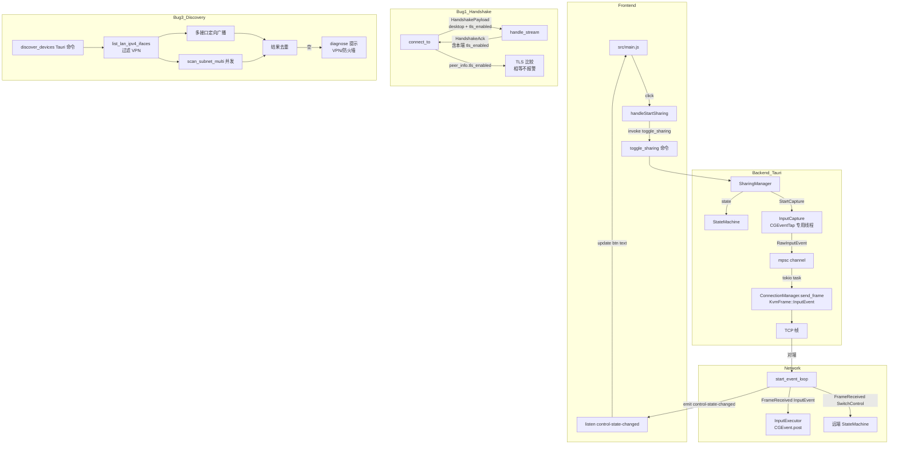

## 用户需求

KVMini 在两台 Mac 上使用时同时存在三个问题，需在本次开发中**一次性全部修复**（用户已明确选择 A + 都照原计划修）：

1. **Bug 1（P0，TLS 误报）**：手动连接成功后弹出"本机已开启 TLS 加密，但对端未开启"警告，但实际两端都已开启 TLS。
2. **Bug 2（P0，开始共享按钮失效）**：连接成功后点击"开始共享"按钮没有任何反应。**经调研此为重大功能缺口**——后端从未注册共享相关命令、键鼠采集/注入代码已实现但未接入主流程、状态机未托管、InputEvent 帧在事件循环中被丢弃。本次需**完整接入键鼠共享链路**，使按钮真正生效（IDLE ↔ LocalControlling 切换 + 本端采集 → 对端注入双向转发）。
3. **Bug 3（P1，VPN 下扫描不到）**：在 macOS 防火墙开启且存在 VPN（utun6）时，两台机器互相扫描不到设备。

## 产品概述

修复 KVMini 多机互联场景下的核心可用性问题，使两台 Mac（含 VPN/防火墙环境）能够：发现彼此 → 建立加密连接 → 通过"开始共享"按钮真正接管对端键鼠。

## 核心功能

- **TLS 状态正确互传**：握手协议在 wire 上携带 `tls_enabled`，双端都开 TLS 时不再误报；新旧客户端兼容。
- **开始共享按钮真正可用**：
- 后端新增 `toggle_sharing` Tauri 命令，托管 `StateMachine` 单例。
- 接入 `InputCapture`（本端 → 通过 `KvmFrame::InputEvent` 发送）+ `InputExecutor`（接收远端 → 注入本机）。
- `start_event_loop` 处理 `FrameReceived(InputEvent)` 注入到本机；处理 `SwitchControl/SwitchControlAck` 同步状态。
- 后端 `emit("control-state-changed")`，前端按钮文字与状态栏实时切换。
- 连接断开时自动 `on_disconnected()` 回到 IDLE，按钮文字复位。
- **扫描鲁棒性**：枚举所有物理网卡（过滤 utun*/ppp*/tun*/tap*/WireGuard/Tailscale/PPP/TAP），多接口定向 UDP 广播 + 多网段并发子网扫描；为空时返回中英双语诊断提示（VPN 干扰 / 防火墙放行命令）。
- **全平台双语**：Win / MacM / MacIntel 全部支持，新增文本 zh+en 同步。

## 视觉效果

- 「开始共享」按钮点击后立即切换为「停止共享」（中）/「Stop Sharing」（英），状态栏文字同步。
- TLS 不一致时才弹警告横幅；一致时静默连接。
- 扫描无结果时 toast 展示"检测到 VPN（utun6），可能干扰局域网发现，建议临时断开"或"未发现设备，请检查防火墙：sudo /usr/libexec/ApplicationFirewall/socketfilterfw --add /Applications/KVMini.app"。

## 技术栈

- 既有项目：Rust（kvm-core / src-tauri，Tauri 2.x，tokio 异步） + 原生 JS 前端 + Jest 测试
- 复用：`log` crate、`src/i18n.js`（zh+en 字典 + `data-i18n` + `t()`）、`tauri::Emitter` 事件总线、`broadcast::Sender<NetworkEvent>`
- 新增依赖：`if-addrs`（kvm-core，MIT/Apache 双协议，MacM/Intel/Win 全支持，开销 < 1ms/调用）

## 实现策略

### Bug 1：握手 TLS 状态正确互传

- **不破坏二进制兼容**：复用 `HandshakeInfo.screen_info: Vec<u8>` 字段，内部封装新 struct `HandshakePayload { desktop, tls_enabled }`，`#[serde(default)]` 兼容旧 JSON。
- `parse_payload(bytes)` 优先按 `HandshakePayload` 反序列化，失败回退按旧 `VirtualDesktop` 解析（tls_enabled=false）。
- **关键修复点**：
- `kvm-core/src/network.rs` 第 516 行 `connect_to`：从对端 `HandshakeAck.screen_info` 解析出 `tls_enabled` 写入返回的 `HandshakeInfo`。
- 第 694 行 `handle_stream`：用本机 `local_handshake_info` 的 `tls_enabled` 构造 `HandshakeAck.screen_info`。
- `accept_loop` 增加 `local_info` 参数透传到 `handle_stream`。
- **复杂度**：O(1)，无新增 RTT，向后兼容。

### Bug 2：完整接入键鼠共享链路（A 方案）

#### 后端架构（src-tauri/src/sharing.rs，新建模块）

- 新建 `SharingManager`，Tauri 托管：
- `state_machine: Arc<Mutex<StateMachine>>`
- `capture: Arc<dyn InputCapture + Send + Sync>`（macOS=MacInputCapture，Win=WinInputCapture）
- `executor: Arc<dyn InputExecutor + Send + Sync>`
- `connection: Arc<KvmConnectionManager>`（共享）
- **CGEventTap RunLoop 隔离**（按用户 `macos-cgevent-tap-hotkey` skill 要求）：在专用 std::thread 跑 CFRunLoop，避免与 Tauri/tokio 主 RunLoop 冲突；通过 `Arc<AtomicBool>` 控制启停。
- 新增 Tauri 命令：
- `toggle_sharing` → 调用 `state_machine.toggle_control()`，遍历 `StateEvent`：
    - `StartCapture` → `capture.start_capture(callback)`，callback 把 `RawInputEvent` 包成 `KvmFrame::InputEvent` 通过 `connection.inner.send_frame()` 发送（异步通道，避免在 CGEventTap 回调阻塞）。
    - `StopCapture` → `capture.stop_capture()`。
    - `SendFrame(SwitchControl)` → 通过连接发送给对端。
    - `StateChanged` → `app.emit("control-state-changed", ...)`。
- `get_control_state` → 返回当前 `ControlState`。

#### 接收端注入（修改 connection/mod.rs start_event_loop）

- 移除 `_ => None` 吞帧逻辑，新增 `NetworkEvent::FrameReceived` 分支：
- `KvmFrame::InputEvent { event }` → 通过 channel 转发到 `SharingManager`，`executor` 注入到本机；并先调用 `state_machine.switch_to_remote_controlling()`（若尚未切换）。
- `KvmFrame::SwitchControl { edge, pos_ratio }` → `state_machine.switch_to_remote_controlling()`，emit `control-state-changed`。
- `KvmFrame::SwitchControlAck` → emit 确认事件。
- `NetworkEvent::ConnectionStateChanged(Disconnected)` → `state_machine.on_disconnected()`，emit 状态复位。

#### 前端（src/main.js + src/i18n.js）

- `setupEventListeners` 新增 `elements.startSharingBtn?.addEventListener('click', handleStartSharing)`。
- `handleStartSharing` 调用 `invoke('toggle_sharing')`，捕获错误时 `showError(t('share_toggle_failed'))`。
- 新增 `listen('control-state-changed', ({ to }) => {...})` 监听器：根据 `Idle`/`LocalControlling`/`RemoteControlling` 切换按钮文字（`data-i18n` 在 `start_sharing` ↔ `stop_sharing` 间替换并 `applyI18n`）和状态栏 `controlState`。
- `handleDisconnect` 与 `connection-status` `disconnected` 事件中重置按钮。
- 删除幽灵命令 `invoke('toggle_control')`、`invoke('stop_input_capture')` 调用（main.js 第 336、501 行）。

#### 性能与稳定性

- **CGEventTap 回调零阻塞**：仅做 `tokio::sync::mpsc::UnboundedSender::send`，发送循环在独立 tokio task 内消费 channel 调 `send_frame`（避免 CGEventTap 在 RunLoop 内长时间持锁）。
- **InputEvent 序列化开销**：bincode 已用，单帧 < 64 byte，1000 events/s 带宽 < 64KB/s，可接受。
- **背压**：channel 容量限制 4096，溢出时丢弃旧事件（鼠标移动可丢，按键事件优先级保留——MVP 先无优先级，记 TODO）。
- **平台隔离**：Win 走 `WinInputCapture/WinInputExecutor`（已存在），通过 `cfg(target_os)` 在 `SharingManager::new` 内构造对应实现。
- **故障降级**：`capture.start_capture` 失败（无辅助功能权限）时返回错误给前端，提示用户授权；状态机回滚到 IDLE。

### Bug 3：扫描鲁棒性增强

- **kvm-core/src/network.rs**：
- 新增 `pub struct LanIface { pub name: String, pub ipv4: Ipv4Addr, pub broadcast: Ipv4Addr }`。
- `pub fn list_lan_ipv4_ifaces() -> Vec<LanIface>`：用 `if_addrs::get_if_addrs()` 枚举，按平台前缀过滤：
    - macOS: 排除 `lo*`、`utun*`、`ppp*`、`tun*`、`tap*`、名称含 `vboxnet`。
    - Windows: 排除 `Loopback`、名称含 `PPP`、`TAP`、`WireGuard`、`OpenVPN`、`Tailscale`。
- `pub async fn discover_devices_v2(udp_port: u16) -> KvmResult<Vec<DiscoveredDevice>>`：对每个 iface `bind(<iface_ip>:0)`，`set_broadcast(true)`，`send_to(<iface_broadcast>:udp_port, MAGIC)` + 兜底 `send_to(255.255.255.255:udp_port)`；并发收集 1.5s 内的响应去重。
- `pub async fn scan_subnet_multi(ifaces: &[LanIface], tcp_port: u16) -> KvmResult<Vec<DiscoveredDevice>>`：对每个 iface 并发跑现有 scan_subnet，结果按 IP 字符串 HashSet 去重。
- **src-tauri/src/main.rs**：
- `get_local_lan_ip()`：优先返回 `list_lan_ipv4_ifaces()` 第一个非 VPN IPv4，兜底走原 `8.8.8.8 connect` 路径。
- `discover_devices` 命令切到 v2 实现。
- `diagnose_network` 增强：检测到 utun*/VPN 时追加 `vpn_interference_tip` key；扫描结果空时追加 `firewall_block_tip`（含 macOS `socketfilterfw` 命令）。按 `hotkey::get_config().locale` 返回中英文。
- **i18n**：新增 `firewall_block_tip` / `vpn_interference_tip` / `firewall_cmd_macos` / `firewall_cmd_windows` 双语 keys。

## 实现注意事项（执行细节）

- **兼容性铁律**：握手 payload 用 `#[serde(default)]`，旧客户端 JSON 反序列化成功，反向也兼容；解析失败自动回退到旧路径。
- **平台隔离**：VPN 前缀白名单按 `cfg(target_os = "macos" / "windows")` 分平台定义；input_capture/inject 已是 cfg 隔离，sharing.rs 内只引用 trait。
- **CGEventTap 线程模型**：MacInputCapture 的 `start_event_tap` 当前在调用线程跑 `CFRunLoop::get_current()`——必须把 `start_capture` 调用放在专用 std::thread 内，且该线程要 `CFRunLoop::run()` 阻塞维持事件循环；停止时 `CFRunLoop::stop(run_loop)` 退出。需要修改 input_capture.rs 让 `start_capture` 自管理后台线程。
- **日志**：
- 握手：`log::info!("[Handshake] local_tls={} remote_tls={}", l, r)`
- 共享：`log::info!("[Sharing] toggle: {} -> {}", from, to)`，`log::debug!` 记录 InputEvent 帧（采样：每 100 个打印 1 个，避免日志洪水）
- 扫描：`log::info!("[Discovery] using ifaces: {:?}", ifaces.iter().map(|i| &i.name).collect::<Vec<_>>())`
- 前端：`console.log('[KVMini] toggle sharing -> {state}')`
- 不打印任何敏感数据（按键 keycode 仅 debug 级，release 默认不开）。
- **i18n 铁律**：所有新文本 zh+en 同步在 `src/i18n.js`，HTML 用 `data-i18n`，禁止硬编码中文；按钮 key 在 start_sharing / stop_sharing 切换。
- **版本规则**：本次构建 patch +1（0.1.31 → 0.1.32），同步 `Cargo.toml` workspace.package.version、`package.json`、`src/index.html` meta[app-version]，`src-tauri/src/main.rs::get_changelog()` 顶部新增 0.1.32 中英条目。
- **TDD**：每个 bug 先写失败测试，再写实现。
- **Bug 清单**：3 条记录到 `docs/bug-list.md`（现象/根因/修改方式/修改次数=1/出现次数=1）。
- **构建**：build.sh 走标准流程，构建产物名带版本号，旧产物清理。

## 架构示意



## 目录结构

```
KVMini/
├── kvm-core/Cargo.toml                       # [MODIFY] 新增 if-addrs = "0.13" 依赖
├── kvm-core/src/network.rs                   # [MODIFY] HandshakePayload wire 含 tls_enabled；list_lan_ipv4_ifaces / discover_devices_v2 / scan_subnet_multi；handle_stream 接收 local_info 并写入 HandshakeAck
├── kvm-core/src/state.rs                     # [VERIFY] StateMachine 已就绪；如需 toggle_control_simple（无 ScreenEdge 默认参数）则新增便捷方法
├── src-tauri/src/sharing.rs                  # [NEW] SharingManager 模块；托管 StateMachine + Capture + Executor；toggle_sharing 命令；CGEventTap 专用线程管理；mpsc channel 异步发送 InputEvent
├── src-tauri/src/main.rs                     # [MODIFY] 注册 SharingManager 到 invoke_handler；toggle_sharing/get_control_state 命令；get_local_lan_ip 优先非 VPN；discover_devices 切 v2；diagnose_network 增强；get_changelog 新增 0.1.32 条目；移除 platform/mod.rs 顶部 dead_code 标记（接入主流程后）
├── src-tauri/src/connection/mod.rs           # [MODIFY] start_event_loop 处理 FrameReceived(InputEvent/SwitchControl/SwitchControlAck) 转发到 SharingManager；ConnectionStateChanged(Disconnected) 触发 on_disconnected emit control-state-changed
├── src-tauri/src/platform/mod.rs             # [MODIFY] 移除顶部 #![allow(dead_code)] 注释（接入主流程后不再需要）
├── src-tauri/src/platform/macos/input_capture.rs  # [MODIFY] start_capture 改为内部 spawn 专用 std::thread 跑 CFRunLoop，停止时 CFRunLoop::stop；适配 macos-cgevent-tap-hotkey skill 的 RunLoop 隔离要求
├── src-tauri/src/platform/macos/input_inject.rs   # [VERIFY] 已就绪，无需修改
├── src-tauri/src/platform/windows/input_capture.rs  # [VERIFY] Win 端已实现，sharing.rs 通过 cfg 引用
├── src-tauri/src/platform/windows/input_inject.rs   # [VERIFY] 同上
├── src-tauri/tauri.conf.json                 # [MODIFY] version 0.1.31 → 0.1.32
├── src-tauri/Cargo.toml                      # [VERIFY] workspace version 自动继承
├── Cargo.toml                                # [MODIFY] workspace.package.version 0.1.31 → 0.1.32
├── package.json                              # [MODIFY] version 同步
├── src/index.html                            # [MODIFY] meta[app-version] 同步；start-sharing-btn 保持 data-i18n
├── src/main.js                               # [MODIFY] setupEventListeners 新增 startSharingBtn 绑定；handleStartSharing；listen control-state-changed；删除 toggle_control / stop_input_capture 幽灵调用；扫描空结果展示诊断提示
├── src/i18n.js                               # [MODIFY] zh+en 同步新增 keys: stop_sharing/sharing_started/sharing_stopped/share_toggle_failed/control_state_idle/control_state_local/control_state_remote/firewall_block_tip/vpn_interference_tip/firewall_cmd_macos/firewall_cmd_windows
├── __tests__/handshake_payload.test.ts       # [NEW] HandshakePayload 新旧格式 roundtrip 与向后兼容
├── __tests__/sharing_button.test.ts          # [NEW] 模拟 DOM 验证 click 触发 invoke('toggle_sharing')；listen 回调切换按钮文字
├── __tests__/lan_ifaces_filter.test.ts       # [NEW] VPN 接口过滤逻辑（按 mock 输入校验）
├── __tests__/i18n_keys.test.ts               # [MODIFY] 校验新增 keys 在 zh+en 都存在
├── kvm-core/src/network.rs (tests mod)       # [MODIFY] 新增 test_handshake_payload_roundtrip / test_handshake_payload_legacy_compat / test_list_lan_ipv4_ifaces_filter_vpn
├── src-tauri/src/sharing.rs (tests mod)      # [NEW] 单元测试：toggle_sharing 状态切换 / 远端 InputEvent 注入 mock executor
├── docs/bug-list.md                          # [MODIFY] 新增 BUG-018(TLS误报) / BUG-019(开始共享按钮) / BUG-020(VPN扫描) 三条记录
└── build.sh                                  # [VERIFY] 复用现有版本同步流程
```

## 关键代码结构（仅必要接口）

```rust
// kvm-core/src/network.rs
#[derive(Debug, Clone, Serialize, Deserialize, Default)]
pub(crate) struct HandshakePayload {
    #[serde(default)]
    pub desktop: VirtualDesktop,
    #[serde(default)]
    pub tls_enabled: bool,
}

impl HandshakeInfo {
    pub fn screen_info_bytes(&self) -> Vec<u8>;          // 序列化 HandshakePayload
    pub fn parse_payload(bytes: &[u8]) -> (VirtualDesktop, bool); // 兼容新旧
}

pub struct LanIface { pub name: String, pub ipv4: Ipv4Addr, pub broadcast: Ipv4Addr }
pub fn list_lan_ipv4_ifaces() -> Vec<LanIface>;

// src-tauri/src/sharing.rs
pub struct SharingManager {
    state: Arc<Mutex<StateMachine>>,
    capture: Arc<dyn InputCapture + Send + Sync>,
    executor: Arc<dyn InputExecutor + Send + Sync>,
    conn: Arc<KvmConnectionManager>,
    tx: tokio::sync::mpsc::UnboundedSender<RawInputEvent>,
}

#[tauri::command]
pub async fn toggle_sharing(
    app: tauri::AppHandle,
    sm: tauri::State<'_, SharingManager>,
) -> Result<String, String>;
```

## Agent Extensions

### Skill

- **test-driven-development**
- Purpose: 每个 Bug 修复前先写失败测试（HandshakePayload roundtrip / 按钮 click 触发 invoke / VPN 接口过滤 / SharingManager 状态切换）
- Expected outcome: 每个 bug 都有先失败、后通过的回归测试落入 `__tests__/` 与 Rust `#[cfg(test)]`

- **systematic-debugging**
- Purpose: 共享链路接入复杂度高，CGEventTap 线程模型 / channel 背压 / 状态同步如出现新症状时用结构化方法定位根因
- Expected outcome: 任何中途问题都给出根因 → 验证 → 修复链条

- **macos-cgevent-tap-hotkey**
- Purpose: 修改 MacInputCapture 使其在专用线程跑 CFRunLoop，避免 RunLoop 线程不匹配导致 CGEventTap 失效
- Expected outcome: start_capture 后 CGEventTap 持续接收事件，stop_capture 后干净退出，无 CFMachPort 释放问题

- **verification-before-completion**
- Purpose: 修复完成后跑全量 `npm test` + `cargo test`，并实机验证 TLS 不再误报、开始共享按钮可用（鼠标键盘真正在两机间转发）、VPN 下扫描提示生效
- Expected outcome: 提供测试通过输出与实机验证记录

- **requesting-code-review**
- Purpose: 提交前请 code-explorer 子代理进行代码 review 与性能分析（符合用户提交规则）
- Expected outcome: 收到 review 反馈并按需调整后再提交

### SubAgent

- **code-explorer**
- Purpose: 实施过程中如需快速确认 Win 端 InputCapture/Executor 现有签名、KvmFrame 序列化格式、其他 Tauri 命令注册风格等，调用其精准定位
- Expected outcome: 给出准确文件路径行号与代码片段，避免凭印象编码