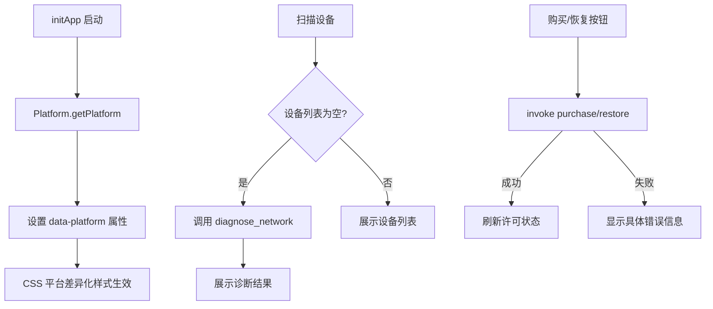

## 产品概述

KVMini 跨平台键鼠共享工具，需要一次性解决以下 5 类问题，确保 Mac 和 Windows 版本功能一致、界面一致、体验一致。

## 核心功能

### 1. Mac/Win 跨平台布局与外观统一

- 在 HTML 根元素上添加 `data-platform` 属性（`macos` / `windows`），使 CSS 可按平台差异化样式
- 字体栈补充 Windows 中文字体 `Microsoft YaHei`
- 设置按钮去除内联样式冲突，统一使用 CSS 类控制
- 添加 `-webkit-app-region: drag` 窗口拖动区域
- 针对 Windows/macOS 标题栏高度差异添加平台 CSS 补偿

### 2. 购买/恢复按钮错误提示优化

- 购买和恢复购买按钮的错误提示从通用文案改为展示后端返回的具体错误信息
- 操作过程中显示 loading 状态，防止重复点击
- 购买成功后自动刷新许可状态

### 3. 设备扫描网络诊断增强

- 扫描未发现设备时，后端执行基础网络诊断（检测防火墙、对端未启动、VPN 干扰等）
- 诊断结果结构化返回给前端，展示可操作的排查建议
- 前端将静态提示文案替换为动态诊断结果

### 4. SDK 版本更新

- 将 tauri-commerce SDK 从 `rev = "49e27dd"` 更新到最新 `rev = "b8da74f"`（v0.1.6）
- 验证编译通过，privacy/autostart/update 等新功能可用

### 5. 构建脚本完善

- 已有 `build.sh` 功能基本完整，需验证并补充版本号自增逻辑

## 技术栈

- **框架**: Tauri 2.x（Rust 后端 + 原生 WebView 前端）
- **前端**: 纯 HTML/CSS/JS（无框架），模块化拆分（main.js、platform.js、ui.js、i18n.js 等）
- **后端**: Rust + tokio 异步运行时
- **SDK**: tauri-commerce（试用/购买/i18n/隐私/自启动/更新日志）
- **平台抽象**: 前端 `platform.js` + 后端 `#[cfg(target_os)]` 条件编译

## 实现方案

### 整体策略

按照前端跨平台适配 -> 购买按钮修复 -> 网络诊断增强 -> SDK 更新的顺序实施。前端修改集中在 CSS/JS 层，通过 `data-platform` 属性实现平台差异化样式。后端新增 `diagnose_network` 命令返回结构化诊断结果。

### 关键技术决策

**1. 平台标识注入方案**

在 `main.js` 的 `initApp()` 中，调用 `Platform.getPlatform()` 获取平台信息后，在 `<html>` 元素上设置 `data-platform="macos"` 或 `data-platform="windows"` 属性。CSS 通过 `[data-platform="windows"]` 选择器实现平台差异化样式。

选择 `data-platform` 而非 CSS class 的原因：与现有 `data-theme`、`data-i18n` 属性模式一致，语义更清晰。

**2. 字体栈修复**

在 `styles.css` body 的 `font-family` 中，在 `'Segoe UI'` 之后添加 `'Microsoft YaHei'`，确保 Windows 下中文字符正确渲染。完整字体栈：

```
-apple-system, BlinkMacSystemFont, 'PingFang SC', 'SF Pro Text', 'Segoe UI', 'Microsoft YaHei', Roboto, sans-serif
```

**3. 设置按钮样式统一**

移除 `index.html` 第 106 行设置按钮的内联 `style` 属性，改用独立 CSS 类 `.btn-settings-hig`，在 `styles.css` 中定义统一样式。

**4. 窗口拖动区域**

在 `.hig-header` 上添加 `-webkit-app-region: drag`，按钮等交互元素添加 `-webkit-app-region: no-drag`。Windows 平台通过 `[data-platform="windows"]` 添加额外的 `padding-top` 补偿标题栏高度。

**5. 购买按钮错误提示改进**

修改 `main.js` 中购买/恢复按钮的 catch 处理：将后端返回的具体错误信息拼接到提示中显示，格式为 `"购买失败: {具体错误}"` 而非仅显示通用的 `purchaseFailed` 文案。同时在 `i18n.js` 中添加新的翻译 key `purchaseFailedDetail` 和 `restoreFailedDetail` 支持参数化错误消息。

**6. 网络诊断命令设计**

在 `main.rs` 中新增 `diagnose_network` Tauri 命令，执行以下检测：

- 检查本机 UDP 8888 端口是否可绑定（端口占用检测）
- 检查是否存在 VPN 网卡（通过已有的 `get_network_interfaces` 逻辑复用）
- 在 Windows 上通过 `netsh` 检查防火墙状态
- 返回结构化诊断结果 `NetworkDiagnostic { checks: Vec<DiagnosticItem> }`

前端在 `handleScan()` 扫描结果为空时，自动调用 `diagnose_network` 并将诊断结果格式化展示。

**7. SDK 版本更新**

将 `src-tauri/Cargo.toml` 中的 `rev = "49e27dd"` 改为 `rev = "b8da74f"`。确认编译通过即可，privacy 字段已在 `main.rs` 中配置完毕。

### 实现注意事项

**兼容性**：

- 所有 CSS 平台差异通过 `[data-platform]` 选择器隔离，不影响另一平台
- `diagnose_network` 命令中的平台特定逻辑（如 `netsh`）通过 `#[cfg(target_os)]` 条件编译隔离
- 字体栈保持 Mac 字体在前、Windows 字体在后的 fallback 顺序

**性能**：

- `diagnose_network` 仅在扫描结果为空时调用，非热路径
- 平台标识在 `initApp()` 中一次性设置，无运行时开销

**日志**：

- 购买/恢复操作的错误信息在 console.warn 中记录完整错误对象
- 网络诊断结果在 Rust 侧以 info 级别记录

## 架构设计



## 目录结构

```
project-root/
├── src/
│   ├── index.html          # [MODIFY] 移除设置按钮内联 style；HTML 结构不变
│   ├── styles.css           # [MODIFY] 添加字体栈 Microsoft YaHei；添加 [data-platform] 平台差异 CSS；新增 .btn-settings-hig 类；添加 -webkit-app-region 拖动区域；网络诊断结果样式
│   ├── main.js              # [MODIFY] initApp 中注入 data-platform；购买/恢复按钮错误提示优化（显示具体错误）；handleScan 扫描为空时调用 diagnose_network 并展示诊断结果
│   ├── i18n.js              # [MODIFY] 新增 purchaseFailedDetail/restoreFailedDetail/诊断相关翻译 key
│   └── platform.js          # 无修改（已有 getPlatform 方法）
├── src-tauri/
│   ├── Cargo.toml           # [MODIFY] 更新 tauri-commerce rev 从 49e27dd 到 b8da74f
│   └── src/
│       └── main.rs          # [MODIFY] 新增 diagnose_network 命令及 DiagnosticItem 结构体；注册到 invoke_handler
└── __tests__/
    └── cross-platform-ui.test.ts  # [NEW] 跨平台 UI 一致性测试用例（平台标识注入、字体栈、诊断结果展示）
```

## Agent Extensions

### Skill

- **using-superpowers**
- Purpose: 开发前加载 superpowers 工具链，确保环境正确配置
- Expected outcome: 开发环境就绪

- **test-driven-development**
- Purpose: 每个功能修改前先编写/更新测试用例，遵循用户 TDD 规则
- Expected outcome: 所有修改有测试覆盖，回归通过

- **verification-before-completion**
- Purpose: 所有修改完成后验证构建成功、测试通过
- Expected outcome: `cargo build` 通过，`npm test` 通过，应用启动正常

- **systematic-debugging**
- Purpose: 遇到购买按钮无响应等 bug 时系统化排查
- Expected outcome: 定位根因并修复

### SubAgent

- **code-explorer**
- Purpose: 大范围代码搜索确认修改影响面（如所有引用 showError 的位置、所有平台相关 CSS）
- Expected outcome: 确保修改不遗漏、不引入回归