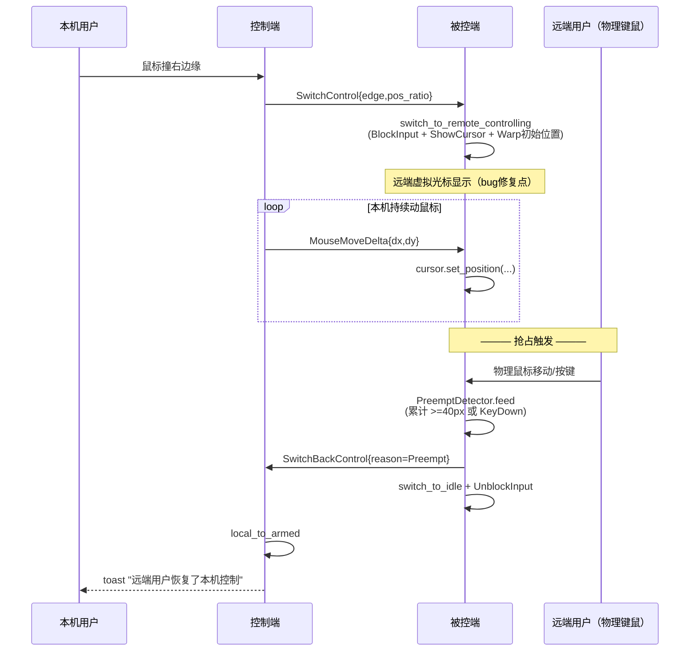

## 用户需求

在 KVMini 现有 KM 共享能力基础上，一次性处理三件事：

1. **修复远端虚拟光标不显示**：本机撞边进入 `LocalControlling` 后，远端（被控端）屏幕上应出现一个"虚拟光标"指示当前被控位置；当前 bug 表现为本机鼠标卡在屏幕边缘显示一半、远端完全看不到光标，但 delta 事件其实已到达。
2. **保留远端物理键鼠被吞的预期行为**：`RemoteControlling` 态下被控端吞掉本机键鼠是 KM 共享的标准设计，不改。
3. **新增"远端物理输入抢占自动终止共享"**：被控端（`RemoteControlling` 态）检测本机物理键鼠持续活动，**累计鼠标位移 > 40px 或任意键盘按下**，立即发 `SwitchBackControl` 给控制端并自切回 `Idle` + 解除 `BlockInput`；控制端收到后走现有 `local_to_armed()` 路径切回 `Armed`，同时在前端显示 3 秒 toast「远端用户恢复了本机控制 / Remote user resumed control」。被控端不提示。

## 产品概述

这是 Synergy / Logitech Flow 风格的"本地输入抢占回收"机制，让两台电脑共享键鼠时，被控端随时按任意键/动一下鼠标就能立刻拿回控制权，不用切软件、不用点按钮；同时修复远端虚拟光标的视觉反馈，让被控用户看得见"鼠标走到哪里"。

## 核心功能

- **远端虚拟光标修复**：定位 `MouseMoveDelta` 落地到 `cursor::set_position` 的执行链路，确认 Warp 被真正调用且光标在被控端可见（不被 `BlockInput`/隐藏逻辑屏蔽），mac / win 两端对齐。
- **抢占检测（mac + win 对称）**：`RemoteControlling` 态下，在平台 input_capture 回调里累计物理鼠标位移平方距离与键盘按下事件；阈值硬编码（位移 40px、键按下 1 次即触发），必须排除程序自身注入的合成事件避免自我触发。
- **抢占动作**：被控端触发后 → 发 `SwitchBackControl` → 自身 `switch_to_idle()` → `UnblockInput` → 清空累计计数；控制端收到 `SwitchBackControl` 走 `local_to_armed()`，emit 前端事件，前端弹 3 秒 toast。
- **UI 反馈**：仅控制端 3s toast，中英文双语 key（`preempt_resume_toast`），被控端静默。
- **版本号可见**：构建产物与界面继续沿用现有 `get_app_version` 显示机制，版本号 bump。
- **Mac / Win 行为一致、代码隔离**：抢占检测逻辑做成平台无关的核心算法（放 `kvm-core`），各平台 capture 模块按原有对称文件结构接入。

## 技术栈

- **核心**：Rust（`kvm-core` 跨平台逻辑 + `src-tauri` 平台实现），沿用现有 workspace
- **前端**：原生 JS + `src/i18n.js` 双语 + 现有 toast 机制（`showToast` in `main.js` / `ui.js`）
- **平台**：
- macOS：`CGEventTap`（现有）+ `CGWarpMouseCursorPosition`（虚拟光标 warp）
- Windows：`SetWindowsHookExW`（现有 LowLevelHook）+ `SetCursorPos`
- **协议**：完全复用 `KvmFrame::SwitchBackControl`、`KvmFrame::MouseMoveDelta`，不加新帧

## 实现策略

### 1. 远端虚拟光标不显示 — 根因调查 + 修复

**调查清单**（plan 执行时必做，按序排查）：

1. `src-tauri/src/sharing.rs` L186-223 `handle_remote_mouse_move_delta`：确认 `RemoteCursorAction::Warp{x,y}` 产生后是否调用了 `cursor.set_position(x, y)`。
2. `platform/macos/cursor.rs` 的 `set_position` 是否正确使用 `CGWarpMouseCursorPosition` 且传入的是全局坐标（非逻辑 DPI 缩放后坐标）。
3. `platform/windows/cursor.rs` 的 `set_position` 是否 `SetCursorPos` + 多显示器 virtual screen 原点偏移。
4. `RemoteControlling` 态下是否错误地调用了 `CGAssociateMouseAndMouseCursorPosition(false)` 或隐藏光标，导致 Warp 后视觉不更新。
5. 被控端是否应该在入态时**显式 show cursor + unhide**（与控制端 `HideCursor` 对称但逻辑相反）。

**预期根因**（先验判断，以实际调查为准）：

- 很可能是 **被控端 `RemoteControlling` 入态没有对应的 "ShowCursor/Warp 初始位置" 事件**，只有 `BlockInput`，导致 Warp 调用链缺失或首帧丢失。
- 修复方向：在 `StateMachine::switch_to_remote_controlling` 追加 `ShowCursor` 事件，sharing 层在收到该事件时调用 `cursor.show_cursor()` + 用 `on_enter` 算出的初始坐标 `set_position`。

### 2. 抢占检测 — 核心算法放 kvm-core，平台层仅注入事件

**核心设计**（第一性原理 + 奥卡姆剃刀）：

- 新增 `kvm-core/src/preempt.rs`：纯逻辑 `PreemptDetector`，输入 `PhysicalInputSample { kind: Move{dx,dy} | KeyDown }`，输出 `PreemptDecision { Idle | ShouldPreempt }`。
- 阈值常量：`PREEMPT_MOVE_THRESHOLD_PX: i32 = 40`（累计欧氏距离，用平方和 `dx*dx+dy*dy >= 40*40` 避免 sqrt）。
- 键盘按下：**任意一次** `KeyDown` 立即触发（符合 Synergy 风格）。
- **状态隔离**：仅在 `RemoteControlling` 态下喂样本；平台 capture 在其他状态直接 `return`，不喂。
- **重置时机**：每次入 `RemoteControlling` 时 `reset()`；触发一次后 `reset()` 防抖动。

**平台集成**：

- `MacInputCapture` / `WinInputCapture` 持一份 `Arc<Mutex<PreemptDetector>>`（或 `Arc<AtomicI32> + AtomicU8` 无锁版本，首选无锁）。
- 在各自的原始事件回调里（事件吞掉之前）：若 `control_state == REMOTE_CONTROLLING` 且事件是 `MouseMoved` / `KeyDown` 且**非合成事件**，则喂样本。
- 合成事件过滤：
- mac：判断 `CGEventSourceStateID` 是否为 `HIDSystemState`，或在注入时打 user-defined field tag（`kCGEventSourceUserData`）后过滤。
- win：LowLevelHook `LLMHF_INJECTED | LLMHF_LOWER_IL_INJECTED` flag 过滤，键盘同理 `LLKHF_INJECTED`。

**触发通道**：

- 平台 capture 触发 → 通过新增 `preempt_tx: UnboundedSender<()>`（在 `SharingManager::start_capture_and_pump` 类似位置建立）通知 sharing 层。
- Sharing 层收到信号 → `on_local_physical_preempt()`：发 `SwitchBackControl` → `sm.switch_to_idle()` → 处理 `UnblockInput` + `ShowCursor` 事件。

### 3. 控制端 UI 反馈

- 控制端 `on_remote_switch_back_control` 现有路径中，**区分回切来源**：新增 `emit("kvm://preempted", {})` Tauri 事件（独立于普通回切 emit）。
- 前端 `main.js` 新增监听 → `showToast(t('preempt_resume_toast'), 3000)`。
- `src/i18n.js` 新增 key：
- zh: `preempt_resume_toast: '远端用户恢复了本机控制'`
- en: `preempt_resume_toast: 'Remote user resumed control'`
- 被控端：不 emit，不 toast。

**区分"抢占回切"vs"虚拟光标反向边缘回切"**：

- 协议层可不区分（都是 `SwitchBackControl`），**被控端在发送时带一个可选 reason**：扩展 `KvmFrame::SwitchBackControl` 为 `SwitchBackControl { reason: u8 }`（0=EdgeReturn, 1=Preempt），payload 由 0 字节变 1 字节。
- 或更简单：**不改协议**，被控端在发 `SwitchBackControl` 前先发一条 toast 专用事件？ → 增加协议复杂度。
- **选方案 A（改协议 +1 字节）**：对称、未来可扩展、符合奥卡姆剃刀下"用现有帧扩展"原则。老版本兼容：decode 时 payload 为空则 reason=0。

## 实现注意（Implementation Notes）

- **性能**：CGEventTap / LowLevelHook 是实时路径，抢占检测必须 O(1)、无锁优先（`AtomicI32` 累加 dx²+dy² / `AtomicBool` keydown flag）。日志需限频（沿用现有 `LOGGED_FIRST_*` 模式）。
- **避免自我抢占**：被控端现在并不注入鼠标移动（LocalControlling 时才注入），但 `input_inject` 模块会注入鼠标按键/键盘到本机（RemoteControlling 时），必须用合成事件 flag 彻底排除。
- **日志**：抢占触发时 `log::info!("[Preempt] physical input detected, sending SwitchBackControl (cause={move|key})")`，首次触发打一次即可。
- **向后兼容**：`SwitchBackControl` 协议扩展必须保证 payload=0 字节的老版本 decode 成 `reason=EdgeReturn`。
- **blast radius**：抢占逻辑仅影响 `RemoteControlling` 态，其他状态一律 early return；失败时的安全兜底是"误触发抢占 → 用户重新撞边即可恢复"，没有数据损坏风险。
- **i18n 铁律**：新增 `preempt_resume_toast` 必须 zh + en 同时加，`tests/frontend/i18n.test.js` 的 `requiredKeys` 同步补全。
- **版本号**：按 KVMini 规范升级 Cargo.toml workspace version、package.json、src/index.html meta、main.rs changelog 条目。

## 架构设计



## 目录结构（只列改动）

```
KVMini/
├── kvm-core/
│   └── src/
│       ├── preempt.rs              # [NEW] PreemptDetector：纯逻辑抢占检测器
│       │                             定义 PhysicalInputSample / PreemptDecision
│       │                             常量 PREEMPT_MOVE_THRESHOLD_PX=40
│       │                             feed() 累加 dx²+dy²、检测 key down
│       │                             reset() 重置累计
│       │                             完整单元测试覆盖边界：39px 不触发 / 40px 触发 /
│       │                             dx+dy 组合勾股 / 任意 keydown 立即触发 / reset 清零
│       ├── lib.rs                  # [MODIFY] pub mod preempt;
│       ├── protocol.rs             # [MODIFY] SwitchBackControl 扩展 reason 字段
│       │                             decode 兼容老版本（payload 空 → reason=0）
│       │                             新增 SwitchBackReason 枚举 {EdgeReturn=0, Preempt=1}
│       │                             补 encode/decode 测试 + 跨版本兼容测试
│       └── state.rs                # [MODIFY] switch_to_remote_controlling 追加
│                                     StateEvent::ShowCursor（修复远端光标不显示）
│                                     补相应单元测试
├── src-tauri/
│   ├── Cargo.toml                  # [MODIFY] workspace version bump
│   └── src/
│       ├── sharing.rs              # [MODIFY]
│       │                             - 新增 on_local_physical_preempt()：
│       │                               发 SwitchBackControl{Preempt} → switch_to_idle
│       │                             - handle_remote_mouse_move_delta：区分 reason
│       │                             - on_remote_switch_back_control：按 reason emit
│       │                               "kvm://preempted" 或普通回切
│       │                             - 入 RemoteControlling 时 cursor.show +
│       │                               按 source_edge+pos_ratio 算初始 warp 点
│       │                             - 提供 preempt_tx channel 给 capture 层
│       ├── platform/
│       │   ├── macos/
│       │   │   ├── input_capture.rs # [MODIFY] CGEventTap 回调中：
│       │   │   │                      - state==REMOTE_CONTROLLING 时喂 PreemptDetector
│       │   │   │                      - 过滤合成事件（CGEventSourceStateID 判定）
│       │   │   │                      - 触发后通过 Arc<Fn()> 回调通知 sharing
│       │   │   └── cursor.rs        # [VERIFY/MODIFY] set_position 验证正确 Warp
│       │   │                          入 RemoteControlling 时 show_cursor 确保可见
│       │   └── windows/
│       │       ├── input_capture.rs # [MODIFY] LowLevelHook 同样集成 PreemptDetector
│       │       │                      - 过滤 LLMHF_INJECTED / LLKHF_INJECTED
│       │       │                      - 保持与 mac 端行为一致
│       │       └── cursor.rs        # [VERIFY/MODIFY] SetCursorPos + 多屏坐标验证
│       └── main.rs                 # [MODIFY] changelog 新增当前版本条目
├── src/
│   ├── i18n.js                     # [MODIFY] 新增 preempt_resume_toast (zh+en)
│   ├── main.js                     # [MODIFY] 监听 tauri "kvm://preempted" → showToast
│   └── index.html                  # [MODIFY] app-version meta 同步
├── package.json                    # [MODIFY] version 同步
├── Cargo.toml                      # [MODIFY] workspace.package.version bump
├── __tests__/
│   └── frontend/
│       └── i18n.test.js            # [MODIFY] requiredKeys 补 preempt_resume_toast
├── kvm-core/src/preempt.rs (tests) # [NEW] TDD：触发阈值 / 勾股 / reset / 多次 feed
├── kvm-core/src/state.rs (tests)   # [MODIFY] 新增 test_remote_controlling_includes_show_cursor
├── kvm-core/src/protocol.rs (tests)# [MODIFY] test_switch_back_reason_encode_decode
│                                               test_switch_back_legacy_empty_payload_compat
└── docs/
    ├── bug-list.md                 # [MODIFY] 新增 BUG-0xx 远端虚拟光标不显示根因+修复
    ├── product-design.md           # [MODIFY] 更新抢占机制章节
    └── architecture-YYYYMMDD.md    # [NEW] 日期归档的架构图 + 开发总结
```

## 关键接口设计

```rust
// kvm-core/src/preempt.rs
pub const PREEMPT_MOVE_THRESHOLD_PX: i32 = 40;

pub enum PhysicalInputSample {
    Move { dx: i32, dy: i32 },
    KeyDown,
}

pub enum PreemptDecision {
    Idle,
    ShouldPreempt { cause: PreemptCause },
}

pub enum PreemptCause { MouseMove, KeyDown }

pub struct PreemptDetector { /* accumulated_dist_sq: i64 */ }

impl PreemptDetector {
    pub fn new() -> Self;
    pub fn feed(&mut self, sample: PhysicalInputSample) -> PreemptDecision;
    pub fn reset(&mut self);
}

// kvm-core/src/protocol.rs 扩展
pub enum SwitchBackReason { EdgeReturn = 0, Preempt = 1 }
// KvmFrame::SwitchBackControl { reason: SwitchBackReason }
// decode: payload.len()==0 → EdgeReturn（向后兼容）
```

## Agent Extensions

### Skill

- **test-driven-development**
- Purpose: 每个改动先写测试后写实现，覆盖 PreemptDetector 逻辑、协议扩展兼容性、状态机 ShowCursor 事件、i18n key 完整性
- Expected outcome: 所有新增/修改代码路径均有测试护航，回归可自动检出

- **systematic-debugging**
- Purpose: 系统性调查"远端虚拟光标不显示"的根因链路（sharing → state → cursor → 平台实现）
- Expected outcome: 定位到首个失效环节（预期是 `switch_to_remote_controlling` 缺 `ShowCursor` 或 cursor 初始 warp 未触发），形成 bug-list 条目

- **macos-cgevent-tap-hotkey**
- Purpose: 在 CGEventTap 回调中安全追加抢占检测逻辑时，避免踩 RunLoop 线程 / CFMachPort 释放的已知坑
- Expected outcome: Mac 端 input_capture 新增合成事件过滤 + PreemptDetector 喂样本后，tap 不被系统 disable，现有全部 CGEventTap 测试仍通过

- **verification-before-completion**
- Purpose: 完成后严格跑 cargo test + jest + cargo build + 实机双端对拷测试
- Expected outcome: 所有测试绿、构建产物生成、mac 和 win 两端实机抢占均可触发且 toast 显示

- **writing-plans**
- Purpose: 细化每个 todo 的子步骤与验收标准，产出可执行的子 plan
- Expected outcome: 分解后每步都能被另一个 agent 接手独立完成

### SubAgent

- **code-explorer**
- Purpose: 并行探查 `platform/macos/cursor.rs` 和 `platform/windows/cursor.rs` 的 `set_position` 实现 + `input_inject.rs` 合成事件标记方式，为根因修复提供确凿证据
- Expected outcome: 输出两端 cursor 实现对比表 + 是否给注入事件打 tag 的现状结论