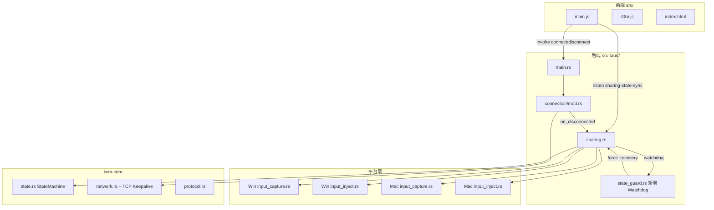

## 产品概述

KVMini v0.1.58 当前存在四个阻塞性缺陷需要系统化修复。本次开发按"诊断先行 + 模块化修复"的方式推进，参考竞品（Synergy 3 / Deskflow / Barrier / Logitech Flow）重构按钮状态模型，并对被控端键鼠恢复做纵深防御。

## 核心功能

### F1 Win → Mac 滚轮注入生效

Win 主控端滚动鼠标滚轮时，Mac 被控端窗口正常滚动（中键/拖动已可用，此处补齐最后一个输入类型）。覆盖垂直滚轮与水平滚轮两种场景。

### F2 连接按钮单按钮三态重构

参照 Synergy 3 / Deskflow，废弃现有"断开 + 重连"双按钮，统一为单按钮三态：

- `Disconnected` → 显示 "连接 / Connect"
- `Connecting` → 显示 "连接中… / Connecting…"（带 spinner，禁用）
- `Connected` → 显示 "断开 / Disconnect"

连接状态以后端 `sharing-state-sync` snapshot 为唯一真相源；心跳波动的 `reconnecting` 事件只更新状态徽章，不影响按钮文案。远端与本地双向同步（被控端收到断开事件时按钮立即切回 Connect）。

### F3 Win 被控端纵深防御（杀进程不锁死本机键鼠）

实现两层兜底，确保远端任何方式下线（kill -9 / 拔网线 / crash）后，本机键鼠在 ≤ 12s 内完全恢复，Ctrl+Alt+Tab 立即可用：

- 层 1：TCP socket SO_KEEPALIVE（idle=5s / interval=3s / count=2），让 read_loop 在约 11s 内感知断线
- 层 2：独立 Watchdog 线程，10s 内无远端帧 / 心跳 Ack 即强制 control_state=Idle + stop_capture + unblock_input + recouple_cursor，无论事件链路是否正常

### F4 鼠标跨端切换链路修复

先加全链路诊断日志（Win 主控 LocalControlling 边缘检测、delta 发送、Mac 被控 RemoteCursorState 累加、反向边缘触发、SwitchBackControl 收发），根据实际日志定位问题点后修复。确保：

- Win 主控 → Mac 被控方向：鼠标可以切过去控制 Mac
- Mac 被控 → Win 主控方向：鼠标/虚拟光标撞反向边缘 或 物理输入抢占 能正常切回 Win 本机

### F5 全链路诊断日志基础设施

为 F3/F4 提供可排查能力：在 Win/Mac 双端 capture、inject、sharing、connection、state_guard 等关键路径埋入结构化日志（带 module tag + 状态 + 关键字段），支持按 `RUST_LOG=kvmini=debug` 打开。

### F6 版本号可见与 Bug 清单

- 主界面、设置页、关于页版本号显示为 v0.1.59（从 0.1.58 递增）
- `docs/bug-list.md` 新增 BUG-041~044 条目：滚轮失效 / 按钮文案错 / 杀进程锁死（第 3 次复发）/ 跨端切换失效

## 技术栈选择

沿用项目现有技术栈（已验证可行，避免引入新模式）：

- **Rust 后端**（`kvm-core` + `src-tauri`）：状态机、连接管理、Win/Mac 平台层
- **Tauri 2.x**：事件通信（`app.emit` + 前端 `listen`）
- **前端**：原生 JS + i18n 模块（`src/i18n.js` zh/en）
- **测试**：Rust `cargo test` + Jest（`__tests__/*.test.ts`）
- **平台隔离**：`#[cfg(target_os = "windows")]` / `#[cfg(target_os = "macos")]`

## 实现策略

### 核心原则

1. **诊断先行**：F4/F5 先埋日志跑一轮再改逻辑，避免盲改
2. **纵深防御**：F3 采用 TCP 层 + 应用层双保险，不依赖单一路径
3. **单一真相源**：F2 按钮状态完全由后端 `sharing-state-sync` snapshot 驱动
4. **模块化开发**：5 个模块独立可测，按顺序提交，每个模块 ≤ 500 行改动
5. **TDD**：每个模块先写测试用例后写实现，bug 修复必配回归用例
6. **奥卡姆剃刀**：删除旧的 `reconnectBtn` 相关代码与 i18n key，不再保留

### 关键技术决策

**F1 滚轮**：

- 经查 `src-tauri/src/platform/macos/input_inject.rs` 的 `inject_scroll` 已 `tag_synthetic`，但 **Mac CGEventTap 回调中 `ScrollWheel` 分支需确认放行逻辑是否在 `state == REMOTE_CONTROLLING && is_synthetic` 时正确 `Some(event)` 而非 `None`**。先加日志验证 tap 放行路径，确认后按最小修改补全 `ScrollWheel` 放行分支。
- 同步检查 Win 被控端 hook 的 `WM_MOUSEWHEEL` 是否在 `is_injected && REMOTE_CONTROLLING` 条件下放行（已有逻辑，回归测试确认）。

**F2 按钮**：

- DOM 层：`#connect-btn` 单一按钮 + `data-state` 属性（disconnected/connecting/connected）
- 状态流：后端 `sharing-state-sync { connected, control_state }` → 前端 `updateConnectButton()` 读 `appState.connected` + `appState.connectionPhase`
- 去除所有 `reconnectBtn` DOM / JS / i18n 引用，合并为 `connectBtn` 的二次点击（disconnected 态点击走历史 peer 或连接对话框）
- `reconnecting` 事件只更新 `#connection-status-badge` 徽章文案，不碰按钮

**F3 纵深防御**：

- **TCP Keepalive**（`kvm-core/src/network.rs`）：
- `TcpStream::set_keepalive` 不够（无法设 interval/count），改用 `socket2::Socket::from` + `TcpKeepalive::new().with_time(5s).with_interval(3s).with_retries(2)`
- 双端都设，客户端 connect 后设，服务端 accept 后设
- **Watchdog**（`src-tauri/src/state_guard.rs` 扩展）：
- 被控端 `RemoteControlling` 入态时启动独立 tokio 任务，每 2s 检查 `touch_remote_frame()` 的时间戳
- 超过 10s 无帧 → 触发 `force_recovery`：`sm.force_idle()` + `capture.set_control_state(Idle)` + `capture.stop_capture()` + `blocker.force_unblock()` + `cursor.recouple_physical_mouse()` + `app.emit("connection-status", disconnected)`
- 主控端 `LocalControlling` 同理（超时无法发帧即触发）
- 复用现有 `Ctrl+Alt+S` 安全阀作为最终人肉保险

**F4 跨端切换**：

- 日志埋点（`log::info!` / `log::debug!`）：
- Win 主控端 `pump` loop：每 N 帧打印 `edge_detect(x,y) → Triggered?`、`MouseMoveDelta(dx,dy) 发送`
- Mac 被控端 `handle_remote_mouse_delta`：打印 `on_delta(dx,dy) → pos(x,y) → action(Move/SwitchBack)`
- 双端 `SwitchBackControl` 收发：打印 reason + 来源
- `state.rs` 状态切换：打印 `from → to + 触发原因`
- 基于诊断结果再定修复（可能的修复点：绝对坐标 vs delta 坐标混用、CGEventTap 回读注入事件造成循环、grab 状态下 delta 累计错误等）

**F5 日志基础设施**：

- 采用 `log` + `env_logger`（项目已有）
- 统一 module prefix：`[Sharing]` / `[Win/Capture]` / `[Mac/Capture]` / `[Mac/Inject]` / `[StateGuard]` / `[Network]`
- 关键热路径用 `log::trace!` 避免日志风暴；状态变化用 `log::info!`；异常用 `log::warn!` / `log::error!`
- 前端在 `src/main.js` 启动时打印版本号 + 构建时间到 console

### 性能与可靠性

- Watchdog 线程每 2s 唤醒一次，负载可忽略（< 0.01% CPU）
- TCP Keepalive 内核实现，零用户态开销
- 日志在 release 构建下 `trace!` 被编译器优化掉（通过 `log` 的 feature flag）
- 按钮状态更新节流 50ms，避免高频 sharing-state-sync 事件导致重复渲染

### 避免技术债

- 复用现有 `StateGuard`（`src-tauri/src/state_guard.rs`）扩展 Watchdog，不新建模块
- 复用现有 `SwitchBackControl` 协议帧（已有 `SwitchBackReason::EdgeReturn/Preempt`），不扩协议
- 复用现有 `inject_mouse_move` / `inject_scroll` 的 `tag_synthetic` 机制，不改注入链路
- 按钮重构删除旧代码而非并行保留，避免双路径 bug

## 实现注意事项

### 性能

- Watchdog 2s 周期用 `tokio::time::interval`，不 spawn 多个线程
- TCP Keepalive 用 socket2 setsockopt，一次性配置
- `sharing-state-sync` 事件前端节流 50ms（lodash `throttle` 或自实现 `requestAnimationFrame`）
- 滚轮路径加日志只在 `ScrollWheel` 分支，不影响 `MouseMove` 热路径（每帧 > 100 次）

### 日志

- 复用 `log` crate（项目已引入）；module prefix 用 `[Sharing]` / `[Win/Capture]` / `[Mac/Capture]` 等
- 热路径（每鼠标移动帧）用 `log::trace!`；状态切换用 `log::info!`
- 禁止日志中打印用户输入内容（键盘扫描码可以，按键字符不行），避免隐私泄露
- 避免单次 Heartbeat 打日志（每 5s 一次，累积会淹没关键信息）

### 兼容性与爆炸半径

- TCP Keepalive 用 `socket2` crate（需加依赖）；Win/Mac 都支持；旧版本 Win10 RS3 以下降级为默认 keepalive
- 按钮重构保留 DOM id `#connect-btn` 一致，i18n key 新增 `btnConnect` / `btnConnecting` / `btnDisconnect`，删除 `btnReconnect`
- Watchdog 仅在被控端 `RemoteControlling` 和主控端 `LocalControlling` 激活，Idle/Armed 不启动，避免空转
- 所有改动用 feature flag 保护（非必要，作为安全阀）：`KVMINI_WATCHDOG_DISABLE=1` 环境变量可关闭 Watchdog 做对照实验

## 架构设计



## 目录结构

```
KVMini/
├── Cargo.toml                                 # [MODIFY] 版本 0.1.58→0.1.59；新增 socket2 依赖
├── package.json                               # [MODIFY] 版本同步
├── src/
│   ├── index.html                             # [MODIFY] 删除 #reconnect-btn，#connect-btn 作为单一按钮；meta version 更新；版本号显示
│   ├── main.js                                # [MODIFY] 删除 reconnectBtn 相关代码；新增 updateConnectButton(phase)；sharing-state-sync 节流；connection-status 事件路由重写
│   ├── i18n.js                                # [MODIFY] 删除 btnReconnect；新增 btnConnect/btnConnecting/btnDisconnect；新增 statusReconnecting 状态徽章文案
│   └── styles.css                             # [MODIFY] #connect-btn[data-state="connecting"] spinner 样式；#connection-status-badge 徽章样式
├── kvm-core/
│   ├── Cargo.toml                             # [MODIFY] 新增 socket2 依赖
│   └── src/
│       └── network.rs                         # [MODIFY] ConnectionManager::connect/accept 后对 TcpStream 应用 TcpKeepalive(time=5s, interval=3s, retries=2)
├── src-tauri/
│   ├── Cargo.toml                             # [MODIFY] 版本
│   ├── tauri.conf.json                        # [MODIFY] 版本
│   └── src/
│       ├── sharing.rs                         # [MODIFY] 启动/停止 watchdog 钩子；on_disconnected 调 watchdog.stop；新增 force_recovery_impl 复用兜底逻辑；F4 日志埋点
│       ├── state_guard.rs                     # [MODIFY] 扩展 Watchdog：start_watchdog(on_timeout: FnMut)/stop_watchdog/touch_remote_frame 已有；新增 10s 超时触发 on_timeout
│       ├── connection/mod.rs                  # [MODIFY] F4 日志：ConnectionStateChanged 路径；Keepalive 配置调用点
│       ├── main.rs                            # [MODIFY] changelog 新增 0.1.59 条目；版本号渲染
│       └── platform/
│           ├── windows/
│           │   ├── input_capture.rs           # [MODIFY] WM_MOUSEWHEEL 注入事件放行日志；force_unblock 调用点；F4 边缘日志
│           │   └── input_inject.rs            # [MODIFY] scroll/move/button 注入日志（trace 级别）
│           └── macos/
│               ├── input_capture.rs           # [MODIFY] ScrollWheel tap 分支放行逻辑确认+补全（BUG-040 延伸）；F4 日志
│               └── input_inject.rs            # [MODIFY] inject_scroll 日志（确认 tag_synthetic 写入）
├── __tests__/
│   ├── bug041-scroll-inject.test.ts           # [NEW] Mac tap ScrollWheel 放行逻辑测试；Win→Mac 滚轮链路
│   ├── bug042-connect-button-tri-state.test.ts # [NEW] 按钮三态切换；reconnecting 事件不改文案；删除 btnReconnect key 断言
│   ├── bug043-watchdog-recovery.test.ts       # [NEW] Watchdog 超时触发 force_recovery；TCP Keepalive 配置断言
│   └── bug044-cross-end-switch-logs.test.ts   # [NEW] F4 日志格式与关键字段断言
├── kvm-core/src/
│   └── network.rs                             # 含单元测试：test_tcp_keepalive_applied
├── src-tauri/src/
│   ├── state_guard.rs                         # 含单元测试：test_watchdog_triggers_on_timeout / test_watchdog_resets_on_touch
│   └── sharing.rs                             # 含单元测试：test_force_recovery_resets_all_state
├── docs/
│   ├── bug-list.md                            # [MODIFY] 新增 BUG-041/042/043/044
│   ├── CHANGELOG_v0.1.59.md                   # [NEW] 本版变更日志（中英双语）
│   ├── dev-summary-v0.1.59.md                 # [NEW] 开发总结 + 架构图
│   └── product-design-v0.1.59.md              # [NEW] 产品设计快照
└── build.sh                                    # [MODIFY] 支持 --no-bump（避免误 bump）；构建前删除老 dmg
```

## 关键代码结构

```rust
// src-tauri/src/state_guard.rs —— Watchdog 核心接口
impl StateGuard {
    /// 启动远端帧看门狗；timeout 内无新帧调用 on_timeout
    pub fn start_watchdog<F>(&self, timeout: Duration, on_timeout: F)
        where F: FnMut() + Send + 'static;

    /// 停止看门狗
    pub fn stop_watchdog(&self);

    /// 喂狗：远端帧到达或心跳 Ack 到达时调用
    pub fn touch_remote_frame(&self);
}

// kvm-core/src/network.rs —— TCP Keepalive 封装
pub fn apply_tcp_keepalive(stream: &TcpStream) -> io::Result<()>;
// idle=5s, interval=3s, retries=2
```

```typescript
// src/main.js —— 按钮状态机
type ConnectionPhase = 'disconnected' | 'connecting' | 'connected';
function updateConnectButton(phase: ConnectionPhase): void;
```