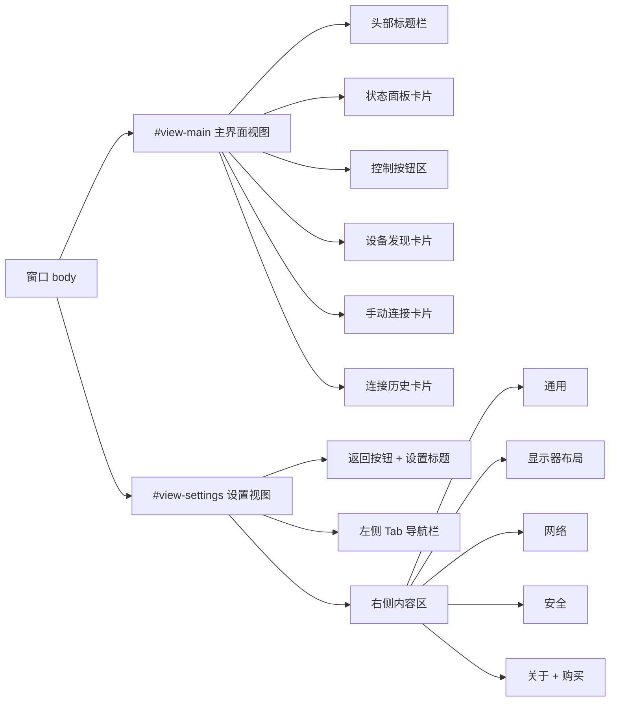
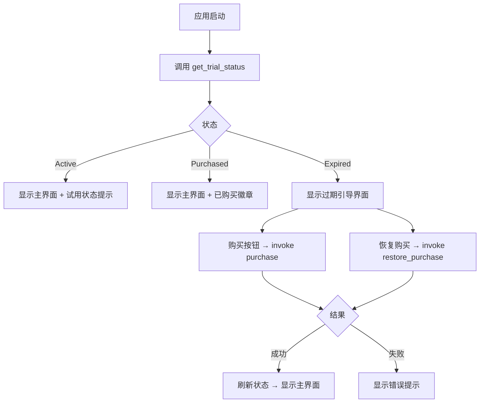

## 产品概述

KVMini 是一款跨平台鼠标键盘共享软件（Tauri 2.x + Rust + 原生 HTML/CSS/JS），需要对其进行 UI 风格重构和商业化流程完善。

## 核心功能

### 1. 删除激活码功能

- 移除授权引导界面中的激活码输入框、激活按钮、错误提示
- 保留购买许可证按钮，改为直接接入 SDK 内购

### 2. 接入 SDK 内购功能

- 启用 tauri-commerce SDK 的 IAP（应用内购买）功能
- 实现购买按钮调用 SDK 内购流程（非跳转网页）
- 实现恢复购买功能
- 过期引导界面：试用到期后展示购买和恢复购买入口
- 购买成功后自动刷新授权状态

### 3. Apple HIG 风格 UI 重构

- 整体风格：灰白底色（#f5f5f7）+ 蓝色主色（#007aff），白色圆角卡片，柔和阴影
- 主界面重新布局：状态面板、设备发现、手动连接、连接历史等功能区用卡片式布局
- 头部区域：去掉紫色渐变背景，改为简洁的标题栏
- 深色模式适配：CSS 变量系统全面重建，支持 Apple HIG 深色配色

### 4. 设置页面改为方案 D（整页替换 + 返回按钮）

- 点击设置按钮后，整个窗口内容切换为设置视图
- 设置视图：顶部返回按钮 + 左侧垂直 Tab 导航栏 + 右侧内容区
- 左侧 Tab 栏包含：通用、显示器布局、网络、安全、关于（保持现有5个分页）
- 返回按钮点击后切换回主界面
- 未保存修改提示保留

### 5. 版本号显示

- 主界面和设置页面均显示版本号

## 技术栈

- 前端：原生 HTML + CSS + JavaScript（无框架，保持现有架构）
- 后端：Rust + Tauri 2.x
- 商业化 SDK：tauri-commerce（Git 依赖，启用 iap feature）
- 主题系统：CSS 变量 + `data-theme` 属性切换

## 实现方案

### 整体策略

在现有单页应用架构上进行改造，将窗口内容分为两个视图层（主界面视图 + 设置视图），通过 CSS class 切换实现视图切换，避免引入路由框架，保持项目简洁。

### 关键技术决策

**1. 视图切换机制**

- 在 `index.html` 中将主界面内容包裹在 `#view-main` 容器中，设置页面包裹在 `#view-settings` 容器中
- 通过 `.hidden` class 切换两个视图的显示/隐藏
- `openSettings()` 隐藏 `#view-main`，显示 `#view-settings`
- `closeSettings()` / 返回按钮隐藏 `#view-settings`，显示 `#view-main`
- 理由：比模态框更简洁，无需 z-index 层叠管理，且两个视图独立不互相干扰

**2. 设置页面布局（方案 D）**

- 设置视图采用 flexbox 两栏布局：左侧固定宽度（180px）的垂直 Tab 导航 + 右侧自适应内容区
- 左侧 Tab 导航样式参考 OnenoteCopy：文字 + 选中态蓝色高亮背景
- 保留现有 `settings-tabs.js` 的 Tab 切换逻辑，只需修改 DOM 选择器和样式

**3. Apple HIG 配色系统重建**

- 全面重写 CSS 变量系统：
- 浅色：背景 `#f5f5f7`，卡片 `#ffffff`，主色 `#007aff`，文字 `#1d1d1f` / `#86868b`
- 深色：背景 `#1c1c1e`，卡片 `#2c2c2e`，主色 `#0a84ff`，文字 `#f5f5f7` / `#98989d`
- 去掉紫色渐变背景，body 直接使用纯色背景
- 卡片统一 12px 圆角、`0 1px 3px rgba(0,0,0,0.08)` 阴影

**4. IAP 内购接入**

- `src-tauri/Cargo.toml`：取消 iap feature 注释，启用内购功能
- 前端 `license.js`：删除激活码相关代码，新增 `purchaseProduct()` 和 `restorePurchase()` 函数，调用 Rust 侧已有的 `purchase` 和 `restore_purchase` 命令
- 过期引导界面重新设计：不再使用激活码输入框，改为简洁的购买引导卡片（试用状态提示 + 购买按钮 + 恢复购买按钮）
- 关于 Tab 中的许可状态卡片保留并优化样式

**5. 主界面布局重新设计**

- 头部：简洁的标题栏（应用名 + 副标题 + 版本号），去掉白色大标题，改为 Apple HIG 风格
- 状态面板：从 2 列 grid 改为更紧凑的卡片式布局
- 控制按钮区：保持现有功能，优化按钮样式为 Apple HIG 圆角蓝色主色
- 设备发现 + 手动连接 + 连接历史：每个功能区一张独立卡片

## 实现注意事项

### 性能

- CSS 变量重建时保持变量数量精简，避免冗余变量
- 视图切换使用 display: none 而非动画，确保切换瞬时

### 兼容性

- 保留 `data-theme` 属性方式的主题切换，兼容现有 `theme.js` 逻辑
- 小屏幕响应式：设置页面左侧 Tab 在窄屏时折叠为顶部水平导航或下拉菜单（复用现有 settings-tabs-select-wrap）
- Windows + macOS 双平台功能一致

### 向后兼容

- 保留所有 DOM element ID（避免破坏 main.js 中的 elements 引用）
- 保留所有 `data-i18n` 属性（避免破坏 i18n.js 翻译）
- 保留所有模块的 window 导出接口（UIModule、SettingsModule、SettingsTabsModule、LicenseModule 等）

### 日志

- IAP 购买/恢复操作添加 console.log 日志，方便调试
- 视图切换操作添加日志

## 架构设计

### 视图切换架构



### 授权流程



## 目录结构

```
src/
├── index.html          # [MODIFY] 重构 HTML 结构：删除激活码区域(#license-gate 中的输入框和按钮)，主界面包裹在 #view-main 中，设置页从模态框改为 #view-settings 视图（左侧 Tab + 右侧内容区 + 返回按钮），过期引导界面重新设计为购买引导卡片
├── styles.css          # [MODIFY] 全面重写：紫色渐变→Apple HIG 灰白风格(#f5f5f7)，CSS 变量系统重建（浅色+深色），设置页两栏布局样式，所有组件卡片化，按钮/开关/输入框统一 Apple HIG 风格
├── main.js             # [MODIFY] 设置页打开/关闭逻辑从模态框改为视图切换（openSettings/closeSettings 改为切换 #view-main 和 #view-settings 的显隐），删除模态框相关的 overlay 逻辑
├── license.js          # [MODIFY] 删除激活码相关代码，新增 purchaseProduct() 和 restorePurchase() 函数调用 Rust 侧 purchase/restore_purchase 命令，购买成功后自动刷新状态并切换 UI
├── settings-tabs.js    # [MODIFY] 适配新的设置页面 DOM 结构（左侧垂直 Tab 导航），更新选择器和切换逻辑
├── i18n.js             # [MODIFY] 新增购买/恢复购买相关的 i18n key（purchaseBtn, restoreBtn, purchaseSuccess, purchaseFailed 等）
├── theme.js            # [MODIFY] 无需大改，保持 data-theme 切换逻辑，但需确认新 CSS 变量名兼容
├── settings.js         # [NO CHANGE] 设置存储逻辑不变
├── connection.js       # [NO CHANGE]
├── ui.js               # [NO CHANGE]
├── history.js          # [NO CHANGE]
├── platform.js         # [NO CHANGE]
├── layout.js           # [NO CHANGE]
└── accessibility.js    # [NO CHANGE]

src-tauri/
├── Cargo.toml          # [MODIFY] 启用 tauri-commerce 的 iap feature（取消注释 App Store 版依赖行，注释掉开发版行）
└── src/
    └── main.rs         # [NO CHANGE] purchase 和 restore_purchase 命令已完整实现，含 #[cfg(feature = "iap")] 条件编译
```

## 设计风格

采用 Apple Human Interface Guidelines (HIG) 设计风格，参考 OnenoteCopy 项目的 UI 实现。整体呈现干净、明亮、专业的视觉效果，使用大量留白和柔和阴影营造层次感。

## 页面规划

### 页面 1：主界面

**区块 1 - 顶部标题栏**
简洁标题栏，左侧显示应用名"KVM Share"和副标题"跨平台鼠标键盘共享"，右侧显示设置齿轮图标按钮。标题使用深色文字，底部有 1px 分割线。版本号小字显示在副标题下方。

**区块 2 - 连接状态卡片**
白色圆角卡片，内部 2 列 grid 布局展示：连接状态（绿/红色标签）、控制状态、已连接设备、连接方式、本机 IP、延迟。每行标签灰色 + 值深色。卡片顶部有"连接状态"小标题。

**区块 3 - 控制按钮区**
水平排列的操作按钮组：断开连接（红色）、重新连接（蓝色）、开始共享（绿色）。按钮采用 Apple HIG 圆角风格（8px 圆角），蓝色主色填充，hover 加深。

**区块 4 - 设备发现卡片**
白色圆角卡片，标题"可用设备" + 右侧"扫描设备"蓝色按钮。设备列表每项为带边框的行，显示设备名和 IP，右侧连接按钮。下方手动连接子区域：浅蓝色背景，IP 输入框 + 端口输入框 + 连接按钮。

**区块 5 - 连接历史卡片**
白色圆角卡片，标题"连接历史" + 右侧"清除"文字按钮。历史记录每项显示设备名、时间、类型，右侧重连按钮。

### 页面 2：设置页面（整页替换模式）

**区块 1 - 顶部导航栏**
左侧返回箭头按钮 + "设置"标题文字。底部有分割线。返回按钮点击后切换回主界面。

**区块 2 - 左侧 Tab 导航栏**
固定宽度 180px 的垂直导航栏，灰色背景（#f5f5f7 / 深色 #2c2c2e）。包含 5 个 Tab 项：通用、显示器布局、网络、安全、关于。选中项有蓝色左侧边条 + 蓝色文字 + 浅蓝色背景高亮。

**区块 3 - 右侧内容区**
白色背景，padding 充裕。根据选中 Tab 显示对应设置内容。所有设置项采用"标签-控件"横排布局，分组间有小标题分隔。开关使用 Apple 风格 Toggle，选择框和输入框统一圆角风格。

**区块 4 - 关于 Tab 内容**
包含许可状态卡片（试用天数/已购买/已过期状态指示）、购买完整版按钮、恢复购买按钮、反馈/分享/隐私/更新日志 2x2 网格按钮、版本信息。

### 页面 3：过期引导界面

**区块 1 - 过期提示卡片**
居中显示的白色圆角卡片。顶部图标，标题"试用已到期"，描述文字。下方两个主要按钮：购买完整版（蓝色主色填充）、恢复购买（蓝色描边）。底部小字提示。

## Agent Extensions

### Skill

- **using-superpowers**
- Purpose: 项目开发前加载 superpowers 工具链
- Expected outcome: 确保开发环境正确配置

- **test-driven-development**
- Purpose: 遵循用户规则严格 TDD，在修改前先编写测试用例
- Expected outcome: 每个修改点都有对应的测试用例覆盖

- **requesting-code-review**
- Purpose: 遵循用户规则，开发完成后进行代码 review
- Expected outcome: 代码质量检查通过，包含重构和性能分析

- **verification-before-completion**
- Purpose: 开发完成后验证所有功能正常
- Expected outcome: 构建成功，所有测试通过，版本号更新

### SubAgent

- **code-explorer**
- Purpose: 在开发过程中探索相关文件和模式
- Expected outcome: 准确定位修改点，避免遗漏