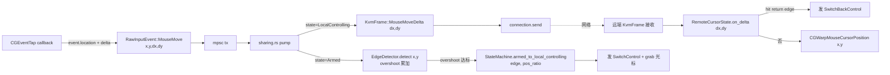
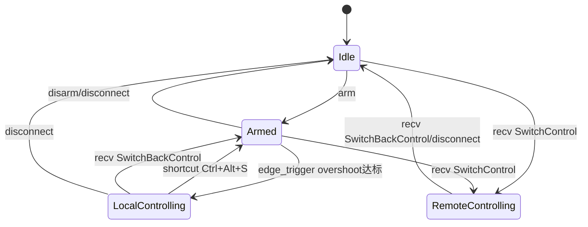

## 用户需求

v0.1.40 版本对 KVMini 进行**鼠标控制竞品级重构 + Armed 4 状态机改造 + BUG-032 修复**三合一，参考 Synergy/Barrier/ShareMouse 的成熟设计，彻底解决"本机鼠标屏蔽后远端不动"的致命 bug。

## 产品概述

当前实现的致命缺陷：进入 LocalControlling 后，本机鼠标被吞掉（CGEventTap return None）+ 光标关联断开（CGAssociateMouseAndMouseCursorPosition(0)），但发给远端的鼠标帧仍用 `event.location()` 拿绝对坐标——而关联断开后该 API 永远返回冻结的同一个点，导致**远端鼠标完全不动**。

本次重构按竞品标准全面改造：鼠标采集改为读取 `kCGMouseEventDeltaX/DeltaY` 硬件 delta；协议直接替换为 `MouseMoveDelta { dx, dy }`（不留绝对坐标兜底，TCP 可靠传输 + 硬件读数无累积误差）；远端新增 `RemoteCursorState` 维护虚拟光标位置 + 反向边缘检测；同时引入 Armed 中间态、过冲量防误触、Y 镜像 pos_ratio、Ctrl+Alt+S 双通道回切；并修复 BUG-032。

## 核心功能

### 1. 鼠标控制 delta 模式重构（核心）

- **采集端**：CGEventTap 回调用 `event.get_integer_value_field(EventField::MOUSE_EVENT_DELTA_X/Y)` 读硬件位移
- **协议**：删除 `KvmFrame::MouseMove { x, y }`，新增 `MouseMoveDelta { dx: i16, dy: i16 }` + `SwitchBackControl`；双端必须同时升级到 v0.1.40
- **本机发送**：LocalControlling 状态发 `MouseMoveDelta(dx, dy)`；Armed 状态用绝对 (x,y) 喂 EdgeDetector 不发帧
- **远端接收**：新增 `RemoteCursorState { x, y, screen_w, screen_h, return_edge }`，每帧 `x += dx; y += dy`，撞反向边缘发 SwitchBackControl，否则 clamp + `CGWarpMouseCursorPosition`
- **Win 平台对齐**：RawInput 已天然提供 `lLastX/lLastY` 相对位移，字段命名对齐即可

### 2. 4 状态机 + Armed 中间态

- 状态：Idle / **Armed（已激活·待边缘切换）** / LocalControlling / RemoteControlling
- 「开始共享」语义：Idle → Armed（仅激活 EdgeDetector，不吞键鼠不隐藏光标不发帧）
- 撞边触发 Armed → LocalControlling，触发瞬间 grab 光标 + 隐藏 + 切换发送模式

### 3. 过冲量防误触 + Y 镜像

- `EdgeConfig.overshoot_px`（默认 20，0~200 可配，0 = 立即触发）
- 触发瞬间计算真实 `pos_ratio`（替代写死的 5000），远端按比例落点

### 4. 双通道回切

- 通道 A：快捷键 `Ctrl+Alt+S` → LocalControlling → Armed
- 通道 B：远端 `RemoteCursorState` 撞反向边缘 → 发 SwitchBackControl → 本机 LocalControlling → Armed

### 5. BUG-032 按钮显示修复

- 现象：连接成功后第一次按钮显示"断开"，后续 reconnecting 事件触发后变成"重连"
- 修复：`updateConnectionButtons` 改为只读 `appState.connected` 单真源
- 写入 `docs/bug-list.md` 并加回归测试

### 6. 多语言与跨平台

- 新增文案 zh/en 双语；Win + Mac M + Mac Intel 行为一致
- 状态-行为对照表（最终）：

| 状态 | EventTap | 本机光标 | 网络发送 | 接收处理 | 边缘检测 |
| --- | --- | --- | --- | --- | --- |
| Idle | 透传 | 正常 | 不发 | SwitchControl→Remote | 关 |
| Armed | 透传 | 正常 | 不发 | SwitchControl→Remote | 本机(x,y+overshoot) |
| LocalControlling | 吞 | grab+隐藏 | MouseMoveDelta | SwitchBack→Armed | 不检测 |
| RemoteControlling | 吞 | 正常 | 不发 | MouseMoveDelta→virtual cursor warp | 远端虚拟光标反向边缘 |


### 7. 版本与归档

- 0.1.39 → 0.1.40，同步 Cargo.toml / package.json / index.html meta / changelog
- 归档 `docs/archive/YYYYMMDD/` 产品设计 + 开发总结 + 架构图
- bug-list.md 新增 BUG-032

## 技术栈

- 后端：Rust workspace（kvm-core 纯逻辑 + src-tauri 平台接入）
- 平台 API：macOS Core Graphics（CGEventTap / CGEvent EventField / CGWarpMouseCursorPosition / CGAssociateMouseAndMouseCursorPosition）；Windows RawInput（RIM_TYPEMOUSE.lLastX/lLastY）
- 协议：bincode + 自定义 KvmFrame 枚举（本次破坏性升级，双端同时 v0.1.40）
- 前端：原生 JS + i18n.js
- 测试：Rust `#[cfg(test)]` + Jest

## 实现思路

### 核心策略

按"采集→协议→分发→远端落点→边缘回切"全链路重构鼠标路径。**纯 delta 模式，无绝对坐标兜底**——理由：CGEvent delta 是硬件层独立读数无累积误差；TCP 可靠传输不丢包；远端 virtual_cursor 是单一 owner 无跨进程同步问题；竞品（Synergy/Barrier/ShareMouse/Logitech Flow）全部如此。

### 关键技术决策

1. **协议破坏性升级而非新旧字段并存**

- 删除 `MouseMove { x, y }`，新增 `MouseMoveDelta { dx: i16, dy: i16 }`
- 旧客户端连入会反序列化失败 → 在握手层加最小版本校验，拒绝 < v0.1.40 的连接，给清晰错误提示
- 这比"留个永远不会走的 fallback 分支"更干净（奥卡姆剃刀）

2. **RawInputEvent::MouseMove 字段扩展为 `{ x, y, dx, dy }`**

- x/y 用于 Armed 状态边缘检测和 overshoot 累积
- dx/dy 用于 LocalControlling 状态网络发送
- 单一事件结构同时满足两个状态的需求，避免重复采集

3. **远端 RemoteCursorState 单独成模块**

- 职责：维护虚拟光标位置、累加 delta、clamp 屏幕、检测反向边缘、CGWarp 落点
- 入态时由 SwitchControl(edge, pos_ratio) 计算初始 (x,y)
- 复用现有 `kvm-core/src/cursor_mapping.rs::CursorMapper::map_entry_position`

4. **过冲量与 Y 镜像在 EdgeDetector 内一并处理**

- `EdgeConfig.overshoot_px` 累加器 O(1)
- 触发时返回 `EdgeTrigger { edge, pos_ratio }`，pos_ratio 由触发瞬间坐标实时计算

5. **BUG-032 单真源原则**

- `updateConnectionButtons` 内部读 `appState.connected`，忽略外部传参
- 防御所有事件分支（reconnecting / heartbeat / error）的状态污染

### 性能与可靠性

- 鼠标热路径：CGEvent 回调 → mpsc 发送 → pump 分流，无锁串行处理；delta 累加 O(1)
- 远端 warp 频率：CGEvent 频率约 100-250Hz，与移动事件同频，无额外 polling
- 网络帧大小：MouseMoveDelta 比 MouseMove 小（i16 vs i32），LAN RTT < 5ms
- 边界处理：clamp 0..screen_w/h，防止 i32 溢出
- 锁粒度：StateMachine Mutex 仅状态转换时持有；RemoteCursorState 独立 Mutex 不与状态机耦合

### 避免技术债

- 复用 cursor_mapping.rs / edge_logic.rs / state.rs 已有抽象
- 新增 `kvm-core/src/remote_cursor.rs`（纯逻辑）+ src-tauri 集成层薄封装
- 不引入第三方依赖

## 执行细节

### 性能与日志

- 状态迁移点打 `log::info!`：`[StateMachine] Idle->Armed`、`[Sharing] LocalControlling->Armed via shortcut`
- 鼠标 delta 高频事件**禁止逐帧打日志**，仅每 1000 帧采样一次 debug 日志
- RemoteCursorState 入态/出态打 info；中间 warp 不打

### 爆炸半径控制

- 协议升级集中在 protocol.rs，RemoteCursorState 是新增不影响旧路径
- 平台层只改 `cg_event_to_raw` 一个函数 + `RawInputEvent::MouseMove` 字段
- BUG-032 修复独立于鼠标重构，可单独回归
- Win 路径与 Mac 路径文件隔离（platform/windows/ vs platform/macos/），不互相影响

### TDD 优先

- 所有 kvm-core 改动先写 Rust 单元测试再实现
- 远端虚拟光标的 delta 累加、clamp、反向边缘检测必须 100% 测试覆盖
- 协议序列化新增 bincode roundtrip 测试

## 架构设计

### 鼠标数据流（重构后）



### 状态机迁移图



## 目录结构

```
KVMini/
├── Cargo.toml                                    # [MODIFY] workspace.version 0.1.39→0.1.40
├── package.json                                  # [MODIFY] version 同步
├── src/
│   ├── index.html                                # [MODIFY] meta[app-version]、Armed 状态样式钩子
│   ├── i18n.js                                   # [MODIFY] zh/en 新增 6 项：controlStatusArmed/btnStartSharing/btnStopSharing/btnArmedWaiting/msgEdgeArmed/msgEdgeOvershootHint
│   └── main.js                                   # [MODIFY]
│                                                 #   1) updateConnectionButtons 改为读 appState.connected 单真源（BUG-032）
│                                                 #   2) reconnecting 事件分支不再强制 false
│                                                 #   3) handleToggleSharing 按 4 态切按钮文案
│                                                 #   4) updateControlStatus 支持 armed 分支
├── kvm-core/src/
│   ├── state.rs                                  # [VERIFY/EXTEND] 已有 Armed 4 态，确认 arm/disarm/armed_to_local_controlling/local_to_armed 完备；补 disconnect 任意态归零测试
│   ├── edge_logic.rs                             # [MODIFY] EdgeConfig 新增 overshoot_px；EdgeDetector 新增 overshoot_accumulator；detect 累加+触发瞬间计算 pos_ratio
│   ├── protocol.rs                               # [MODIFY] 删除 MouseMove{x,y}；新增 MouseMoveDelta{dx:i16,dy:i16} + SwitchBackControl；新增握手最小版本字段
│   ├── remote_cursor.rs                          # [NEW] RemoteCursorState 结构：on_enter(edge,pos_ratio,screen_w/h)→初始化；on_delta(dx,dy)→累加+clamp+反向边缘检测，返回 Option<KvmFrame::SwitchBackControl>
│   ├── config.rs                                 # [MODIFY] AppConfig.edge_overshoot_px: i32 默认 20
│   └── cursor_mapping.rs                         # [VERIFY] 复用 map_entry_position，补 Y 镜像测试
├── src-tauri/src/
│   ├── platform/macos/input_capture.rs           # [MODIFY] 核心：cg_event_to_raw 用 EventField::MOUSE_EVENT_DELTA_X/Y 读硬件 delta，RawInputEvent::MouseMove 扩展为 {x,y,dx,dy}
│   ├── platform/macos/cursor.rs                  # [VERIFY] grab/release 逻辑保留；warp_cursor 用于远端虚拟光标
│   ├── platform/windows/input_capture.rs         # [MODIFY] RawInput 路径对齐字段：lLastX/lLastY 直接作为 dx/dy；x/y 用 GetCursorPos（Armed 边缘检测用）
│   ├── platform/windows/cursor.rs                # [VERIFY] grab/release 与 mac 行为对称（ClipCursor/SetCursorPos）
│   ├── platform/mod.rs 或 RawInputEvent 定义处   # [MODIFY] RawInputEvent::MouseMove 字段扩展
│   ├── sharing.rs                                # [MODIFY] 核心：
│   │                                             #   1) toggle_sharing 走 arm/disarm
│   │                                             #   2) start_capture_and_pump 中 pump 按状态分流：Armed→edge_detector.detect(x,y)；LocalControlling→connection.send(MouseMoveDelta{dx,dy})
│   │                                             #   3) 新增 RemoteCursorManager（包装 RemoteCursorState + warp 调用）
│   │                                             #   4) handle_switch_control / handle_switch_back_control 帧分发
│   │                                             #   5) overshoot 触发回调串联 armed_to_local_controlling
│   ├── main.rs                                   # [MODIFY] Ctrl+Alt+S 在 LocalControlling 调 local_to_armed；get_changelog 新增 v0.1.40；emit control_state_changed 加 armed 字段
│   └── connection/                               # [MODIFY] KvmFrame 反序列化分发新增 MouseMoveDelta / SwitchBackControl 路由；握手版本校验
├── __tests__/
│   ├── sharing-armed.test.js                     # [NEW] 4 态按钮文案/UI 分支
│   ├── bug-032-reconnect-button.test.js          # [NEW] connected=true 任意事件按钮必显"断开"
│   └── i18n.test.js                              # [MODIFY] requiredKeys 新增 6 项
├── kvm-core/src/state.rs (tests)                 # [MODIFY] test_arm_disarm/test_armed_to_local/test_local_to_armed/test_disconnect_from_any
├── kvm-core/src/edge_logic.rs (tests)            # [MODIFY] test_overshoot_accumulator/test_overshoot_reset_on_reverse/test_overshoot_zero_immediate/test_pos_ratio_calc
├── kvm-core/src/protocol.rs (tests)              # [MODIFY] test_mouse_move_delta_bincode_roundtrip / test_switch_back_control_roundtrip / test_old_mouse_move_removed
├── kvm-core/src/remote_cursor.rs (tests)         # [NEW] test_on_enter_initial_position / test_on_delta_accumulate / test_on_delta_hit_return_edge / test_on_delta_clamp_screen
└── docs/
    ├── bug-list.md                               # [MODIFY] 新增 BUG-032 + BUG-033（远端鼠标不动根因）
    ├── product-design-v0.1.40.md                 # [NEW] 产品设计文档：4 状态机 + delta 模式 + RemoteCursorState
    ├── dev-summary-v0.1.40.md                    # [NEW] 开发总结
    └── archive/YYYYMMDD/                         # [NEW] 归档
```

## 关键接口定义

```rust
// kvm-core/src/protocol.rs
pub enum KvmFrame {
    // ... 其他变体保留
    SwitchControl { edge: ScreenEdge, pos_ratio: u16 },
    SwitchControlAck,
    MouseMoveDelta { dx: i16, dy: i16 },   // 新增（替代旧 MouseMove）
    SwitchBackControl,                      // 新增
    // 其他鼠标事件（按键/滚轮）保留
}

// kvm-core/src/remote_cursor.rs
pub struct RemoteCursorState {
    pub x: i32, pub y: i32,
    pub screen_w: i32, pub screen_h: i32,
    pub return_edge: ScreenEdge,
}

impl RemoteCursorState {
    pub fn on_enter(edge: ScreenEdge, pos_ratio: u16, screen_w: i32, screen_h: i32) -> Self;
    pub fn on_delta(&mut self, dx: i16, dy: i16) -> RemoteCursorAction;
}

pub enum RemoteCursorAction {
    Warp { x: i32, y: i32 },
    SwitchBack,
}

// src-tauri 平台层（mac/win 共用）
pub enum RawInputEvent {
    MouseMove { x: i32, y: i32, dx: i16, dy: i16 },  // 字段扩展
    // ... 其他事件
}
```

## Agent Extensions

### Skill

- **systematic-debugging**
- Purpose: 已用于定位"远端鼠标不动"根因（CGAssociateMouse + event.location 冲突）和 BUG-032 reconnecting 事件污染；后续若实现中遇到新现象继续用此流程
- Expected outcome: 每个 bug 都有"现象→假设→证据→根因→修法"完整闭环，写入 bug-list.md

- **test-driven-development**
- Purpose: 协议升级、RemoteCursorState、EdgeDetector overshoot、状态机扩展全部先写测试再实现
- Expected outcome: kvm-core 新代码测试覆盖 ≥ 95%，每条测试对应一个具体行为点

- **brainstorming**
- Purpose: 4 状态机边界（断连归零优先级、双通道回切冲突）、远端虚拟光标越界（clamp vs 穿越）的设计决策
- Expected outcome: 产品设计文档 v0.1.40 含完整状态转换矩阵和边界处理表

- **verification-before-completion**
- Purpose: 每个 todo 完成前运行 `cargo test -p kvm-core` + `cargo build` + `npm test`，禁止仅靠"看起来对"声明完成
- Expected outcome: 每步有测试通过/构建成功证据

- **requesting-code-review**
- Purpose: 提交前另一 agent review 重构与性能（项目铁律）
- Expected outcome: review 反馈处理后再构建打包

### SubAgent

- **code-explorer**
- Purpose: 深入探索 `src-tauri/src/connection/` 帧路由、`platform/windows/input_capture.rs` Win RawInput 现状、`sharing.rs` start_capture_and_pump 完整调用链；确认 Win 平台是否已用相对位移
- Expected outcome: 给出每个改动点的精确行号和现有 API 签名，避免遗漏 Win/Mac 差异