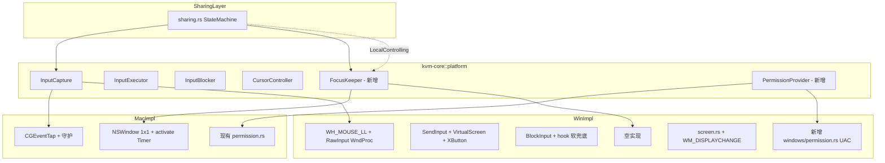

## 用户需求

v0.1.41 解决三个相关问题，使 KVMini 达到与 Synergy/Barrier/Logitech Flow 等商业 KVM 软件对等的体验。

## 核心特性

### 1. Win 端完整对标 Mac 版（P0+P1+P2 全做）

**P0 功能正确性修复**：

- 修复 ClipCursor + WH_MOUSE_LL 组合下 dx/dy 恒为 0 的关键 bug：引入 RawInput（`RegisterRawInputDevices` + 隐藏窗口 `WM_INPUT`）从 `RAWMOUSE.lLastX/lLastY` 取硬件 delta，LL hook 仅用于绝对坐标和事件吞噬。
- 修复多屏 SendInput：`SM_CXVIRTUALSCREEN`/`SM_CYVIRTUALSCREEN` + `MOUSEEVENTF_VIRTUALDESK`。
- start_capture 失败同步上报（mpsc 通道）。

**P1 健壮性**：

- LL hook 5s 健康检查 + 自动 re-hook（应对 LowLevelHooksTimeout 静默移除）。
- InputBlocker 软屏蔽兜底：去掉对 BlockInput 提权的强依赖，让 hook 层 swallow 独立生效。
- XButton（Side1/Side2）注入补全。
- 滚轮 mouseData 用 `i32 as u32` 正确表达负向滚动。

**P2 Mac 对等**：

- 新建 `windows/permission.rs`：检测 UAC/Admin elevation，前端展示与 Mac 同款的权限横幅（提示需管理员权限）。
- `WM_DISPLAYCHANGE` 监听触发 screen.change_callback。

### 2. Mac 端"失焦后键鼠屏蔽失效"修复（业界主流方案）

- 创建一个 1×1 透明窗口（`level=.statusBar`、`alphaValue=0.01`、`ignoresMouseEvents=true`），命名为 FocusKeeper。
- 进入 `LocalControlling` 状态时显示并启动 200ms 定时器持续 `NSApp.activate(ignoringOtherApps:true)` + `makeKeyAndOrderFront`，让 macOS 始终认为 KVMini 处于前台 → CGAssociateMouseAndMouseCursorPosition 不会被系统重置 → CGEventTap 持续吞事件。
- 退出 `LocalControlling` 时立即关窗 + 停定时器，把焦点完全还给系统。
- 选 A 不选 A+B：A 已隐式覆盖 B（A 让失焦永不发生，B 监听的失焦通知根本不会触发；同时启用 A+B 会形成"用户切走立即被抢回"的死循环）。

### 3. 手势处理（业界标准）

- LocalControlling 时吞掉本机所有高级手势避免触发 Mission Control / Launchpad / Pinch 缩放，但**不转发到远端**（跨平台语义不一致）。
- 扩展 CGEventTap event mask 加入：`kCGEventGesture(29)`、所有 `MouseDragged`（Left/Right/Other）、`NSEventTypeMagnify`、`NSEventTypeRotate`、`NSEventTypeSwipe`、`NSEventTypeBeginGesture/EndGesture`。
- ScrollWheel 维持现状（采集 + 转发 + 吞噬）。

### 4. 兼容/构建

- 全程双语（中英 i18n key 同步补全）。
- Mac 包本地构建给用户验证；Win 端代码 commit + push，用户拉到 Win 机器跑 `BuildForWin.bat` 出包。
- 版本号 0.1.40 → 0.1.41，同步 Cargo.toml + package.json + index.html meta + changelog。

## 技术栈

- 后端：Rust（workspace），现有依赖 `winapi 0.3`、`core-graphics`、`objc2`、`tauri 2.10.3`
- 前端：原生 JS + i18n.js（无框架）
- 测试：Jest（前端）+ `cargo test`（Rust）

## 实施策略

### A. Win 端 RawInput 改造（P0 关键修复）

**根因**：ClipCursor 钳住光标后 LL Hook 上报的 `MSLLHOOKSTRUCT.pt.x/y` 不再变化，帧差恒为 0。
**方案**：双源采集架构

- **绝对坐标流**（边缘检测、控制状态判定）：保留 `WH_MOUSE_LL`，用 `pt.x/y` 作为屏幕绝对坐标。
- **硬件 delta 流**（远端 MouseMoveDelta）：新增 RawInput
- 在采集线程中创建一个隐藏 message-only 窗口（`HWND_MESSAGE`）
- `RegisterRawInputDevices` 注册 `RIDEV_INPUTSINK`（usagePage=1, usage=2，鼠标）
- WndProc 处理 `WM_INPUT` → `GetRawInputData` → `RAWMOUSE.lLastX/lLastY` 即硬件 delta
- 处理相对/绝对模式切换：检查 `usFlags & MOUSE_MOVE_ABSOLUTE`，若是绝对则记录上一帧自行算差
- **事件合并**：在 hook 线程内维护 `last_raw_delta: AtomicI32` 双字段，LL hook 触发 MouseMove 事件时读取并清零，组装 `RawInputEvent::MouseMove { x, y, dx, dy }` 上抛。

复杂度：单消息循环线程兼跑 PeekMessage（hook）+ DispatchMessage（RawInput），与 mac CGEventTap 模型对称。

### B. Win 端 PermissionProvider（新模块）

- `OpenProcessToken(GetCurrentProcess(), TOKEN_QUERY, ...)` + `GetTokenInformation(TokenElevation)`
- 暴露 `is_elevated() -> bool`、`request_elevation()`（启动新进程带 `runas` verb 触发 UAC 弹窗后退出当前进程）
- 前端在加载时调用 `check_admin_permission` 命令，未提权时展示横幅。

### C. Mac FocusKeeper（业界主流方案）

- 新建 `src-tauri/src/platform/macos/focus_keeper.rs`
- 用 `objc2-app-kit` 创建 NSWindow（1×1，alpha 0.01，statusBar level，accepts mouse events=false）
- `start()`：window.makeKeyAndOrderFront + NSApp.activate + 启动 `CFRunLoopTimer` 200ms 间隔重复 activate
- `stop()`：timer invalidate + window.orderOut
- `sharing.rs` 在状态机进入 `LocalControlling` 时调 start，离开时调 stop
- 抽象到 `kvm-core::platform` 新增 `FocusKeeper` trait，Win 端给空实现（Win 不存在此问题）

### D. Mac 手势屏蔽

- `input_capture.rs` 的 event mask 表加入 `kCGEventOtherMouseDragged | kCGEventLeftMouseDragged | kCGEventRightMouseDragged | (1 << 29)`（kCGEventGesture）
- LocalControlling 时回调返回 None，否则透传

## 实现注意事项

### 性能

- RawInput WndProc 在 hook 线程同步处理，避免跨线程通知开销；用 `AtomicI32` 累加 delta，hook 回调读取并清零，无锁。
- FocusKeeper 200ms 定时器只在 LocalControlling 时存在，非热路径无开销。
- LL hook 5s 健康检查使用单独 `tokio::time::interval`，避免阻塞采集线程。

### 日志

- 复用现有 `log` crate；Win 端新增日志统一加 `target: "kvm::win::input"` / `kvm::win::raw_input` 前缀。
- 关键 transition（hook 创建/失败/重启、RawInput 注册、UAC 检测）打 info!；高频路径（每帧 delta）打 trace!。
- 不打印 keycode 字符明文，只打 keycode 数值，防泄密。

### 爆炸半径

- FocusKeeper 抽象为新 trait，Win 端空实现，不影响现有 win 流程。
- RawInput 改造保留旧帧差路径作为 fallback：若 `RegisterRawInputDevices` 失败 log warn 并退回旧逻辑，保证最差情况下不退化于 v0.1.40。
- 新 i18n key 仅追加不删改，前端兼容旧版本。

## 架构



## 目录结构

```
KVMini/
├── Cargo.toml                                          # [MODIFY] version 0.1.40 → 0.1.41
├── package.json                                        # [MODIFY] version 同步
├── src/
│   ├── index.html                                      # [MODIFY] meta[name="app-version"] 同步 + 可能新增权限横幅 DOM
│   ├── i18n.js                                         # [MODIFY] 新增 win_admin_required / focus_keeper_status 等 key（zh/en）
│   └── main.js                                         # [MODIFY] 调用 check_admin_permission（Win 平台）展示横幅
├── kvm-core/src/
│   └── platform.rs                                     # [MODIFY] 新增 FocusKeeper trait + PermissionProvider trait + PlatformAdapter 聚合
├── src-tauri/
│   ├── Cargo.toml                                      # [MODIFY] winapi feature 增加 raw_input/processthreadsapi/securitybaseapi
│   └── src/
│       ├── main.rs                                     # [MODIFY] get_changelog() 顶部新增 v0.1.41 条目；新增 check_admin_permission / request_elevation 命令；注册前端命令
│       ├── sharing.rs                                  # [MODIFY] 状态机进入 LocalControlling 时 focus_keeper.start()，退出时 stop()；新增 PlatformFocusKeeper 类型别名
│       └── platform/
│           ├── mod.rs                                  # [MODIFY] 暴露 focus_keeper / permission 平台特定模块
│           ├── macos.rs                                # [MODIFY] PlatformAdapter 聚合 FocusKeeper
│           ├── windows.rs                              # [MODIFY] PlatformAdapter 聚合 FocusKeeper（空实现）+ PermissionProvider
│           ├── macos/
│           │   ├── input_capture.rs                    # [MODIFY] event mask 新增 kCGEventGesture(29) + MouseDragged 三种 + Pinch/Rotate/Swipe；LocalControlling 时全部 swallow
│           │   ├── focus_keeper.rs                     # [NEW] NSWindow 1x1 + 200ms NSApp.activate 定时器
│           │   └── cursor.rs                           # [MODIFY] grab() 增加 NSApp.activate(ignoringOtherApps:true) 兜底
│           └── windows/
│               ├── input_capture.rs                    # [MODIFY] 新增 RawInput WndProc + 双源 delta 合并 + start_capture mpsc 同步上报 + 5s health check 守护
│               ├── input_inject.rs                     # [MODIFY] SM_CXVIRTUALSCREEN + MOUSEEVENTF_VIRTUALDESK + XButton + 滚轮 i32 cast
│               ├── input_block.rs                      # [MODIFY] 移除对 BlockInput 提权的强依赖，hook 软兜底
│               ├── cursor.rs                           # [MODIFY] grab 时记录之前的 ClipCursor 区域便于 release 还原
│               ├── screen.rs                           # [MODIFY] 创建 message-only 窗口监听 WM_DISPLAYCHANGE 触发 callback
│               ├── focus_keeper.rs                     # [NEW] 空实现（Win 不需要 focus 保护）
│               └── permission.rs                       # [NEW] is_elevated / request_elevation（UAC 启动新进程后退出）
└── __tests__/
    ├── win-input-capture.test.ts                       # [NEW] mock 测试 RawInput delta 合并、hook 失败上报路径（注：纯 Rust 单元测试在 .rs 内 #[cfg(test)]）
    ├── focus-keeper.test.ts                            # [NEW] mock 测试 LocalControlling 进入/退出时 start/stop 调用次数
    ├── i18n.test.js                                    # [MODIFY] requiredKeys 数组增加 win_admin_required 等新 key
    └── version.test.js                                 # [MODIFY] 校验 0.1.41 版本号一致性
```

## 关键代码结构

```rust
// kvm-core/src/platform.rs 新增 trait
pub trait FocusKeeper: Send + Sync {
    fn start(&self) -> Result<(), KvmError>;
    fn stop(&self) -> Result<(), KvmError>;
    fn is_active(&self) -> bool;
}

pub trait PermissionProvider: Send + Sync {
    fn is_elevated(&self) -> bool;
    fn request_elevation(&self) -> Result<(), KvmError>;
    fn permission_status(&self) -> PermissionStatus;
}

#[derive(Debug, Clone, Serialize)]
pub struct PermissionStatus {
    pub elevated: bool,
    pub accessibility: bool,        // mac only
    pub input_monitoring: bool,     // mac only
    pub admin_required: bool,       // win only
}
```

## Agent Extensions

### Skill

- **test-driven-development**
- Purpose: 在每个修改点实施前先写 Rust 单元测试 + Jest 测试
- Expected outcome: RawInput delta 合并、FocusKeeper 启停、Win permission 检测、event mask 扩展全部有测试覆盖
- **systematic-debugging**
- Purpose: 验证 ClipCursor + RawInput 双源合并是否真正修复 dx/dy=0 问题，验证 FocusKeeper 是否真的让 CGEventTap 持续吞事件
- Expected outcome: 通过日志/断点/手动测试三层证据确认修复有效
- **macos-cgevent-tap-hotkey**
- Purpose: 处理 CGEventTap 在 LocalControlling 时被系统 disable 的边界情况，配合 FocusKeeper 验证 RunLoop/TCC 兼容
- Expected outcome: 即便 macOS 临时 disable tap，5s 守护线程能正确 re-enable
- **verification-before-completion**
- Purpose: 构建产物前必须跑完整测试 + 手动验证四个场景（远端可控、失焦不失屏蔽、手势不触发本机、Win RawInput delta>0）
- Expected outcome: 所有声明的修复点均经过实测确认
- **requesting-code-review**
- Purpose: 提交前请另一 agent 做代码审查（重构 + 性能）
- Expected outcome: 收到结构化 review 报告并采纳必要修改

### SubAgent

- **code-explorer**
- Purpose: 在实施过程中按需探索具体代码细节（如 InputCapture trait 的所有调用点、sharing.rs 中状态切换的精确位置）
- Expected outcome: 减少重复全文 grep 的成本，精确定位插入/修改点