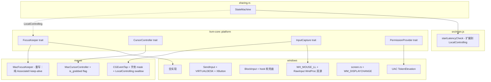

## 用户需求

v0.1.41 实测后发现 Mac 端控制响应严重异常（点击多次响应一次、误触发拖拽、键盘失效、本机闪烁、缺延迟显示），同时 Win 端仍存在 v0.1.41 plan 中已规划但未充分验证的 P0/P1/P2 问题。v0.1.42 综合修复，使 KVMini 达到与 Synergy/Barrier 对等的 KVM 体验。

## 核心特性

### 1. Mac 端控制响应彻底修复（核心）

- **重写 FocusKeeper 实现**：删除"NSWindow 1×1 + activateIgnoringOtherApps"抢前台焦点逻辑，改为纯 `CGAssociateMouseAndMouseCursorPosition(0)` keep-alive 定时器（200ms 周期）。文件路径与 trait 接口（start/stop/is_active）保持不变，sharing.rs 的调用方式无需修改，做到爆炸半径最小。
- **修复 warp_cursor 破坏 grab 的隐藏 bug**：`set_position` 调用链中无条件 `CGAssociateMouseAndMouseCursorPosition(1)` 会立即解除 grab；改为感知 grab 状态（共享 AtomicBool），grab 中只 warp 不 associate。
- **手势屏蔽**：CGEventTap event mask 加入 `kCGEventGesture(29)` + `LeftMouseDragged` + `RightMouseDragged` + `OtherMouseDragged` + Pinch/Rotate/Swipe，LocalControlling 时全部 swallow（不转发到远端）。

### 2. 前端延迟显示

- LocalControlling 状态下也启动 `startLatencyCheck` 定时探测，UI 实时显示连接 RTT（已有 `get_latency` 命令和 `last_latency` 维护，仅前端调度缺失）。

### 3. Win 端完整对标 Mac（保留 v0.1.41 plan 全部内容）

- **P0**：RawInput 双源采集修 dx/dy=0；多屏 SM_CXVIRTUALSCREEN + MOUSEEVENTF_VIRTUALDESK；start_capture 失败 mpsc 同步上报。
- **P1**：LL hook 5s 健康检查 + auto re-hook；InputBlocker 软屏蔽兜底；XButton（Side1/Side2）注入；滚轮 mouseData `i32 as u32`。
- **P2**：UAC TokenElevation 检测 + 权限横幅；WM_DISPLAYCHANGE 监听。

### 4. 兼容/构建/版本

- 全程 zh/en 双语 i18n key 同步。
- 版本号 0.1.41 → **0.1.42**：Cargo.toml + package.json + index.html meta + main.rs `get_changelog()` 顶部新增条目。
- Mac 本地构建 DMG 给用户验证；Win 端代码 push 后用户在 Win 机器跑 `BuildForWin.bat` 出包。

## 技术栈

- 后端：Rust workspace（kvm-core + src-tauri），现有依赖 `winapi 0.3`、`core-graphics`、`objc 0.2` / `objc2 0.6.4`、`tauri 2.10.3`
- 前端：原生 JS + i18n.js + index.html
- 测试：Jest（前端） + `cargo test`（Rust）

## 实施策略

### A. Mac FocusKeeper 重写（核心修复）

**根因复述**：v0.1.41 实现每 200ms 调 `activateIgnoringOtherApps:YES + makeKeyAndOrderFront`，把 KVMini 抢成 key app，导致：

1. Cocoa first responder 链开始吃键盘事件 → 远端键盘失效
2. mouseDown 被 CGEventTap swallow，但 activate 间隙 mouseUp 落到 KVMini 主窗口 → 远端"按住没松"=拖拽
3. 点击落到 KVMini 主窗口 → 本机闪烁
4. 事件路由在"前台 app"和"HID tap"之间反复切换 → 点击丢失

**正确做法（业界主流，Synergy/Barrier/Logitech Flow 实测路径）**：

- CGEventTap 用 `kCGHIDEventTap` 在 HID 层吞噬，**不依赖 key window 状态**，本来就持续有效
- 唯一需要"维持"的是 `CGAssociateMouseAndMouseCursorPosition(0)` —— 系统在某些时机（其它 app 调相关 API、显示模式变化）会重置它
- 解法：200ms 定时器周期重新调一次 `Associate(0)`，**不创建任何窗口、不调 activate**

**新实现要点**：

- `MacFocusKeeper::start()`：原子标记 active=true，spawn 后台线程循环 `sleep 200ms` + `unsafe { CGAssociateMouseAndMouseCursorPosition(0) }` 直到 stop_signal=true
- `MacFocusKeeper::stop()`：stop_signal=true，线程退出前不再 reassociate（grab 由 cursor.release() 自己负责 Associate(1)）
- 接口签名（`start/stop/is_active`）不变，sharing.rs 调用方式零改动
- 删除所有 NSWindow / dispatch_async_f / FocusKeeperStartCtx / FocusKeeperActivateCtx / FocusKeeperCloseCtx 相关代码

### B. cursor.rs warp_cursor 修复

**问题**：`warp_cursor` 第 91 行 `CGAssociateMouseAndMouseCursorPosition(1)` 会解除 grab。当远端 `MouseMoveAbsolute` 或 SwitchBack 路径触发 `cursor.set_position()` 时，grab 会被悄悄破坏。

**修复**：

- 在 `MacCursorController` 中加 `is_grabbed: Arc<AtomicBool>`
- `grab()` 时设 true，`release()` 时设 false
- `warp_cursor` 改为成员方法或读取该 flag：grab 中只调 `CGWarpMouseCursorPosition`，跳过 `Associate(1)`；非 grab 状态保持现有行为

### C. Mac 手势屏蔽

- `input_capture.rs` event mask 表（`CGEventMask`）增加位：
- `1u64 << 6`（kCGEventLeftMouseDragged）
- `1u64 << 7`（kCGEventRightMouseDragged）
- `1u64 << 27`（kCGEventOtherMouseDragged）
- `1u64 << 29`（kCGEventGesture）
- 高级手势（Pinch/Rotate/Swipe/BeginGesture/EndGesture）通过 `kCGEventGesture` 类型统一捕获
- LocalControlling 时回调返回 `None`（swallow，不转发到远端）；非控制态正常透传

### D. 前端延迟显示

- `src/main.js::startLatencyCheck` 当前仅在 `connected` 时启动；改为 `connected || localControlling` 时都启动
- 探测间隔保持现有值（不改高频路径）
- UI 文案走 i18n（已有 key 复用 `latency_label`，若不存在则 zh/en 同步补）

### E. Win 端（继承 v0.1.41 plan 全部条目）

保持 v0.1.41 plan 的 RawInput 双源、多屏 VIRTUALDESK、XButton、滚轮 i32 cast、5s health check、软屏蔽兜底、UAC TokenElevation、WM_DISPLAYCHANGE 设计完整不变。详见 v0.1.41 plan 实施策略 A/B 段。

## 实现注意事项

### 性能

- FocusKeeper 后台线程仅 1 个 syscall/200ms（`CGAssociateMouseAndMouseCursorPosition`），无 GUI 操作，CPU 占用可忽略
- `is_grabbed` 用 `AtomicBool` Acquire/Release，无锁
- 前端 latency 探测 1Hz 即可，不影响热路径
- Win 端 RawInput delta 用 `AtomicI32` 累加，hook 回调读取并清零，无锁

### 日志

- 复用现有 `log` crate
- FocusKeeper：start/stop 打 info!，每次 keep-alive tick 打 trace!（避免日志泛滥）
- warp_cursor 跳过 associate 的分支打 debug!（便于排查"远端可控但光标漂移"类问题）

### 爆炸半径

- FocusKeeper trait 签名零改动 → sharing.rs / kvm-core/platform.rs / windows/focus_keeper.rs（空实现）全部不动
- warp_cursor 修复仅影响 set_position 路径，grab/release 逻辑不变
- 手势屏蔽是 mask 位累加 + LocalControlling 分支 swallow，对非控制态透传无影响
- Win 端 RawInput 改造保留 LL hook 旧路径作为 fallback

## 架构



## 目录结构

```
KVMini/
├── Cargo.toml                                          # [MODIFY] version 0.1.41 → 0.1.42
├── package.json                                        # [MODIFY] version 同步
├── src/
│   ├── index.html                                      # [MODIFY] meta[name="app-version"] 同步 + Win 权限横幅 DOM
│   ├── i18n.js                                         # [MODIFY] 新增 win_admin_required / latency_label（如缺）等 key（zh/en 同步）
│   └── main.js                                         # [MODIFY] startLatencyCheck 扩展到 LocalControlling；Win 平台展示权限横幅
├── kvm-core/src/
│   └── platform.rs                                     # [MODIFY] 已有 FocusKeeper trait；新增 PermissionProvider trait + PermissionStatus
├── src-tauri/
│   ├── Cargo.toml                                      # [MODIFY] winapi feature 增加 raw_input/processthreadsapi/securitybaseapi
│   └── src/
│       ├── main.rs                                     # [MODIFY] get_changelog() 顶部新增 v0.1.42 条目（中英）；新增 check_admin_permission/request_elevation 命令
│       ├── sharing.rs                                  # [REVIEW-ONLY] FocusKeeper 接口不变，无需改动；仅核对 LocalControlling 进入/退出 start/stop 调用点正确
│       ├── connection.rs                               # [REVIEW-ONLY] get_latency/last_latency 已就位
│       └── platform/
│           ├── macos/
│           │   ├── focus_keeper.rs                     # [REWRITE] 删除 NSWindow + activate；改为后台线程 200ms CGAssociateMouseAndMouseCursorPosition(0) keep-alive，接口保持不变
│           │   ├── cursor.rs                           # [MODIFY] 新增 is_grabbed: Arc<AtomicBool>；warp_cursor 在 grab 中跳过 Associate(1)；grab/release 设置 flag
│           │   └── input_capture.rs                    # [MODIFY] event mask 新增 kCGEventGesture(1<<29) + LeftMouseDragged(1<<6) + RightMouseDragged(1<<7) + OtherMouseDragged(1<<27)；LocalControlling 时全部 swallow
│           └── windows/
│               ├── input_capture.rs                    # [MODIFY] RawInput 隐藏窗口 + WM_INPUT 取硬件 delta + 双源合并 + start_capture mpsc 同步上报 + 5s health check
│               ├── input_inject.rs                     # [MODIFY] SM_CXVIRTUALSCREEN + MOUSEEVENTF_VIRTUALDESK + XButton + 滚轮 i32 as u32
│               ├── input_block.rs                      # [MODIFY] 移除 BlockInput 提权强依赖，hook 软兜底
│               ├── screen.rs                           # [MODIFY] message-only 窗口监听 WM_DISPLAYCHANGE 触发 callback
│               ├── permission.rs                       # [NEW] OpenProcessToken + GetTokenInformation(TokenElevation)；request_elevation 用 ShellExecute runas
│               └── focus_keeper.rs                     # [REVIEW-ONLY] 空实现保持不变
└── __tests__/
    ├── focus-keeper.test.js                            # [MODIFY/NEW] 验证 LocalControlling 进入/退出 start/stop 调用次数（Rust 单测在 .rs 内 #[cfg(test)]）
    ├── cursor-grab.test.rs（在 cursor.rs #[cfg(test)] 内）# 验证 grab 中 set_position 不解除 Associate
    ├── i18n.test.js                                    # [MODIFY] requiredKeys 数组同步新增 key
    └── version.test.js                                 # [MODIFY] 校验 0.1.42
```

## 关键代码结构

```rust
// src-tauri/src/platform/macos/focus_keeper.rs 重写后的核心
impl FocusKeeper for MacFocusKeeper {
    fn start(&self) -> KvmResult<()>;  // spawn 后台线程，200ms 调一次 CGAssociateMouseAndMouseCursorPosition(0)
    fn stop(&self) -> KvmResult<()>;   // 设置 stop_signal，线程自然退出
    fn is_active(&self) -> bool;
}

// src-tauri/src/platform/macos/cursor.rs 新增字段
pub struct MacCursorController {
    is_grabbed: Arc<AtomicBool>,  // grab 中 warp 不再 reassociate
}
```

## Agent Extensions

### Skill

- **test-driven-development**
- Purpose: FocusKeeper 重写、cursor warp 修复、手势 mask 扩展、Win RawInput 全部先写测试再改实现
- Expected outcome: 关键修改点都有 Rust 单测 / Jest 测试覆盖，回归测试通过
- **systematic-debugging**
- Purpose: 验证 v0.1.41 症状（点击丢失/误拖拽/键盘失效/本机闪烁）在 v0.1.42 全部消失，且失焦后 grab 仍然有效
- Expected outcome: 通过日志 + 手动场景测试三层证据确认每个症状闭环
- **macos-cgevent-tap-hotkey**
- Purpose: 确认新版 FocusKeeper 不抢前台后，CGEventTap 在 kCGHIDEventTap 层仍能持续吞事件；处理 tap 偶发被 disable 的 re-enable 路径
- Expected outcome: 失焦/切 Space/锁屏返回等场景下 tap 持续有效，必要时 5s 守护重启
- **verification-before-completion**
- Purpose: 构建前跑全量测试 + 手动验证六场景（远端点击单击/拖拽/键盘/失焦不漏屏蔽/手势不触发本机/延迟显示）
- Expected outcome: 所有声明的修复点均经过实测确认才允许打包
- **requesting-code-review**
- Purpose: 提交前请另一 agent 做代码审查（重构 + 性能 + 是否回归 v0.1.41 抢焦点的副作用）
- Expected outcome: 收到结构化 review 报告并采纳必要修改

### SubAgent

- **code-explorer**
- Purpose: 实施过程中按需精确定位修改点（sharing.rs 状态切换调用栈、Win 端 hook 线程消息循环结构、i18n key 现存清单）
- Expected outcome: 减少全文 grep 成本，避免遗漏调用点