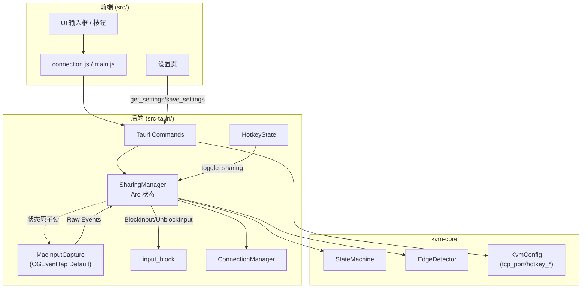

## 产品概述

修复 KVMini v0.1.37 三个核心可用性缺陷并升级到 v0.1.38：扫描到设备后无法连接、端口默认值混乱、"共享"后两台电脑同时响应（而非软 KVM 边界切换）。同时把"默认端口"做成用户设置驱动，不再有任何硬编码的端口数字。

## 核心功能

### 1. 连接命令名统一修复

- 前端所有 `invoke('connect_to_device', { deviceId })` 调用（connection.js、main.js 约 4 处）改为正确的 `invoke('connect_to_peer', { peerIp, port })`
- 自动发现设备列表点"连接"时，把设备 IP + 用户默认端口作为参数传入
- 重连路径（history / reconnectManualIp）同步修复，不再丢参数

### 2. 端口配置真源化

- 唯一真源：用户设置里的 `tcp_port`（继承自 `KvmConfig::default().tcp_port = 23456`）
- UI 初始化时从后端 `get_settings` 读取默认端口，填入"手动连接端口"和"监听端口"两个输入框
- 清除所有硬编码：`src/main.js` 6 处 `|| 8889` 与 `src/index.html` 两个 `value="8889"` 全部删除/替换
- 旧配置兼容：用户已保存的配置如果字段缺失或为 0，回退到 23456
- 用户修改"默认端口"并保存后，连接对话框与监听输入框的默认值立即反映新值

### 3. 真 KVM 边界切换行为

- 默认行为改为"软 KVM"：鼠标在本机屏幕内时本机独占输入；按布局方向（左/右/上/下）触达屏幕边缘时自动切到控制对端，对端鼠标触达反向边缘回切本机
- 本机处于"控制对端"状态时，本机的键鼠输入被完全吞掉（不再同时操控两台电脑），只转发给对端执行
- 被对端控制时（RemoteControlling），本机输入同样被屏蔽，防止本地干扰
- 两种触发方式并存（用户可在设置里开/关其一或都开）：
- 边缘触发（默认开启）：鼠标触达布局边缘自动切换
- 全局快捷键（默认 Ctrl+Alt+S，可配置）：手动切换控制目标
- IDLE（未按开始共享）时 100% 放行本地输入，绝不误吞

### 4. 可见版本号

- 版本号从 0.1.37 升到 0.1.38，所有"关于"页面、启动日志、changelog 同步展示

### 视觉效果

- 设置页新增"键鼠切换"分区：启用边缘触发（开关）、启用快捷键切换（开关+组合键捕获框，默认 Ctrl+Alt+S）
- 关于页/状态栏显示当前控制状态：`各自独立 / 正在控制对方 / 对方正在控制本机`（已有 control-state-changed 事件，补 UI 绑定即可）
- 连接对话框端口框不再固定显示 8889，而是动态回显用户设置的默认端口
- 所有新增/修改文案同步补齐 zh + en

## 技术栈

- 前端：原生 HTML/CSS/JavaScript + i18n 双语（复用 `src/i18n.js`）
- 后端：Rust + Tauri v2，`kvm-core` workspace crate 复用
- 平台差异：macOS CGEventTap（core-graphics）/ Windows Raw Input + Low-Level Hook
- 测试：Jest（前端 TS 测试）+ Rust `#[cfg(test)]`

## 实现策略

### 策略 1：命令名修复（最小侵入）

前端 4 处 `invoke('connect_to_device', { deviceId })` 的调用点（`src/connection.js:148`、`src/main.js:590/966/1867`）全部重写成 `invoke('connect_to_peer', { peerIp, port })`。由于 `discover_devices` 返回结构中已带 IP，改动只需把 `deviceId` 查回 IP，并附上用户默认端口。

### 策略 2：端口默认值下沉到配置

- 新增前端 `appState.defaults.tcpPort`（启动时 `get_settings` 填充，fallback 23456）
- 所有需要端口默认值的地方统一读 `appState.defaults.tcpPort`，不再出现字面量
- 保存设置时同步更新 `appState.defaults.tcpPort`，让输入框 placeholder/初始值反映新值
- HTML 两处 `value="8889"` 改为空，由 JS 在 `DOMContentLoaded` 后填充

### 策略 3：真 KVM 行为（核心）

第一性原理拆成 3 个独立可测的子系统：

**子系统 A：输入屏蔽（macOS 最关键改动）**

- 把 `MacInputCapture` 从 `CGEventTapOptions::ListenOnly` 改为 `CGEventTapOptions::Default`
- 回调根据 `SharingManager` 当前状态决定返回值：
- `ControlState::Idle` → 返回 `Some(event)`（完全不影响本机）
- `ControlState::LocalControlling` → 返回 `None`（吞事件，不在本机执行）
- `ControlState::RemoteControlling` → 返回 `None`（被对端控制时也吞）
- 状态通过 `Arc<AtomicU8>` 原子共享给 CGEventTap 回调线程（避免跨线程锁）
- Windows 侧采用对称策略：Low-Level Hook 回调中按状态返回 `CallNextHookEx`（放行）或非零值（吞掉）

**子系统 B：边缘触发循环**

- 复用 `kvm-core::edge_logic::EdgeDetector`（已有 detect / detect_return_edge，无需改动）
- 在 `SharingManager::start_capture_and_pump` 里，对 `RawInputEvent::MouseMove` 额外喂给 detector
- `EdgeDetectResult::Triggered` → 调 `StateMachine::switch_to_local_controlling`，自动发 `SwitchControl` 帧 + 触发 StartCapture 后续流程
- Desktop 信息启动时通过现有 `get_monitors` 获取并塞进 SharingManager

**子系统 C：快捷键切换**

- 复用现有 `register_global_hotkey` + `HotkeyState`
- 新增默认组合 "Ctrl+Alt+S" 注册路径，回调里调 `SharingManager::toggle(app)`
- 快捷键组合与开关存在 `KvmConfig`（新增 `hotkey_switch_enabled: bool` 和 `hotkey_switch_combo: String`）

**子系统 D：StateEvent 对齐**

- `sharing.rs::handle_one` 对 `BlockInput / UnblockInput / HideCursor / ShowCursor` 补齐实现
- `BlockInput` → 调 `platform::macos::input_block::start_block_input()`（已有文件，确认/封装 API）
- `UnblockInput` → 停止 block
- `HideCursor / ShowCursor` → macOS 调 `CGDisplayHideCursor / Show`，Windows 用 `ShowCursor(FALSE/TRUE)`（非必需 MVP 可先空实现但打日志）

## 实现要点（Execution Details）

### 性能

- CGEventTap 回调处于实时输入路径，状态判断必须用 `AtomicU8::load(Relaxed)`，禁止 `Mutex::lock`（锁竞争会引发输入卡顿）
- EdgeDetector 的 `detect()` 已自带 50ms 防抖，无需额外节流
- 快捷键注册调用量极低，无性能顾虑

### 日志（复用现有 log crate）

- 状态切换日志已完善（`[Sharing] StateChanged`），无需新增
- 新增日志：`[Sharing] BlockInput/UnblockInput called`、`[EdgeDetect] triggered direction=..`，级别 info
- 禁止在 CGEventTap 回调里打日志（回调频率 >1000Hz，会立即刷屏）

### 爆炸半径控制

- `CGEventTapOptions::Default` 是最危险的改动：一旦状态判断出错会导致用户完全无法操作电脑。必须：

1. IDLE 状态分支单元测试 + 集成测试双重覆盖
2. 构建后先手工验证"未点开始共享时键鼠完全正常"（release switch 前置条件）
3. `SharingManager::on_disconnected` 强制回 IDLE 逻辑保留，作为兜底

- 端口默认值迁移要兼容旧用户配置（`tcp_port == 0` 或缺失 → fallback 23456）
- 快捷键默认不自动注册，用户在设置里主动勾选才注册，避免与其他软件冲突

### i18n 双语

- 新增 key：`settings_kvm_section_title / settings_edge_trigger_enabled / settings_hotkey_switch_enabled / settings_hotkey_combo / status_idle / status_local_controlling / status_remote_controlling`
- 每个 key 必须在 `src/i18n.js` 的 zh / en 字典同时出现

## 架构图

## 受影响文件清单

### 前端

- `src/main.js` [MODIFY] 删除 6 处硬编码 8889，改为 `appState.defaults.tcpPort`；修复 3 处 `connect_to_device` → `connect_to_peer` 调用；启动时调用 `get_settings` 初始化 defaults；绑定 `control-state-changed` 事件更新状态徽标
- `src/connection.js` [MODIFY] 第 148 行 `connect_to_device` → `connect_to_peer`；第 49/171 行端口 fallback 改为 `appState.defaults.tcpPort`
- `src/index.html` [MODIFY] 第 237/475 行 `value="8889"` 改为 `value=""`；设置页新增"键鼠切换"分区容器；新增控制状态徽标容器
- `src/history.js` [MODIFY] reconnect 路径端口 fallback 统一
- `src/platform.js` [MODIFY] 端口 fallback 统一到 `appState.defaults.tcpPort`（或函数参数）
- `src/i18n.js` [MODIFY] 新增 7 个 key，zh/en 同步

### 后端 Rust

- `src-tauri/src/platform/macos/input_capture.rs` [MODIFY] `ListenOnly` → `Default`；回调引入状态原子读并决定 Some/None 返回；增补 IDLE 放行测试
- `src-tauri/src/platform/windows/input_capture.rs` [MODIFY] Low-Level Hook 同策略：按状态决定放行/吞
- `src-tauri/src/sharing.rs` [MODIFY] 新增 `Arc<AtomicU8>` 状态共享字段并同步更新；`handle_one` 补齐 BlockInput/UnblockInput/HideCursor/ShowCursor；`start_capture_and_pump` 在 MouseMove 分支喂 EdgeDetector 并触发状态机切换；`toggle` 保留作为手动兜底
- `src-tauri/src/platform/macos/input_block.rs` [MODIFY or VERIFY] 确认 `start_block_input / stop_block_input` 对外 API，由 `sharing.rs` 调用
- `src-tauri/src/platform/windows/input_block.rs` [MODIFY or VERIFY] 同上
- `src-tauri/src/main.rs` [MODIFY] changelog 新增 0.1.38 条目（中英双语）；setup 阶段按配置注册默认 Hotkey
- `src-tauri/src/config.rs` [MODIFY] `KvmConfig` 增加 `edge_trigger_enabled / hotkey_switch_enabled / hotkey_switch_combo` 三个字段（带默认值），兼容旧配置 tcp_port==0 → 23456
- `kvm-core/src/config.rs` [MODIFY] 同步新增上述三个字段到 `KvmConfig`
- `Cargo.toml` / `package.json` / `src/index.html` meta / `kvm-core` [MODIFY] 版本 0.1.37 → 0.1.38

### 测试

- `__tests__/connect-command.test.ts` [NEW] 验证前端不再出现 `connect_to_device`，且调用 `connect_to_peer` 带 peerIp + port 参数
- `__tests__/port-defaults.test.ts` [NEW] 验证 UI 启动时从 get_settings 填默认端口；配置中 tcp_port=0 时 fallback 23456；HTML 不含硬编码 8889
- `__tests__/kvm-edge-switch.test.ts` [NEW] 端到端模拟：模拟 MouseMove 触发 EdgeDetector 切到 LocalControlling；状态为 Local 时 control-state-changed 事件被 emit
- `src-tauri/src/platform/macos/input_capture.rs` tests [ADD] `test_idle_state_passes_event_through`（IDLE 状态回调返回 Some）、`test_local_controlling_swallows_event`（状态为 Local 时回调返回 None）
- `src-tauri/src/sharing.rs` tests [ADD] `test_block_input_called_on_remote_controlling`、`test_edge_detect_triggers_switch_to_local`
- `kvm-core/src/config.rs` tests [ADD] `test_tcp_port_zero_fallback`、`test_default_hotkey_fields`

### 文档

- `docs/bug-list.md` [MODIFY] 新增 BUG-020（connect_to_device 命令错配）、BUG-021（端口默认值混乱）、BUG-022（KVM 同时控制两台电脑）三条记录（现象/根因/修法/出现次数）
- `docs/archive/<日期>/` [NEW] v0.1.38 产品设计、开发总结、架构图按日期存档

## Agent Extensions

### Skill

- **systematic-debugging**
- Purpose：修 BUG-022（同时控制两台电脑）前，对 `sharing.rs` + `input_capture.rs` + `edge_logic.rs` 的交互做根因闭环梳理，避免只改一层掩盖深层问题
- Expected outcome：给出可验证的"状态 → 回调返回值 → 本机行为"真值表，作为修改与测试依据

- **test-driven-development**
- Purpose：严格遵循项目 TDD 规则，所有改动前先补/更新测试用例（connect-command / port-defaults / kvm-edge-switch / input_capture 新增测试）
- Expected outcome：所有测试先 red 后 green，代码提交前全量 `npx jest` + `cargo test` 双绿

- **macos-cgevent-tap-hotkey**
- Purpose：CGEventTap 从 ListenOnly 改 Default 是高风险改动；必须核对 RunLoop 线程、TCC 权限缓存、回调返回值语义等已知坑
- Expected outcome：改造后 IDLE 状态键鼠 100% 无影响，LocalControlling 状态 100% 吞掉事件，且用户首次授予输入监控权限后不需要重启 App 以外的额外操作

- **verification-before-completion**
- Purpose：构建前必须验证"IDLE 时本机键鼠完全正常"、双架构 DMG 签名通过、Jest + cargo test 全绿三项硬条件
- Expected outcome：交付前有明确证据链（命令输出 / 测试结果 / 签名验证）支撑"已完成"声明

### SubAgent

- **code-explorer**
- Purpose：在动手前并行深挖 3 个点：① `platform/macos/input_block.rs` 与 `platform/windows/input_block.rs` 现有对外 API；② `WinInputCapture` 的事件吞掉机制现状；③ 前端 `appState` 结构与 `get_settings` 返回字段映射
- Expected outcome：返回一份精确 API 与字段清单，避免 plan 执行时对文件内部结构再做猜测