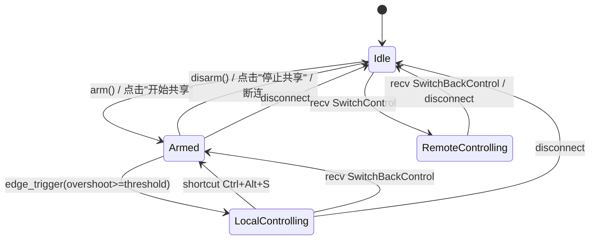

## 用户需求

v0.1.40 版本对 KVMini 的 KVM 共享行为进行竞品级改造，并修复一个连接按钮显示 bug。

## 产品概述

当前「开始共享」按钮按下后会**立即**抢占对端的键鼠控制权，行为不符合 Synergy/Barrier/ShareMouse 等主流 KVM 产品。改造后「开始共享」只做"激活边缘监听"，真正的控制权切换由鼠标撞到本机显示器布局边缘后触发；同时引入双通道回切机制，让用户可以用快捷键或撞远端反向边缘自然返回本机。

## 核心功能

### 1. 新增 Armed 中间态（4 状态机）

- 状态扩展：Idle / **Armed（已激活 · 待边缘切换）** / LocalControlling / RemoteControlling
- 「开始共享」语义变更：Idle → Armed（仅激活 EdgeDetector，**不吞键鼠、不隐藏光标、不发帧**）
- UI 控制状态面板新增独立显示态"已激活 · 待边缘切换"/"Armed · Waiting for edge"
- 两端按钮对称，谁先撞到布局边缘谁先控制对方

### 2. 边缘触发切换 Armed → LocalControlling

- 本机鼠标在 Armed 状态触达 `ScreenLayout.trigger_edge()` 配置的边缘方向时触发
- **过冲量防误触**：需推过边缘 N 像素才切换，默认 20px，用户可配置 0~200（0 = 贴边即切）
- **Y 坐标镜像映射**：记录触发瞬间本机鼠标 normalized_y（0~10000），SwitchControl 帧携带该比例，对端光标按比例落到远端显示器对应 Y 位置（替代固定中点 5000）

### 3. 双通道回切

- **通道 A**：全局快捷键 `Ctrl+Alt+S`（复用现有绑定）从 LocalControlling → Armed（不回 Idle，Armed 继续监听下次撞边）
- **通道 B**：远端被控期间常驻 EdgeDetector，远端光标撞反向边缘 → 协议新增 `KvmFrame::SwitchBackControl` 消息通知本机 → LocalControlling → Armed
- 仅「停止共享」按钮或主动断连才回 Idle

### 4. BUG-032 按钮显示修复

- 现象：连接成功第一次按钮正确显示"断开"，后续变为"重连"
- 已定位嫌疑点：`reconnecting` 事件 L455-460 调用 `updateConnectionButtons(false)` 导致 connected=true 状态下按钮误切
- 作为 BUG-032 写入 `docs/bug-list.md`，TDD 覆盖"connected=true 任意事件下按钮必须显示断开"

### 5. 多语言与跨平台

- 所有新增文案（Armed 状态、过冲量提示、Stop Sharing 等）同时更新 `src/i18n.js` zh/en 字典
- Win（ARawInput）/ Mac M / Mac Intel（CGEventTap）三平台行为一致，吞键鼠时机从"立即"推迟到"Armed → 撞边后"

### 6. 版本与文档

- 版本号 0.1.39 → 0.1.40，同步 Cargo.toml、package.json、index.html meta、changelog
- 归档产品设计 v0.1.40 + 开发总结 + 架构图到 `docs/archive/YYYYMMDD/`
- bug-list.md 新增 BUG-032

## 技术栈

- 后端：Rust（workspace: kvm-core 纯逻辑 + src-tauri 平台接入）
- 前端：原生 JS + HTML + CSS（不引入新框架，沿用 src/main.js、src/i18n.js）
- 测试：Rust 单元测试（`#[cfg(test)]`）+ Jest（`__tests__/`，已有 54 个用例）
- 协议：bincode 序列化 + 自定义 KvmFrame 枚举（新增变体需追加尾部保持向后兼容）

## 实现思路

### 核心策略

在**不破坏现有三态架构**的基础上插入 Armed 中间态，由 `StateMachine` 内部状态图和 `EdgeDetector.set_active()` 联动驱动。Armed 状态下 EdgeDetector 开启但不触发 `StartCapture`/`HideCursor`，直到 overshoot 累积达到阈值才真正走 `switch_to_local_controlling` 路径。

### 关键技术决策

1. **为何选择 4 状态机而非保留 3 态改按钮语义**

- Synergy/Barrier 开源实现验证过的成熟模型，UI 呈现清晰（用户能明确区分"激活待机"和"正在控制"）
- 状态迁移约束清晰：Idle → Armed（arm 按钮）、Armed → LocalControlling（edge）、LocalControlling → Armed（快捷键/SwitchBack）、Armed → Idle（disarm 按钮/断连）
- 避免"按钮状态"和"控制状态"语义耦合，便于 TDD

2. **过冲量（overshoot）实现**

- 在 `EdgeConfig` 新增 `overshoot_px: i32`，`EdgeDetector` 内部维护 `overshoot_accumulator: i32`
- 鼠标首次贴边时记录起始坐标，后续 detect 调用累加同方向超出距离；反向移动或离开边缘时归零
- 累积量 ≥ `overshoot_px` 才返回 `Triggered`，= 0 时退化为现有立即触发行为
- 复杂度 O(1)，不影响热路径

3. **Y 坐标镜像映射**

- 当前 `switch_to_local_controlling(edge, pos_ratio)` 签名已支持，只是调用方传死 `5000`
- 改造点：在 EdgeDetector 触发瞬间由鼠标实际 y（或 x，取决于 edge 方向）计算 `pos_ratio = (y - oy) * 10000 / h`
- 对端接收 SwitchControl 后调用 `CursorMapper::map_entry_position(pos_ratio, edge, remote_desktop)` 定位光标（该函数已存在）

4. **SwitchBackControl 协议扩展**

- `KvmFrame` 尾部追加 `SwitchBackControl` 变体，bincode 依赖字段顺序但对枚举尾部追加是兼容的（旧版本客户端会反序列化失败并丢帧，而非崩溃；v0.1.40 双端同时升级无此问题）
- 被控端常驻 EdgeDetector 配置为 `remote_entry_edge().opposite()` 作为返回边缘检测方向

5. **BUG-032 根因假设**

- 嫌疑点：`reconnecting` 事件（main.js L455-460）把 `updateConnectionButtons(false)` 放在 `setConnectionStatus('connecting')` 后面，但 connected 状态下后端心跳波动也会触发 reconnecting 事件
- 修复方案：`updateConnectionButtons` 的源头改为只依赖 `appState.connected` 单真源，所有事件分支调用前先重新判定，或直接在函数内读取 `appState.connected` 忽略外部传参

### 性能与可靠性

- 状态机操作纯内存 O(1)，锁粒度小（Mutex<StateMachine>）
- EdgeDetector debounce_ms 已有，overshoot 累积不增加额外 syscall
- 回切路径延迟 = 网络 RTT + 一次状态转换（~1-5ms LAN）

### 避免技术债

- 复用 `cursor_mapping.rs`、`edge_logic.rs`、`config.rs::ScreenLayout` 既有抽象
- 不引入新模块，所有改动在现有文件内扩展
- 新增测试文件遵守 `__tests__/*.test.js` 和 `#[cfg(test)] mod tests` 既有约定

## 执行细节

### 性能

- StateMachine 迁移已有 `state_changed_at: Instant` 记录，无需新增
- EdgeDetector overshoot 累加在单次 `detect()` 内完成，避免新建 Timer
- 前端控制状态 UI 仅在 state 变更事件驱动下重渲染，不 polling

### 日志

- 复用 `log::info!`/`log::debug!`（`kvm-core/src/logging.rs` 已初始化）
- 状态迁移日志：`[StateMachine] Idle -> Armed (arm)` / `[StateMachine] Armed -> LocalControlling (edge_trigger, pos_ratio=3724)`
- 回切日志：`[Sharing] switch_back_triggered channel=shortcut|remote_edge`
- 禁止打印鼠标绝对坐标高频数据（每帧都打日志会撑爆日志）—— 仅状态迁移点打

### 爆炸半径控制

- 协议 `SwitchBackControl` 追加到枚举尾部，保证 bincode 对旧客户端不致崩
- `toggle_sharing` 命令改名保留兼容：前端调用不变，后端内部分发到 `arm`/`disarm`
- UI 文本全部走 i18n，防硬编码（项目规则）
- BUG-032 修复优先级高：先合并修复分支再做行为改造，避免交叉验证困难

## 架构设计

### 状态机迁移图



### 组件关系

```
前端 main.js
  ├─ handleToggleSharing → invoke('toggle_sharing')
  ├─ listen('control_state_changed') → updateControlStatus(4态)
  └─ listen('connection_event') → updateConnectionButtons (BUG-032修复)

后端 sharing.rs
  ├─ toggle_sharing: Idle↔Armed
  ├─ on_edge_triggered(pos_ratio) → state.switch_to_local_controlling
  ├─ on_recv_switch_back → state.local_to_armed
  └─ spawn EdgeDetector 监听线程 (Armed/LocalControlling 期间)

kvm-core
  ├─ state.rs: StateMachine + arm/disarm/local_to_armed/armed_to_local
  ├─ edge_logic.rs: EdgeConfig.overshoot_px + accumulator
  ├─ protocol.rs: KvmFrame::SwitchBackControl
  └─ config.rs: AppConfig.edge_overshoot_px
```

## 目录结构

```
KVMini/
├── Cargo.toml                                    # [MODIFY] workspace.version 0.1.39 → 0.1.40
├── package.json                                  # [MODIFY] version 同步
├── src/
│   ├── index.html                                # [MODIFY] meta[app-version]、新增 #control-status-armed 样式钩子
│   ├── i18n.js                                   # [MODIFY] zh/en 各新增 6 项：controlStatusArmed / btnStartSharing / btnStopSharing / btnArmedWaiting / msgEdgeArmed / msgEdgeOvershootHint
│   ├── main.js                                   # [MODIFY] 核心：
│   │                                             #   1) L602 updateConnectionButtons 改为读 appState.connected 单真源（BUG-032）
│   │                                             #   2) L455-460 reconnecting 事件不再强制 false
│   │                                             #   3) handleToggleSharing 按 4 态切换按钮文案
│   │                                             #   4) 新增 updateControlStatus 支持 armed 分支
│   └── layout.js                                 # [MODIFY] 可能需要把 edge_overshoot_px 加入显示器布局配置面板
├── kvm-core/src/
│   ├── state.rs                                  # [MODIFY] ControlState 新增 Armed 变体；
│   │                                             #   新增方法 arm()/disarm()/armed_to_local_controlling(pos_ratio)/local_to_armed()
│   │                                             #   原 toggle_control 语义调整
│   ├── edge_logic.rs                             # [MODIFY] EdgeConfig 新增 overshoot_px 字段；
│   │                                             #   EdgeDetector 新增 overshoot_accumulator 状态；
│   │                                             #   detect() 累加逻辑；set_return_mode() 用于 LocalControlling 期间切换到监听远端反向边缘
│   ├── protocol.rs                               # [MODIFY] KvmFrame 尾部追加 SwitchBackControl 变体；bincode test
│   ├── config.rs                                 # [MODIFY] AppConfig 新增 edge_overshoot_px: i32（默认 20，范围 0..=200）
│   └── cursor_mapping.rs                         # [MODIFY] 补 Y 镜像单元测试，确认 pos_ratio 语义
├── src-tauri/src/
│   ├── sharing.rs                                # [MODIFY] 核心改造：
│   │                                             #   toggle_sharing 命令从 toggle_control 改为 arm/disarm
│   │                                             #   新增 on_edge_triggered(pos_ratio) 回调串联 StateMachine
│   │                                             #   新增 handle_switch_back_frame 处理远端返回消息
│   │                                             #   EdgeDetector 初始化传入 overshoot_px 读取自 AppConfig
│   ├── main.rs                                   # [MODIFY]
│   │                                             #   1) Ctrl+Alt+S 快捷键处理分支：LocalControlling → local_to_armed；Armed/Idle 状态下保留原行为
│   │                                             #   2) get_changelog 新增 v0.1.40 条目
│   │                                             #   3) emit control_state_changed 事件加 armed 字段
│   └── connection/                               # [MODIFY 按需] 接收到 SwitchBackControl 帧后路由到 sharing.rs::handle_switch_back_frame
├── __tests__/
│   ├── sharing-armed.test.js                     # [NEW] 前端测试 Armed 状态按钮文案/UI 分支
│   ├── bug-032-reconnect-button.test.js          # [NEW] BUG-032 回归测试：多次 reconnecting 事件下按钮状态不变
│   └── i18n.test.js                              # [MODIFY] requiredKeys 新增 6 项
├── kvm-core/src/state.rs::tests                  # [MODIFY] 新增 test_arm_disarm / test_armed_to_local_controlling / test_local_to_armed / test_armed_transitions_from_any
├── kvm-core/src/edge_logic.rs::tests             # [MODIFY] 新增 test_overshoot_accumulator / test_overshoot_reset_on_reverse / test_overshoot_zero_equals_immediate
├── kvm-core/src/protocol.rs::tests               # [MODIFY] 新增 test_switch_back_control_bincode_roundtrip
└── docs/
    ├── bug-list.md                               # [MODIFY] 新增 BUG-032（现象/根因/修复/测试用例编号/出现次数）
    ├── product-design-v0.1.40.md                 # [NEW] 产品设计文档，说明 4 状态机、过冲量、Y 镜像、双通道回切
    ├── dev-summary-v0.1.40.md                    # [NEW] 开发总结（构建后生成）
    └── archive/YYYYMMDD/                         # [NEW] 归档本次产品设计 + 开发总结 + 架构图
```

## 关键接口定义

```rust
// kvm-core/src/state.rs
pub enum ControlState {
    Idle,
    Armed,              // 新增
    LocalControlling,
    RemoteControlling,
}

impl StateMachine {
    pub fn arm(&mut self) -> Vec<StateEvent>;                              // Idle → Armed
    pub fn disarm(&mut self) -> Vec<StateEvent>;                           // Armed → Idle
    pub fn armed_to_local_controlling(&mut self, edge: ScreenEdge, pos_ratio: u16) -> Vec<StateEvent>;
    pub fn local_to_armed(&mut self) -> Vec<StateEvent>;                   // 回切到 Armed（不回 Idle）
}

// kvm-core/src/edge_logic.rs
pub struct EdgeConfig {
    pub trigger_edge: ScreenEdge,
    pub threshold: i32,
    pub debounce_ms: u64,
    pub overshoot_px: i32,   // 新增：默认 20，0 = 立即触发
}

// kvm-core/src/protocol.rs
pub enum KvmFrame {
    // ... 现有变体
    SwitchControl { edge: ScreenEdge, pos_ratio: u16 },
    SwitchControlAck,
    SwitchBackControl,       // 新增：尾部追加保持 bincode 兼容
}
```

## Agent Extensions

### Skill

- **test-driven-development**
- Purpose: 为状态机扩展、过冲量逻辑、BUG-032 修复先写测试用例再写实现
- Expected outcome: Rust 单元测试 + Jest 前端测试覆盖所有新增状态转换和按钮显示逻辑，CI 全绿

- **systematic-debugging**
- Purpose: 排查 BUG-032（已连接状态下按钮误显示重连）的根因，不做经验主义猜测
- Expected outcome: 定位到具体触发路径（预测：reconnecting 事件），写入 bug-list.md 根因分析

- **brainstorming**
- Purpose: 在状态机设计前确认 4 态切换的边界条件（断连时如何回收 Armed/LocalControlling、快捷键和远端撞边的回切优先级）
- Expected outcome: 产品设计文档 v0.1.40 包含完整状态转换矩阵

- **verification-before-completion**
- Purpose: 每步实现后用 `cargo test` + `npm test` 验证，禁止未运行就声明完成
- Expected outcome: 每个 todo item 完成前有测试通过证据

- **requesting-code-review**
- Purpose: 提交前让另一个 agent review 重构和性能（项目规则要求）
- Expected outcome: 收到 review 意见并处理后再构建打包

### SubAgent

- **code-explorer**
- Purpose: 深入探索 `src-tauri/src/sharing.rs` 的现有 toggle_sharing 调用链、`src-tauri/src/connection/` 的 KvmFrame 分发路径、以及 `src-tauri/src/platform/` 各平台吞键鼠实现
- Expected outcome: 精确定位所有需要改动的函数签名和调用点，避免遗漏 Win/Mac 平台差异