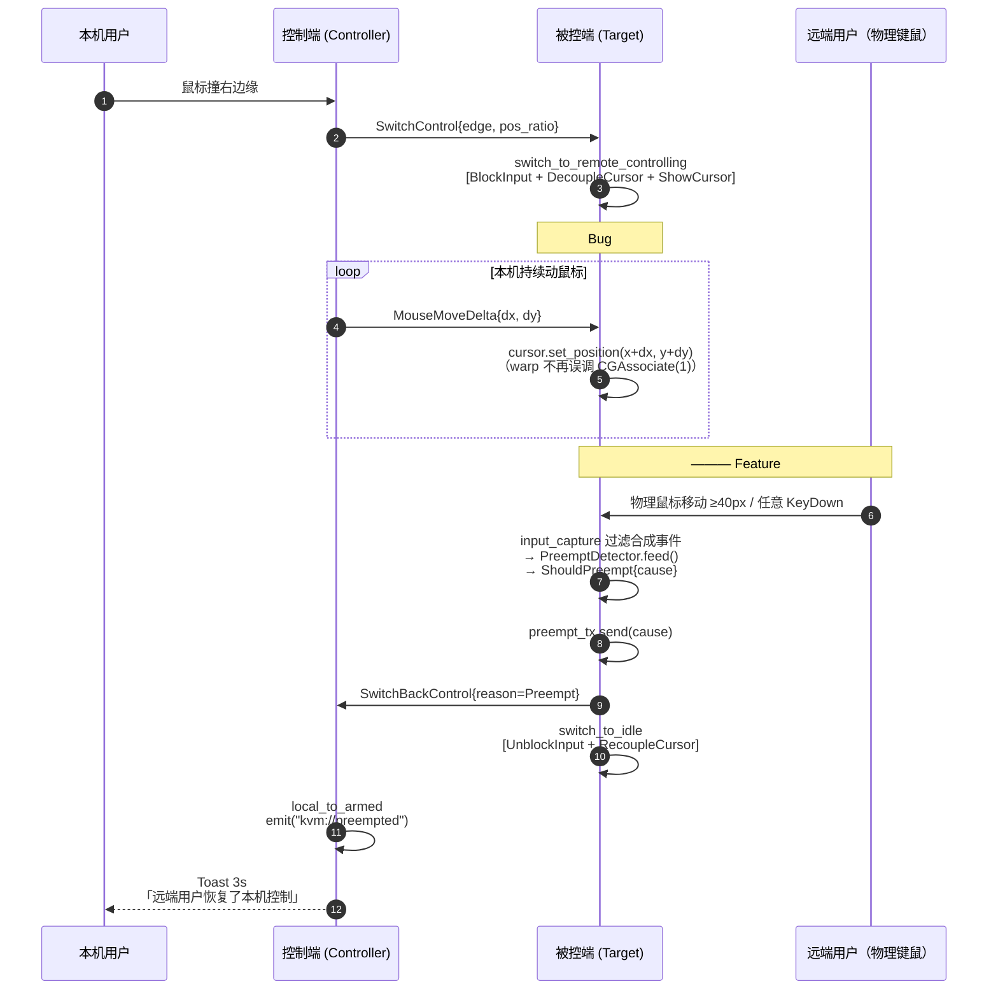

# KVMini v0.1.43 架构归档（2026-05-09）

## 1. 关键时序（远端虚拟光标修复 + 物理输入抢占）



## 2. 模块依赖

```mermaid
graph LR
    subgraph kvm-core
        preempt[preempt.rs<br/>PreemptDetector]
        protocol[protocol.rs<br/>SwitchBackReason]
        state[state.rs<br/>Decouple/RecoupleCursor]
        platform_trait[platform.rs<br/>CursorController trait]
    end

    subgraph src-tauri/platform/macos
        mac_capture[input_capture.rs]
        mac_inject[input_inject.rs<br/>tag_synthetic]
        mac_cursor[cursor.rs<br/>decouple/recouple]
    end

    subgraph src-tauri/platform/windows
        win_capture[input_capture.rs<br/>LLMHF/LLKHF 过滤]
        win_cursor[cursor.rs]
    end

    subgraph src-tauri/src
        sharing[sharing.rs<br/>pump task + select!]
        connection[connection/mod.rs<br/>on_remote_switch_back]
        main_rs[main.rs<br/>get_changelog]
    end

    subgraph src (frontend)
        main_js[main.js<br/>kvm://preempted listener]
        i18n_js[i18n.js<br/>preempt_resume_toast]
    end

    preempt --> mac_capture
    preempt --> win_capture
    protocol --> sharing
    protocol --> connection
    state --> sharing
    platform_trait --> mac_cursor
    platform_trait --> win_cursor

    mac_capture --> sharing
    win_capture --> sharing
    sharing --> main_js
    i18n_js --> main_js
```

## 3. 数据流：合成事件过滤

```mermaid
flowchart TD
    A[远端 MouseMoveDelta/KeyDown 到达被控端] --> B[input_inject 注入事件]
    B --> C{平台}
    C -->|Mac| D[event.set_integer_value_field<br/>kCGEventSourceUserData=42<br/>value=0x4B56_4D49 \"KVMI\"]
    C -->|Win| E[SendInput 自动打 LLMHF/LLKHF_INJECTED]
    D --> F[event.post]
    E --> F
    F --> G[事件冒泡到本平台 hook/tap]
    G --> H{capture 检测标记}
    H -->|匹配| I[跳过，不喂 PreemptDetector]
    H -->|不匹配| J[物理输入 → 喂 PreemptDetector]
    J --> K{累计>=40px or KeyDown?}
    K -->|否| L[返回 Idle]
    K -->|是| M[ShouldPreempt → preempt_tx]
```

## 4. 协议兼容矩阵

| 控制端 | 被控端 | SwitchBackControl payload | 行为 |
|---|---|---|---|
| v0.1.43 | v0.1.43 | 1 字节 reason | 抢占 toast / 边缘无 toast |
| v0.1.43 | v0.1.42 及以下 | 0 字节 | decode 为 EdgeReturn，无 toast |
| v0.1.42 及以下 | v0.1.43 | 1 字节 reason | 旧客户端 decode 跳过多余字节，按 EdgeReturn 处理 |

向后兼容已通过 `test_switch_back_legacy_empty_payload_compat` 测试验证。

## 5. 验收指标

- 248 Rust 测试 ✅
- 33 jest i18n 测试 ✅
- build.sh 构建产物 `KVMini_0.1.43_aarch64.dmg` 生成
- 实机双端（Mac M + Mac Intel / Win）互控：
  - 撞边进入 RemoteControlling → 远端光标随动
  - 被控端动鼠标 > 40px → 控制端 3s toast，双端回 Armed/Idle
  - 被控端按任意键 → 同上
