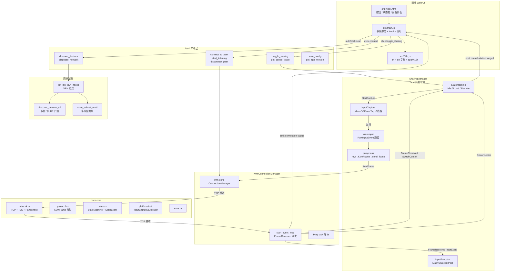
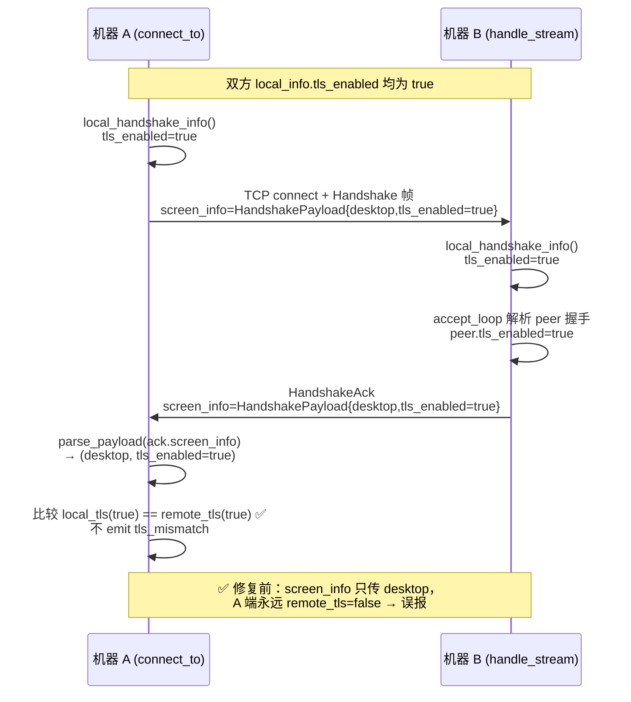
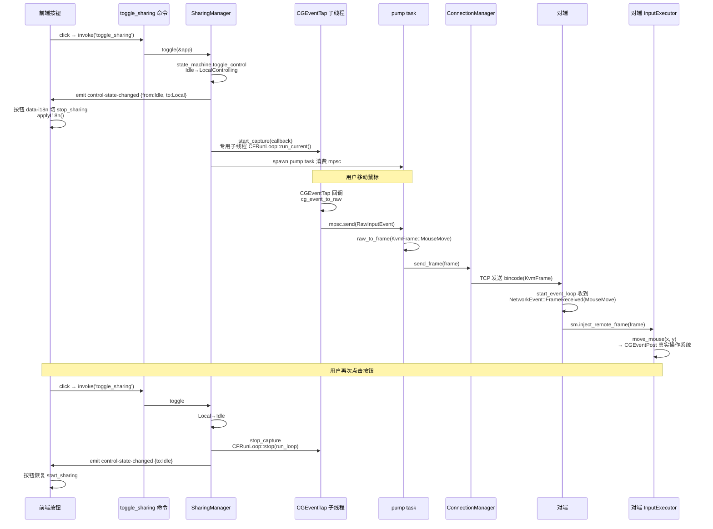
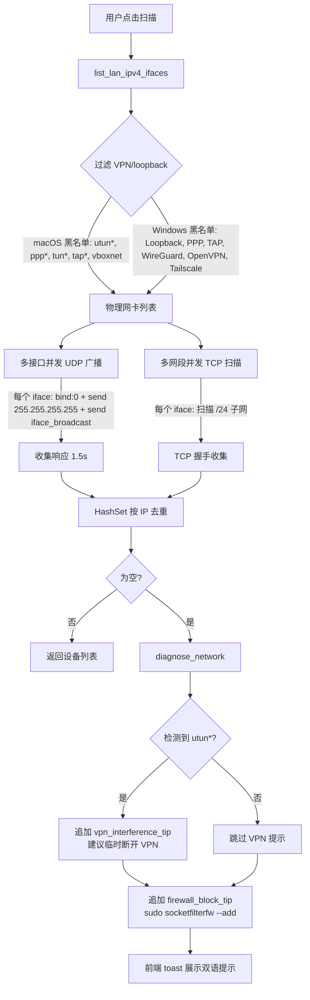
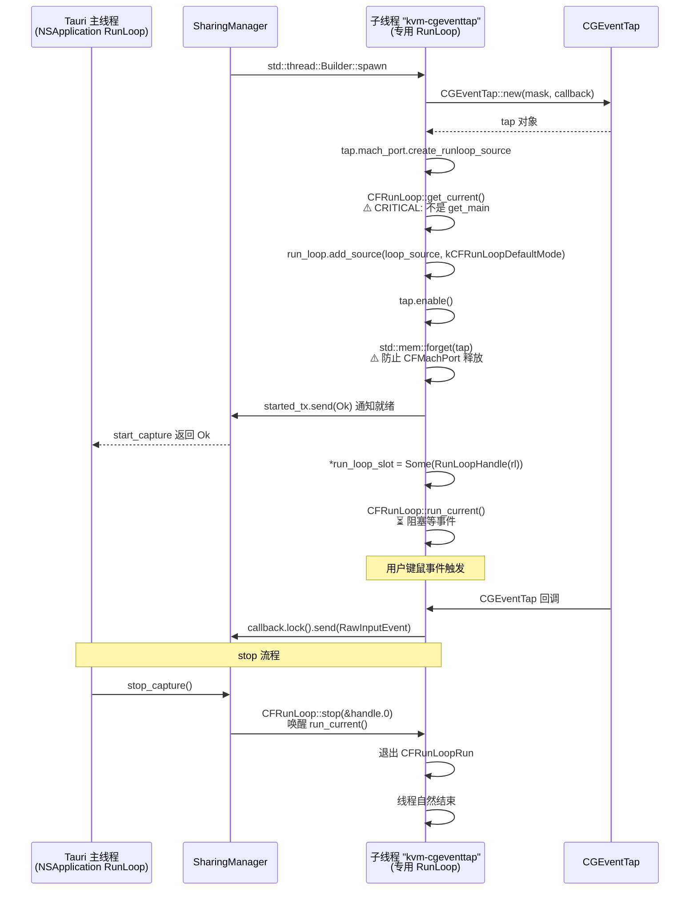

# KVMini v0.1.35 架构图

**日期**：2026-05-01  
**范围**：整体架构 + 本次 BUG-018/019/020 修复后的新增链路

---

## 一、整体架构（v0.1.35）

---

## 二、BUG-018（TLS 握手）新链路

---

## 三、BUG-019（开始共享）完整链路

---

## 四、BUG-020（VPN 扫描）链路

---

## 五、CGEventTap 线程模型（关键细节）

---

## 六、关键文件对应

| 模块 | 文件 | 本次改动 |
|---|---|---|
| 握手协议 | `kvm-core/src/network.rs` | 新增 HandshakePayload + parse_payload 双层回退 |
| 状态机 | `kvm-core/src/state.rs` | 无改动（验证） |
| 平台 trait | `kvm-core/src/platform/mod.rs` | 无改动（验证） |
| Mac 采集 | `src-tauri/src/platform/macos/input_capture.rs` | **重写 start_capture：专用子线程 + CFRunLoop** |
| Mac 注入 | `src-tauri/src/platform/macos/input_inject.rs` | 无改动（验证） |
| Win 采集/注入 | `src-tauri/src/platform/windows/*.rs` | 无改动（验证） |
| 共享管理 | `src-tauri/src/sharing.rs` | **全新模块** |
| 连接事件 | `src-tauri/src/connection/mod.rs` | **新增 FrameReceived/Disconnected 分发** |
| 网络扫描 | `src-tauri/src/network_scan.rs` | **新增 list_lan_ipv4_ifaces / v2 扫描** |
| 命令注册 | `src-tauri/src/main.rs` | **注册 SharingManager + toggle_sharing** |
| 前端按钮 | `src/main.js` | **新增 handleStartSharing / listen control-state-changed** |
| 前端 i18n | `src/i18n.js` | **新增 10+ key（zh+en）** |
| HTML 按钮 | `src/index.html` | data-i18n 保持 start-sharing-btn |
| 版本管理 | `scripts/version-update.js` | **抽出 decideBumpAction + BUMP_VERSION=0** |

---

## 七、三端隔离状态

| 能力 | macOS (M/Intel) | Windows |
|---|---|---|
| InputCapture 实现 | `MacInputCapture`（CGEventTap 子线程） | `WinInputCapture`（低级钩子） |
| InputExecutor 实现 | `MacInputExecutor`（CGEventPost） | `WinInputExecutor`（SendInput） |
| VPN 过滤黑名单 | `utun*` `ppp*` `tun*` `tap*` `vboxnet` | `Loopback` `PPP` `TAP` `WireGuard` `OpenVPN` `Tailscale` |
| 权限提示 | 辅助功能 + 输入监控（TODO BUG-021） | UAC + 防火墙 |
| UI 文案 | zh + en（data-i18n） | zh + en（data-i18n） |

**铁律**：Mac 和 Win 功能必须保持 1:1 一致；隔离只在底层实现，上层 trait / 前端 UI / 命令签名完全相同。
