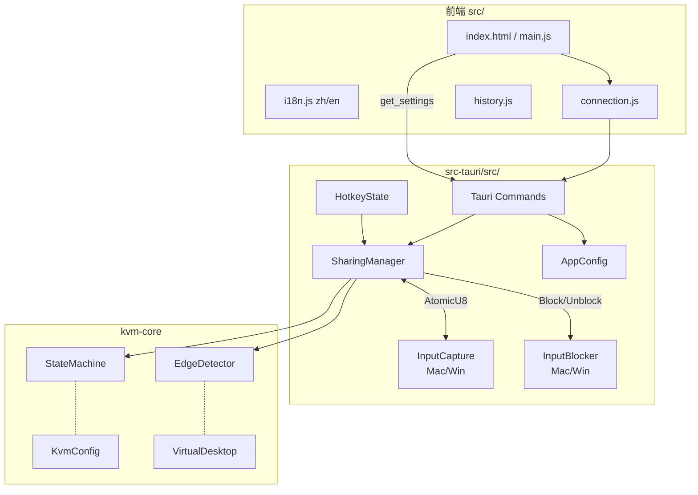
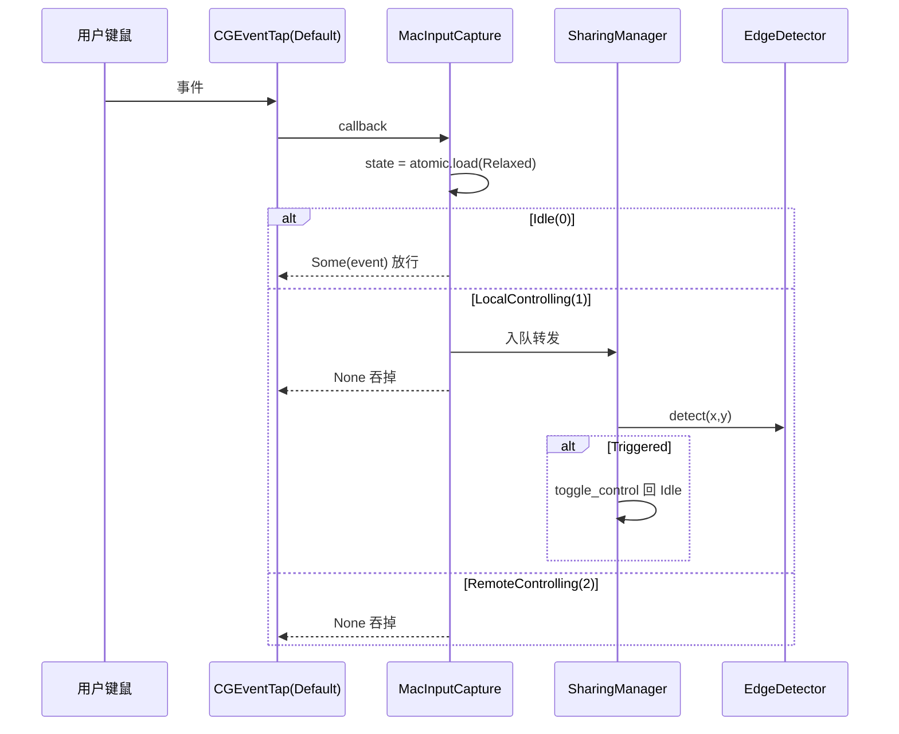
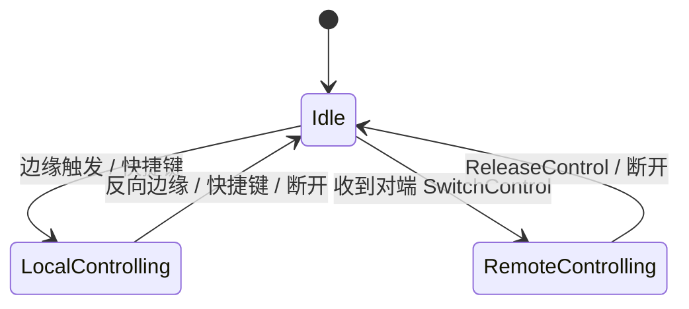

# KVMini v0.1.38 架构归档

- 日期：2026-05-06
- 版本：0.1.38
- 主题：真 KVM 边界切换 + 端口默认值真源化 + 连接命令名修复

## 1. 模块全景



## 2. 真 KVM 控制态共享（核心改动）



## 3. 状态机



每次 StateChanged 都会同步：
- `capture.set_control_state(u8)` 镜像到回调线程
- `blocker.block/unblock_input()` 真实拦截系统输入
- `edge_detector.set_active(local_controlling)`

## 4. 端口默认值真源链路

```
kvm-core::KvmConfig::default().tcp_port = 23456
        ↓ serde default
AppConfig.tcp_port
        ↓ get_settings
appState.defaults.tcpPort  (前端启动 initializePortDefaults)
        ↓ 引用
监听端口框 / 手动连接端口 / 连接对话框默认值
        ↓ 用户改值
set_listen_address → 写回 AppConfig + 同步 appState
```

清除点：`src/main.js`、`src/index.html`、`src/history.js` 所有 `8889` 字面量。
回退规则：`tcp_port == 0` 或缺失 → 23456。

## 5. 关键设计取舍

| 项 | 选择 | 理由 |
|---|---|---|
| 跨线程状态传播 | `Arc<AtomicU8>` + Relaxed | CGEventTap 回调每秒千次，禁止 Mutex |
| CGEventTap 模式 | `Default`（非 ListenOnly） | 唯一能让回调返回值真正吞事件的模式 |
| save_settings payload | 显式 snake_case | 后端 AppConfig 是 snake_case，camelCase 会被静默忽略 |
| 默认端口源 | kvm-core 唯一真源 | 避免前后端字面量不一致 |
| 边缘检测节流 | 已有 50ms 防抖 | 直接复用，无需额外节流 |
| 快捷键默认 | 已注册 Ctrl+Alt+S | 与边缘触发并存兜底 |

## 6. 受影响文件

**前端**：`main.js`、`connection.js`、`history.js`、`index.html`、`i18n.js`
**后端**：`platform/macos/input_capture.rs`、`platform/windows/input_capture.rs`、`sharing.rs`、`config.rs`、`main.rs`（changelog）
**核心**：`kvm-core/src/edge_logic.rs`、`config.rs`、`state.rs`（只读复用）
**测试**：21 个 Jest 用例 + Rust `sharing` / `input_capture` 单测全绿

## 7. 验收

- Jest：52 suites / 874 tests PASS
- cargo test --workspace --lib：111 tests PASS（kvmini 19 + kvm-core 92）
- cargo build --package kvmini：Finished
- 双架构 DMG：`KVMini_0.1.38_aarch64.dmg` 6.3M、`KVMini_0.1.38_x64.dmg` 6.5M
- 签名：Developer ID + minisign updater 双重签名通过
