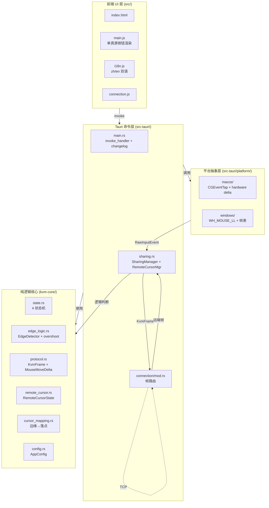
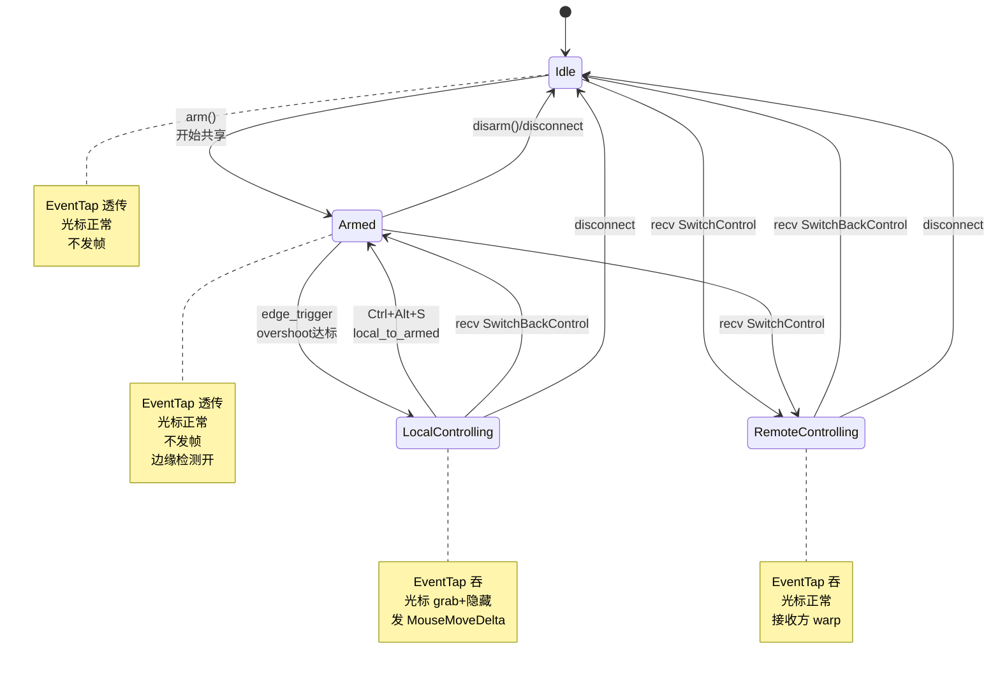
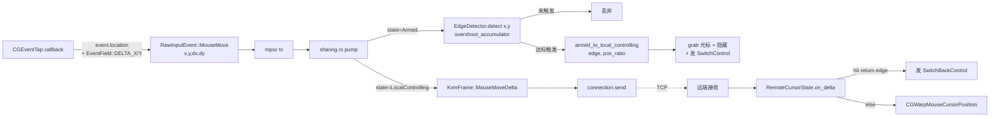
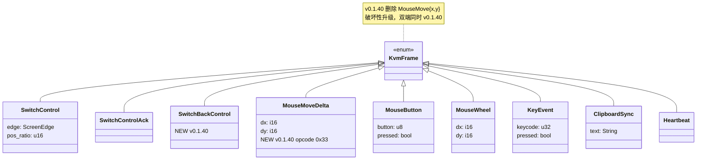
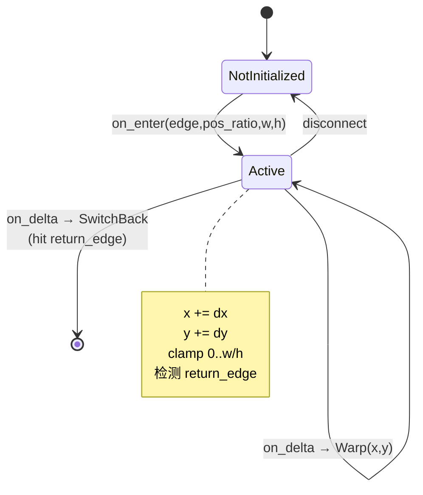
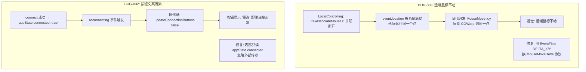

# KVMini v0.1.40 架构图

> 对应版本：v0.1.40（2026-05-07） · 鼠标控制竞品级重构 + Armed 4 状态机 + BUG-032/033 修复

## 1. 顶层分层架构

## 2. 4 状态机迁移图

## 3. 鼠标数据流（重构后）

## 4. 协议帧（v0.1.40）

## 5. RemoteCursorState 状态转移

## 6. 状态-行为对照表

| 状态 | CGEventTap 返回 | 本机光标 | 网络发送 | 接收处理 | 边缘检测 |
|------|----------------|---------|---------|---------|---------|
| Idle | Some(透传) | 正常 | 不发 | SwitchControl→Remote | 关 |
| Armed | Some(透传) | 正常 | 不发 | SwitchControl→Remote | 本机(x,y)+overshoot |
| LocalControlling | None(吞) | grab+隐藏 | MouseMoveDelta | SwitchBack→Armed | 不检测 |
| RemoteControlling | None(吞) | 正常 | 不发 | MouseMoveDelta→virtual cursor warp | 远端虚拟光标反向边缘 |

## 7. 跨平台采集差异

| 能力 | macOS | Windows |
|------|-------|---------|
| Hook 类型 | CGEventTap (Default mode) | WH_MOUSE_LL Low-Level Hook |
| dx/dy 来源 | `EventField::MOUSE_EVENT_DELTA_X/Y`（硬件原生） | 帧差近似（`thread_local LAST_MOUSE_POS`） |
| 精度 | 硬件透传，无累积误差 | 1-2px 偏差（后续可升级 RawInput） |
| 吞事件方式 | 回调返回 None | `return 1;` from hook proc |
| 光标隐藏 | `CGDisplayHideCursor` | `ShowCursor(FALSE)` |
| 光标关联 | `CGAssociateMouseAndMouseCursorPosition(0)` | `ClipCursor` |
| 远端 warp | `CGWarpMouseCursorPosition` | `SetCursorPos` |

## 8. BUG-032 / BUG-033 根因路径

