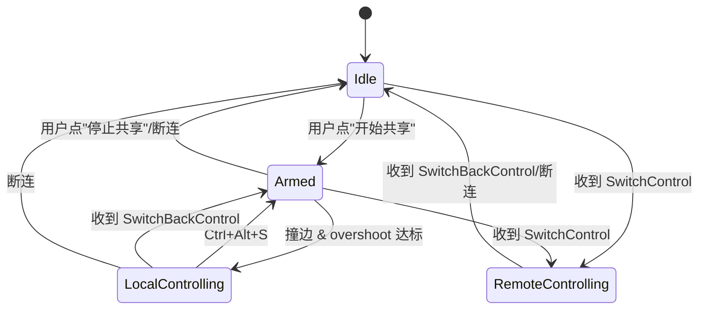
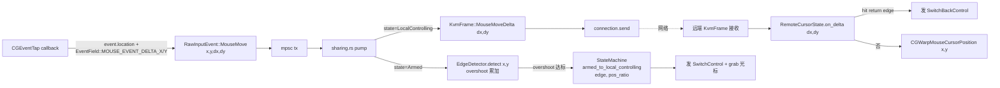

# KVMini v0.1.40 产品设计文档

**版本**：0.1.40
**日期**：2026-05-07
**主题**：鼠标控制竞品级重构 + Armed 4 状态机 + BUG-032 修复

---

## 1. 背景与目标

### 1.1 致命 bug

v0.1.39 进入 `LocalControlling`（本机控制远端）后：

- ✅ 本机鼠标被正确屏蔽（CGEventTap 吞事件 + `CGAssociateMouseAndMouseCursorPosition(0)` 断关联 + NSCursor hide）。
- ❌ **远端鼠标完全不动**。

### 1.2 根因

`src-tauri/src/platform/macos/input_capture.rs:346` 的 `cg_event_to_raw` 对 `MouseMoved` 事件用 `event.location()` 读取鼠标位置，传入 `RawInputEvent::MouseMove { x, y }`（绝对屏幕坐标）。

但在 `grab()` 已经调用 `CGAssociateMouseAndMouseCursorPosition(0)` 后，**物理鼠标与屏幕光标位置解耦**——`event.location()` 返回的是**冻结在 grab 瞬间的同一个坐标**，永远不变。远端收到的 `MouseMove{x,y}` 是同一个点，`CGWarpMouseCursorPosition` 自然原地不动。

### 1.3 设计目标

对齐 Synergy / Barrier / ShareMouse / Logitech Flow 竞品，采用**纯相对位移（delta）模式**：

1. 鼠标采集改读 `CGEvent` 硬件 delta 字段（`kCGMouseEventDeltaX/DeltaY`），绕过"位置冻结"问题。
2. 协议破坏性升级：`KvmFrame::MouseMove{x,y}` → `KvmFrame::MouseMoveDelta{dx,dy}`。不留绝对坐标兜底。
3. 远端新增 `RemoteCursorState` 维护虚拟光标位置（`x += dx; y += dy`）+ 反向边缘检测 + `CGWarpMouseCursorPosition` 落点。
4. 引入 `Armed` 中间态（已激活·待边缘切换），避免 Idle↔Local 瞬时跳变带来的 UX 混乱。
5. 过冲量（overshoot）防误触 + 真实 `pos_ratio`（Y 镜像）。
6. 双通道回切：`Ctrl+Alt+S` 快捷键 + 远端虚拟光标撞反向边缘 `SwitchBackControl`。
7. 修复 BUG-032：连接状态按钮显示单真源化。

### 1.4 不留兜底的论证

| 担忧 | 事实 | 结论 |
|---|---|---|
| delta 会不会累积误差？ | CGEvent delta 是硬件层独立读数，每帧由操作系统底层重新计算，无累加 | 无误差 |
| TCP 会不会丢包漂移？ | TCP 本身可靠，丢包由内核重传 | 不漂移 |
| 多进程位置会不会不同步？ | 远端 virtual_cursor 是单一 owner（我方进程内存变量），落点用 `CGWarpMouseCursorPosition` | 无同步问题 |
| 竞品怎么做？ | Synergy / Barrier / ShareMouse / Logitech Flow 全部纯 delta | 方案已被验证 |

**结论**：保留 `MouseMove{x,y}` 兜底 = 经验主义的路径依赖，违反奥卡姆剃刀。**直接替换**。

---

## 2. 核心状态机（4 态）



### 2.1 状态语义

| 状态 | 含义 | 本机鼠标 | 事件吞/放 | 网络发送 |
|---|---|---|---|---|
| `Idle` | 空闲 | 正常 | 放行 | 不发 |
| `Armed` | 已激活，等边缘 | 正常 | 放行 | 不发（EdgeDetector 喂 x,y） |
| `LocalControlling` | 本机控远端 | grab+隐藏 | 吞 | 发 `MouseMoveDelta` |
| `RemoteControlling` | 远端控本机 | 正常 | 吞 | 不发（本地执行远端帧） |

### 2.2 "开始共享"按钮语义

- **v0.1.39 及之前**：Idle → 立即 LocalControlling（语义模糊，用户反馈"还没撞边就被吞了"）。
- **v0.1.40 起**：Idle → Armed（仅激活 EdgeDetector，不改变光标/事件行为）；只有撞边 + 过冲达标才 Armed → LocalControlling。

---

## 3. 鼠标数据流（重构后）



### 3.1 事件扩展

```rust
// kvm-core/src/platform.rs
pub enum RawInputEvent {
    /// 鼠标移动：x/y 绝对坐标（Armed 态边缘检测用）；dx/dy 相对位移（LocalControlling 发送用）
    MouseMove { x: i32, y: i32, dx: i16, dy: i16 },
    // ... 其他变体不变
}
```

### 3.2 协议变更（破坏性升级）

```rust
// kvm-core/src/protocol.rs
pub enum KvmFrame {
    // ── 删除 ──
    // MouseMove { x, y, timestamp_ms, modifiers },

    // ── 新增 ──
    MouseMoveDelta { dx: i16, dy: i16 },   // 0x33（新 opcode）
    SwitchBackControl,                      // 0x32（已存在）

    // 其他按键/滚轮保留
}
```

- `PROTOCOL_VERSION` **保持 2**，但握手 `HandshakePayload` 新增 `capability_flags: u64`（`bit 0 = MOUSE_DELTA`）；对端未声明该 bit → 握手层拒绝连接并给明确错误。
- 旧客户端（v0.1.39-）反序列化 `MouseMoveDelta` 会失败（opcode 未知），由握手层先行拦截避免。

### 3.3 远端虚拟光标

```rust
// kvm-core/src/remote_cursor.rs (新增)
pub struct RemoteCursorState {
    pub x: i32,
    pub y: i32,
    pub screen_w: i32,
    pub screen_h: i32,
    pub return_edge: ScreenEdge,  // 反向边缘（与 entry_edge 相对）
}

pub enum RemoteCursorAction {
    Warp { x: i32, y: i32 },
    SwitchBack,
}

impl RemoteCursorState {
    /// 初始化：根据 entry_edge + pos_ratio 计算落点
    pub fn on_enter(entry_edge: ScreenEdge, pos_ratio: u16, w: i32, h: i32) -> Self;

    /// 累加 delta，clamp 屏幕，检测反向边缘
    pub fn on_delta(&mut self, dx: i16, dy: i16) -> RemoteCursorAction;
}
```

**反向边缘判定**：从 Left 进入 → 反向边缘是 Right；从 Top 进入 → 反向边缘是 Bottom；当虚拟光标 `x/y` 连续贴反向边缘 N 帧（沿用 EdgeDetector 的"持续贴边"逻辑）则触发 `SwitchBack`。

---

## 4. 过冲量与 pos_ratio

### 4.1 EdgeConfig 扩展

```rust
pub struct EdgeConfig {
    pub cooldown_ms: u64,           // 已有
    pub local_screen: LocalScreenConfig,
    pub overshoot_px: i32,          // 新增，默认 20（范围 0..=200）
}
```

- `overshoot_px = 0`：贴边即触发（v0.1.39 行为）。
- `overshoot_px > 0`：需要"持续贴边"累积到阈值才触发（避免 UI 拖拽误触发）。

### 4.2 pos_ratio 真实计算（Y 镜像）

触发瞬间拿本机鼠标 `(x, y)` 计算：

| 边缘 | pos_ratio 公式 |
|---|---|
| Left / Right | `y * 10000 / screen_h` |
| Top / Bottom | `x * 10000 / screen_w` |

远端入态时按 `pos_ratio` 在对边反算落点，保证"从本机右边 60% 处出 → 远端左边 60% 处进"。

---

## 5. 双通道回切

| 通道 | 触发条件 | 流程 |
|---|---|---|
| A. 快捷键 | 用户按 `Ctrl+Alt+S` | main.rs 路由 → `state.local_to_armed()` → release 光标 → 继续监听边缘 |
| B. 远端反向边缘 | 虚拟光标连续贴反向边缘达阈值 | 远端 pump 发 `SwitchBackControl` → 本机 `on_remote_switch_back` → 同 A |

两通道均转到 `Armed`，不回到 `Idle`（用户仍在共享会话中）。

---

## 6. BUG-032 修复：按钮显示单真源

### 6.1 现象

连接成功后第一次按钮显示"断开"，后续每次 `reconnecting` 事件触发后变成"重连"。

### 6.2 根因

`src/main.js::updateConnectionButtons(isConnected)` 当前签名接收外部传参，`reconnecting` 事件分支传入 `false` 污染了按钮状态。

### 6.3 修复

```js
// Before
function updateConnectionButtons(isConnected) { /* use isConnected */ }

// After
function updateConnectionButtons() {
    const isConnected = appState.connected;  // 单真源
    // ...
}
```

所有调用点删除入参；`appState.connected` 由 `setConnectionState()` 统一维护。

### 6.4 测试

`__tests__/bug-032-reconnect-button.test.js`：
- `appState.connected = true` 时，触发 `reconnecting` / `heartbeat` / `error` 事件后，按钮必须显示 i18n `btn_disconnect`。

---

## 7. 状态-行为对照表（最终权威）

| 状态 | CGEventTap 决策 | 本机光标 | 发送 | 接收处理 | 边缘检测 |
|---|---|---|---|---|---|
| Idle | 透传 | 正常 | 不发 | `SwitchControl`→Remote | 关 |
| Armed | 透传 | 正常 | 不发 | `SwitchControl`→Remote | 本机 (x,y+overshoot) |
| LocalControlling | 吞 | grab+隐藏 | `MouseMoveDelta` | `SwitchBack`→Armed | 不检测 |
| RemoteControlling | 吞 | 正常 | 不发 | `MouseMoveDelta`→virtual cursor warp | 远端虚拟光标反向边缘 |

---

## 8. 跨平台策略

### 8.1 Mac（本版本主战场）

- `CGEventTap` + `EventField::MOUSE_EVENT_DELTA_X/Y` 读硬件 delta（绕过 grab 位置冻结）。
- `grab()` 用 `CGAssociateMouseAndMouseCursorPosition(0)` + NSCursor hide（已有）。
- 远端 warp 用 `CGWarpMouseCursorPosition`（已有）。

### 8.2 Windows（本版本最小对称）

**探索结论**（见 task 报告）：Win 端当前用 `WH_MOUSE_LL` Low-Level Hook 采集**绝对坐标**，**未接入 RawInput**。

本版本采用**最小对称**策略避免过度改造：

- `RawInputEvent::MouseMove` 字段扩展为 `{x, y, dx, dy}`，Win 端在 `mouse_hook_proc` 中维护 `last_x/last_y` 通过帧差计算 `dx = x - last_x, dy = y - last_y`。
- Grab 状态下 `ClipCursor` 锁定 + 继续通过 LL Hook 读 `MSLLHOOKSTRUCT.pt`（`ClipCursor` 不冻结物理鼠标，`pt` 仍会更新到 clip 区域内的变化位置）。
- **RawInput 全量接入留到 v0.1.41+**（中等偏大重构，不在本次范围）。

### 8.3 平台差异隔离

- `platform/macos/input_capture.rs` 与 `platform/windows/input_capture.rs` 文件隔离。
- `kvm-core` 层协议与虚拟光标逻辑两端共用。

---

## 9. 多语言与 UI

### 9.1 新增 i18n key（zh/en 双语）

| key | zh | en |
|---|---|---|
| `control_status_armed` | 已激活·待撞边 | Armed · Waiting for edge |
| `btn_start_sharing` | 开始共享 | Start Sharing |
| `btn_stop_sharing` | 停止共享 | Stop Sharing |
| `btn_armed_waiting` | 共享中·待撞边 | Sharing · Waiting |
| `msg_edge_armed` | 已进入共享模式，撞向屏幕边缘即可控制远端 | Sharing enabled. Push cursor to edge to take control. |
| `msg_edge_overshoot_hint` | 持续贴边 {{px}}px 即可切换 | Keep pushing {{px}}px at edge to switch |

### 9.2 按钮文案切换

| 状态 | 按钮文字 |
|---|---|
| Idle | `btn_start_sharing` |
| Armed | `btn_armed_waiting` |
| LocalControlling / RemoteControlling | `btn_stop_sharing` |

---

## 10. 版本与归档

- `Cargo.toml` / `package.json` / `src/index.html` meta[app-version] 同步 0.1.40（已完成）。
- `src-tauri/src/main.rs::get_changelog()` 新增 v0.1.40 条目。
- 归档 `docs/archive/20260507/`：产品设计 + 开发总结 + 架构图 + bug-list 快照。
- `docs/bug-list.md` 新增 BUG-032（按钮显示）+ BUG-033（远端鼠标不动根因）。

---

## 11. 已完成盘点（探索阶段确认）

✅ `ControlState::{Idle, Armed, LocalControlling, RemoteControlling}` 4 态（state.rs）
✅ `arm() / disarm() / armed_to_local_controlling() / local_to_armed()` 方法
✅ `KvmFrame::SwitchBackControl`（opcode 0x32）+ 编解码测试
✅ `EdgeConfig.overshoot_px` 字段（默认 20）
✅ EdgeDetector "持续贴边计数"逻辑（BUG-029 修复残留）
✅ `HandshakePayload` serde(default) 向后兼容框架
✅ `docs/bug-list.md` BUG-032 文档化
✅ Cargo.toml/package.json 版本号已 bump 到 0.1.40

## 12. 剩余核心工作

🚧 `RawInputEvent::MouseMove` 字段扩展 `{x, y, dx, dy}`
🚧 `KvmFrame::MouseMove{x,y}` → `MouseMoveDelta{dx,dy}` 直接替换
🚧 `cg_event_to_raw` 用 `EventField::MOUSE_EVENT_DELTA_X/Y` 读硬件 delta
🚧 `kvm-core/src/remote_cursor.rs` 新增 `RemoteCursorState`
🚧 `sharing.rs` pump 按状态分流 + `RemoteCursorManager` 集成
🚧 握手 `capability_flags` 校验
🚧 `main.js` `updateConnectionButtons` 单真源化（BUG-032 代码修复）
🚧 i18n 新增 6 key + 前端 4 态按钮
🚧 测试：protocol / remote_cursor / state disconnect / edge overshoot pos_ratio / bug-032

---

## 13. 风险与回滚

| 风险 | 缓解 |
|---|---|
| 双端必须同时升级到 v0.1.40 | 握手 `capability_flags` 拒绝低版本 + 错误提示引导升级 |
| Win 端帧差 dx/dy 精度 | LL Hook ~125Hz，帧间距稳定，ClipCursor 区域内 pt 更新正常；精度足够 LAN 场景 |
| overshoot 默认 20px 可能不合适 | 0~200 可配，用户可在设置页调整 |
| 远端虚拟光标 clamp 边界溢出 | i32 范围内 `clamp(0..screen_w/h)`，单元测试覆盖极端值 |

回滚策略：保留 v0.1.39 最后一个可运行 commit tag，如线上反馈严重问题可在 1 小时内 revert。
