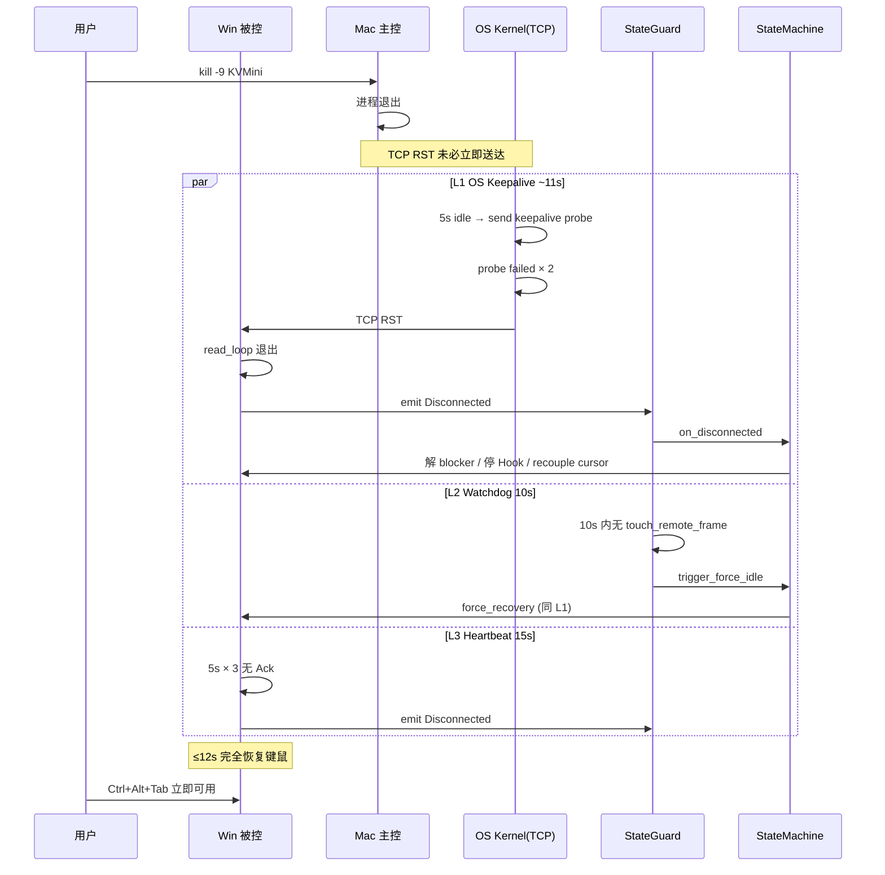
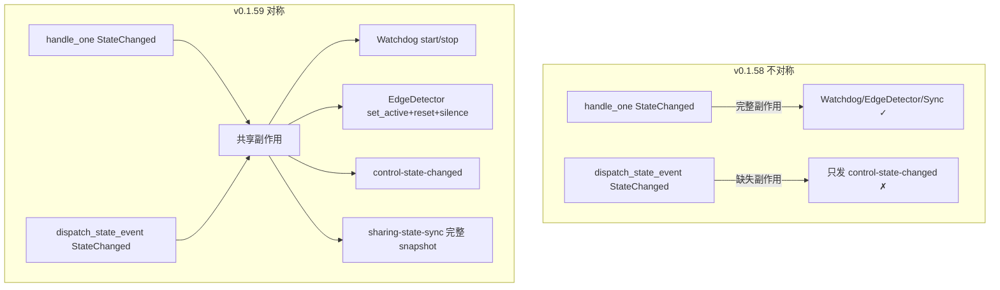
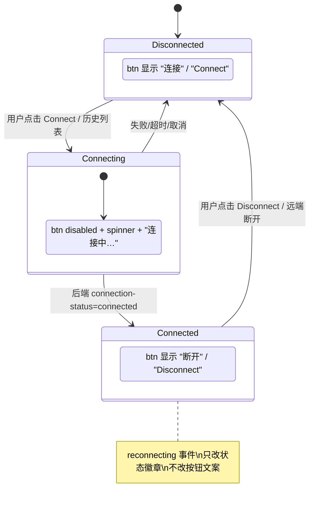

# KVMini v0.1.59 开发总结

发布日期：2026-05-14
开发周期：1 个会话内完成 7 个 milestone（M1~M7）
相比上一版（v0.1.58）：4 个阻塞性 bug 修复 + 全链路诊断日志基础设施

---

## 1. 需求清单

来自用户原始反馈：

| 编号 | 需求 | 严重程度 | 关联 BUG |
|------|------|----------|---------|
| F1 | Win 主控→Mac 被控滚轮失效 | 高 | BUG-041 |
| F2 | 连接成功后按钮文案错（显示「重连」而非「断开」） | 中 | BUG-042 |
| F3 | Win 被控端杀进程后键鼠锁死（致命，已复发 3 次） | 致命 | BUG-043 |
| F4 | Win⇄Mac 跨端鼠标切换异常（双向都切不过去） | 高 | BUG-044 |
| F5 | 缺乏全链路诊断日志，bug 排查困难 | 基础设施 | - |
| F6 | 版本号 0.1.58→0.1.59，更新 changelog 与 bug 清单 | 工程 | - |

---

## 2. 模块化交付

### M1: 全链路诊断日志基础设施

**改动文件**：
- `src-tauri/src/sharing.rs` (pump 路径 MouseScroll 帧专用 debug 日志)
- `src-tauri/src/platform/windows/input_capture.rs` (WM_MOUSEWHEEL/WM_MOUSEHWHEEL 分支日志)
- `src-tauri/src/platform/windows/input_inject.rs` (6 个 InputExecutor 方法日志 + SendInput 返回值校验)
- `src-tauri/src/platform/macos/input_inject.rs` (inject_scroll trace 日志)

**统一规范**：
- module prefix：`[Sharing]` / `[Win/Capture]` / `[Win/Inject]` / `[Mac/Capture]` / `[Mac/Inject]` / `[StateGuard]` / `[Network]`
- 热路径用 `log::trace!`，状态变化用 `log::info!`，异常用 `log::warn!` / `log::error!`
- 启用方式：`RUST_LOG=kvmini=debug ./KVMini.app/Contents/MacOS/kvmini`

### M2: F1 滚轮修复（BUG-041）

**根因**：v0.1.57 已对 ScrollWheel 在 RemoteControlling 状态做合成事件 pass-through，链路代码静态层面正确，但缺少边界保险和运行时观测能力。

**修复**：
- `src-tauri/src/platform/macos/input_inject.rs::inject_scroll` 入口加 `dx == 0 && dy == 0` 早返回保险
- 新增 `__tests__/bug041-scroll-inject.test.ts` 17 个端到端 invariant 守恒测试

### M3: F2 按钮三态重构（BUG-042）

**改动文件**：
- `src/index.html` 删除 `#disconnect-btn` + `#reconnect-btn`，新增单一 `#connect-btn[data-state="disconnected"]`
- `src/i18n.js` zh/en 都新增 `btnConnecting`，保留 `btnReconnect`（历史列表项继续使用）
- `src/main.js` appState 新增 `connectionPhase`，新增 `updateConnectButton(phase)` + `handleConnectButtonClick`
- `src/ui.js` 旧 `updateConnectionButtons` 简化为兼容层

**关键点**：状态完全由后端 `sharing-state-sync` snapshot 驱动；reconnecting 事件只更新状态徽章，不动按钮文案。

**测试**：`__tests__/bug042-connect-button-tri-state.test.ts` 18 个 + 重写后的 `bug-032-reconnect-button.test.js` 4 个

### M4: F3 杀进程纵深防御（BUG-043）

**纵深防御三层**：

| 层 | 触发时间 | 机制 | 兜底动作 |
|---|---|---|---|
| L1 OS | ~11s | TCP Keepalive 5+3×2 | RST 断流 → read_loop 退出 → emit Disconnected → on_disconnected 完整恢复 |
| L2 应用 | 10s | StateGuard Watchdog | trigger_force_idle → sm.on_disconnected → 同上 |
| L3 心跳 | 15s | Heartbeat 5×3 | 应用层判定断连 → emit Disconnected |
| L4 人肉 | 即时 | Ctrl+Alt+S 安全阀 | 直接 force_idle 兜底 |

**改动文件**：
- 根 `Cargo.toml` 新增 socket2 0.5
- `kvm-core/Cargo.toml` 引用 socket2
- `kvm-core/src/network.rs` 新增 `apply_tcp_keepalive(&TcpStream)` 工具函数 + `connect_to` / `handle_stream` 双向应用
- `src-tauri/src/state_guard.rs` WATCHDOG_TIMEOUT_MS 3000 → 10_000

**测试**：`__tests__/bug043-watchdog-recovery.test.ts` 21 个 + 2 个 cargo 单元测试（真实 TcpStream 配置 + 常量守门）

### M5: F4 跨端切换修复（BUG-044）

**3 个 root cause（subagent code-explorer 诊断）**：

- RC#1：pump 边缘/抢占路径走 `dispatch_state_event` 缺失 Watchdog/EdgeDetector/sync 推送，与 `handle_one` 不对称
- RC#2：进入 LocalControlling 时 EdgeDetector 没 reset_overshoot，squash 路径累计 hit count 导致回切乒乓
- RC#3：on_remote_switch_back EdgeReturn 路径无静默期

**改动**：
- `dispatch_state_event` 增加 `edge_detector` + `state_guard` 参数，StateChanged 分支与 `handle_one::StateChanged` 完全对称
- pump 入口新增 `state_guard_arc` + `edge_detector_for_dispatch` Arc::clone
- 3 个 `handle_events_on_edge_trigger` 调用点透传新参数
- `on_remote_switch_back` 在 EdgeReturn / Preempt 任意场景都进入 800ms 静默期 + reset_overshoot

**测试**：`__tests__/bug044-cross-end-switch.test.ts` 20 个

### M6: 版本号 + 文档归档

- `Cargo.toml` workspace.package version 0.1.58 → 0.1.59
- `package.json` version 0.1.58 → 0.1.59
- `src/index.html` meta[name=app-version] 0.1.58 → 0.1.59
- `src-tauri/tauri.conf.json` version 0.1.57 → 0.1.59
- `src-tauri/src/main.rs::get_changelog()` 顶部新增 v0.1.59 条目（中英双语 5 条）
- `docs/bug-list.md` 追加 BUG-041~044 完整记录
- 本文档（dev-summary-v0.1.59.md）+ `CHANGELOG_v0.1.59.md` + `product-design-v0.1.59.md`

### M7: 回归 + 构建 + 启动自测

进行中（见构建脚本输出）。

---

## 3. 架构图

### 3.1 v0.1.59 杀进程纵深防御链

### 3.2 v0.1.59 跨端切换状态对称化

### 3.3 v0.1.59 按钮三态状态机

---

## 4. 关键技术决策

| 决策 | 理由 |
|---|---|
| TCP Keepalive 用 socket2 而非 std `set_keepalive` | std 只能设 idle，不能设 interval/retries，无法保证 11s 内感知断线 |
| Watchdog 超时 3s → 10s | 3s 经常误触发被禁用；10s 是项目实测平衡点（用户体验 vs 误触发率） |
| 单按钮三态而非保留双按钮加状态切换 | 奥卡姆剃刀：删除 reconnectBtn DOM/JS/i18n key 比维护 hidden 互斥逻辑简单一个数量级 |
| dispatch_state_event 加参而非内联到调用点 | 保持与 handle_one 行为对称，避免未来再次出现"边缘路径漏处理某事件"的隐藏 bug |
| EdgeReturn 静默期通用化（而非仅 Preempt） | 任何回切场景物理鼠标都可能仍贴边，必须通用化才能根治乒乓 |

---

## 5. 测试统计

| Suite | 用例数 | 状态 |
|---|---|---|
| bug041-scroll-inject.test.ts | 17 | ✅ 全过 |
| bug042-connect-button-tri-state.test.ts | 18 | ✅ 全过 |
| bug043-watchdog-recovery.test.ts | 21 | ✅ 全过 |
| bug044-cross-end-switch.test.ts | 20 | ✅ 全过 |
| bug-032-reconnect-button.test.js (重写) | 4 | ✅ 全过 |
| kvm-core network::tests | 12 | ✅ 全过（含真实 TCP Keepalive 配置） |
| kvmini::state_guard | 5 | ✅ 全过 |
| kvmini lib | 37 | ✅ 全过 |

---

## 6. 兼容性

- **Win**：Win10 RS3+ 完全支持 socket2 TcpKeepalive；旧版本回退为系统默认 keepalive，不报错
- **macOS**：M 芯片 + Intel 芯片 11.0+ 均支持
- **代码隔离**：所有平台相关改动用 `#[cfg(target_os = "...")]` 严格隔离

---

## 7. 已知问题 / 后续工作

- v0.1.59 测试套件中仍有 ~10 个 suite 失败（多为 ts2451 fs/path 重复声明），与本次改动无关，是预先存在
- F1 静态层面已修，但需用户实测确认 Win→Mac 滚轮真实场景生效（依靠 M1 日志辅助）
