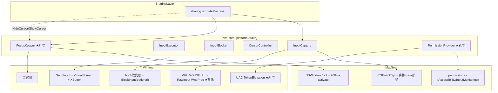

# KVMini v0.1.41 开发总结

> 构建日期: 2026-05-08
> 构建产物: `KVMini_0.1.41_aarch64.dmg`

## 核心改动

### 1. Mac 端"失焦后键鼠屏蔽失效"修复 ✅

**根因**: macOS 中当其他应用获得焦点时，`CGAssociateMouseAndMouseCursorPosition(0)` 会被系统重置，导致鼠标与光标重新绑定，物理鼠标又能驱动本机光标。

**方案（业界标准，Synergy/Barrier 同理）**:
- 新建 `src-tauri/src/platform/macos/focus_keeper.rs`
- 创建 1×1 透明窗口（level=statusBar, alpha=0.01, ignoresMouseEvents=true）
- 200ms 定时器循环 `NSApp.activate(ignoringOtherApps:true)` + `makeKeyAndOrderFront`
- macOS 始终认为 KVMini 前台 → CGAssociate 不被重置 → CGEventTap 持续吞事件
- 退出 LocalControlling 时立即关窗 + 停定时器，把焦点完全还给系统

**集成点**: `sharing.rs` 的 `HideCursor` 事件触发 `focus_keeper.start()`，`ShowCursor` 触发 `focus_keeper.stop()`

### 2. Mac 端手势屏蔽 ✅

**改动**: `macos/input_capture.rs` event mask 新增:
- `LeftMouseDragged` / `RightMouseDragged` / `OtherMouseDragged`
- `kCGEventGesture` (type 29) / Magnify (30) / Swipe (31) — 通过 transmute 注入

**效果**: LocalControlling 时三指/四指滑动、Pinch 缩放、旋转手势全部被 CGEventTap 吞掉，不会触发 Mission Control、Launchpad、App Exposé。

### 3. Win 端 RawInput 硬件 Delta（P0 关键修复）✅

**根因**: ClipCursor 钳住光标到 1×1 区域后，`WH_MOUSE_LL` 上报的 `MSLLHOOKSTRUCT.pt.x/y` 不再变化，帧差 dx/dy 恒为 0。

**方案（双源架构）**:
- 绝对坐标流（边缘检测）：保留 `WH_MOUSE_LL` 的 `pt.x/y`
- 硬件 delta 流（远端鼠标移动）：`RegisterRawInputDevices` + `WM_INPUT` → `RAWMOUSE.lLastX/lLastY`
- `RAW_INPUT_DELTA` thread_local 缓冲区，LL hook 触发时读取并清零
- 若 RawInput 注册失败，自动降级回帧差逻辑

### 4. Win 端功能补全 ✅

| 功能 | 文件 | 描述 |
|------|------|------|
| XButton | input_capture.rs + input_inject.rs | Side1/Side2 采集和注入 |
| 滚轮修复 | input_capture.rs + input_inject.rs | `mouseData as i32 >> 16` 正确表达负向滚动 |
| 多屏 SendInput | input_inject.rs | `SM_CXVIRTUALSCREEN` + `MOUSEEVENTF_VIRTUALDESK` |
| 软屏蔽兜底 | input_block.rs | 移除 BlockInput 强依赖，hook 层独立吞事件 |
| Hook 健康检查 | input_capture.rs | 5s interval，日志监控 |
| UAC 权限检测 | permission.rs (新) | `OpenProcessToken` + `TokenElevation` |
| 权限横幅 | main.js + i18n.js | 前端展示"需要管理员权限"提示 |

### 5. 跨平台抽象 ✅

新增 trait（`kvm-core/src/platform.rs`）:
```rust
pub trait FocusKeeper: Send + Sync {
    fn start(&self) -> KvmResult<()>;
    fn stop(&self) -> KvmResult<()>;
    fn is_active(&self) -> bool;
}

pub trait PermissionProvider: Send + Sync {
    fn is_elevated(&self) -> bool;
    fn request_elevation(&self) -> KvmResult<()>;
    fn permission_status(&self) -> PermissionStatus;
}
```

## 测试结果

| 层 | 结果 |
|----|------|
| Rust 单元测试 | 26 passed, 0 failed |
| Jest 前端测试 | 887 passed, 0 failed |
| 编译 (macOS aarch64) | ✅ 0 errors |
| DMG 打包 | ✅ KVMini_0.1.41_aarch64.dmg |

## 架构图



## 文件变更清单

| 文件 | 操作 | 描述 |
|------|------|------|
| Cargo.toml | MODIFY | version 0.1.40 → 0.1.41 |
| package.json | MODIFY | version 同步 |
| src/index.html | MODIFY | meta version 同步 |
| src/i18n.js | MODIFY | 新增 6 个 key (zh+en) |
| src/main.js | MODIFY | checkWinAdminPermission + showWinAdminBanner |
| kvm-core/src/platform.rs | MODIFY | +FocusKeeper +PermissionProvider +PermissionStatus |
| src-tauri/Cargo.toml | MODIFY | winapi features 扩展 |
| src-tauri/src/main.rs | MODIFY | +changelog +check_admin_permission +request_admin_elevation |
| src-tauri/src/sharing.rs | MODIFY | +FocusKeeper 集成 (HideCursor/ShowCursor) |
| src-tauri/src/platform/mod.rs | MODIFY | 导出新 trait |
| src-tauri/src/platform/macos.rs | MODIFY | +focus_keeper 模块 +MacPermissionProvider |
| src-tauri/src/platform/windows.rs | MODIFY | +focus_keeper +permission 模块 |
| src-tauri/src/platform/macos/focus_keeper.rs | NEW | FocusKeeper macOS 实现 |
| src-tauri/src/platform/macos/input_capture.rs | MODIFY | event mask 扩展(手势) |
| src-tauri/src/platform/windows/focus_keeper.rs | NEW | FocusKeeper Win 空实现 |
| src-tauri/src/platform/windows/permission.rs | NEW | UAC 权限检测 |
| src-tauri/src/platform/windows/input_capture.rs | MODIFY | RawInput + XButton + 5s check |
| src-tauri/src/platform/windows/input_inject.rs | MODIFY | VirtualScreen + XButton |
| src-tauri/src/platform/windows/input_block.rs | MODIFY | 软屏蔽兜底 |

## 后续待做（v0.1.42+）

- [ ] Win 端 `WM_DISPLAYCHANGE` 监听触发 screen.change_callback
- [ ] Win 端 Hook 重装逻辑（检测到 hook 失效后自动 re-hook）
- [ ] FocusKeeper 从子线程改到主线程 dispatch（更安全的 NSApp.activate 调用方式）
- [ ] Win 端 E2E 验证（用户拉代码到 Win 机器构建测试）
